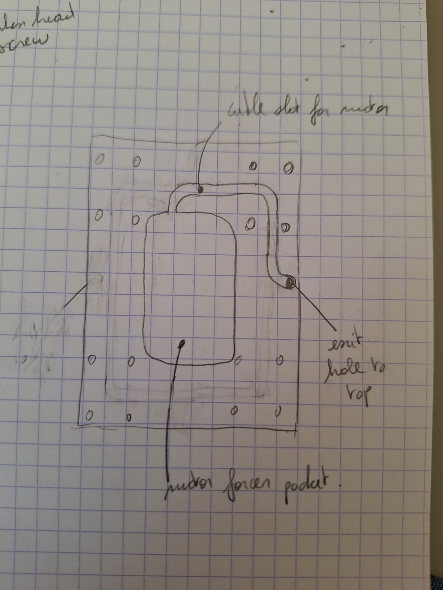
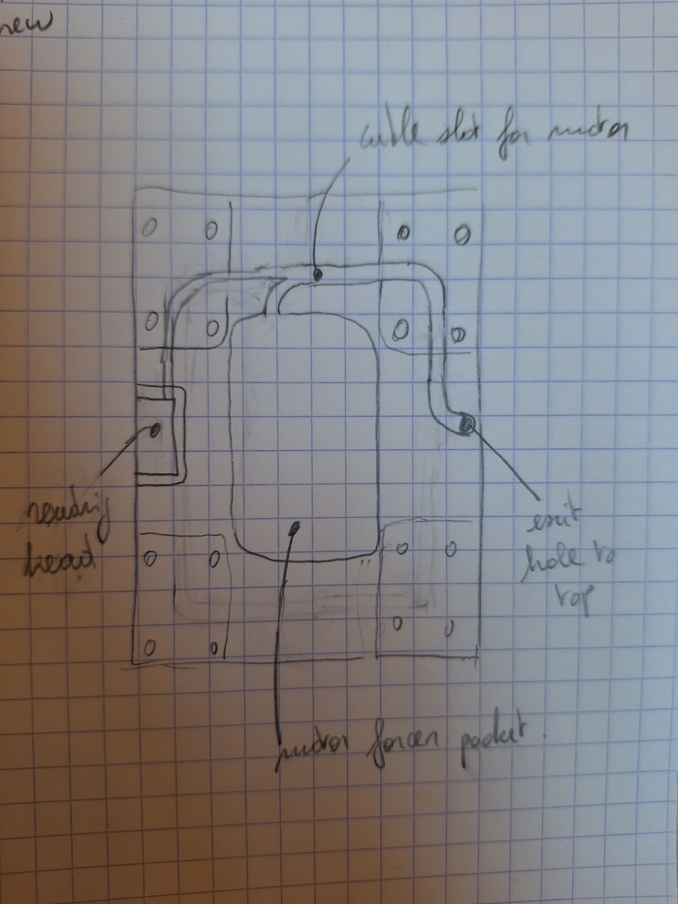

# 2026-10-12 — Idea: a path for the motor and reading head cables in the bottom carriage

**Role(s):** cad

## Goal

Find a way to bring the cable of the linear motor from the bottom carriage to the top of the
stage. The motor part that moves (the forcer) sits under the carriage, so its cable starts there.
The reading head of the linear encoder also sits on the bottom carriage. Its cable must go to the
top as well.

## Work Done

- **Niels drew an idea by hand.** It is only an idea. The CAD model of the bottom carriage has not
  changed.
- **The forcer sits in a pocket in the bottom carriage.** The pocket is a rounded rectangle in the
  middle of the plate, between the rows of rail block holes.
- **A slot in the plate guides the motor cable.** The slot starts at the top corner of the forcer
  pocket. It runs up, then across the plate to the right, then down along the right side.
- **A hole at the end of the slot takes the cable to the top.** The hole sits near the right edge
  of the plate, between the second and the third row of holes.

Hand sketch of the bottom carriage seen from above: the forcer pocket in the middle, the cable slot,
and the exit hole to the top on the right.

### Second version: a slot for the reading head cable

- **Niels added a second slot for the cable of the encoder reading head.** This is still only an
  idea. The CAD model has not changed.
- **The reading head sits in a small pocket on the left edge of the plate.** The pocket is about
  halfway along the plate, between the first two rows of rail block holes and the last two rows.
- **The new slot runs from the reading head up the left side, then across the top.** It meets the
  motor cable slot near the middle of the top edge.
- **Both cables share one slot from there to the exit hole on the right.** So one hole still takes
  all cables to the top of the stage.

Second hand sketch, marked "new": the reading head on the left, the new cable slot from the reading
head to the top, the shared slot, and the exit hole to the top on the right.

## Open Questions

- How wide and how deep must the slot be? This depends on the cable diameter and its smallest
  bending radius. Both must come from the motor data sheet.
- Does the slot make the plate too weak near the rail block holes?
- Is the shared slot wide enough for the motor cable and the reading head cable together?
- Must the encoder cable stay away from the motor cable? Motor current can disturb the encoder
  signal. The encoder data sheet must say if a gap or a screen is needed.
- Does the exit hole clear the top carriage and its screws?
- The note in the top left corner of the sketch is cut off. It seems to name a screw type
  ("…head screw"). Niels can say what it is for.

## Next Steps

1. Read the cable diameter and bending radius in the motor data sheet.
2. Read the reading head cable diameter and bending radius in the encoder data sheet.
3. Draw the forcer pocket, the reading head pocket, both cable slots and the exit hole in the CAD
   model of the bottom carriage.
4. Check the stiffness of the plate with the slot in it.

Technical notes

- Source: photos of two hand sketches on squared paper, sent by Niels on 2026-10-12. Both were
  made smaller (1200 × 1600 px) before they were added. The second one is `2026-10-12-02.jpg`.
- `modules/compact-stage/cad/parts/carriage-bottom/carriage-bottom.FCStd` was not changed. No
  fingerprint was written.
- Mistake rules checked: the PowerShell rules (all shell work ran in bash), and
  [reverted the tooling update](../mistakes/2026-09-22_reverted-the-tooling-update.md).

