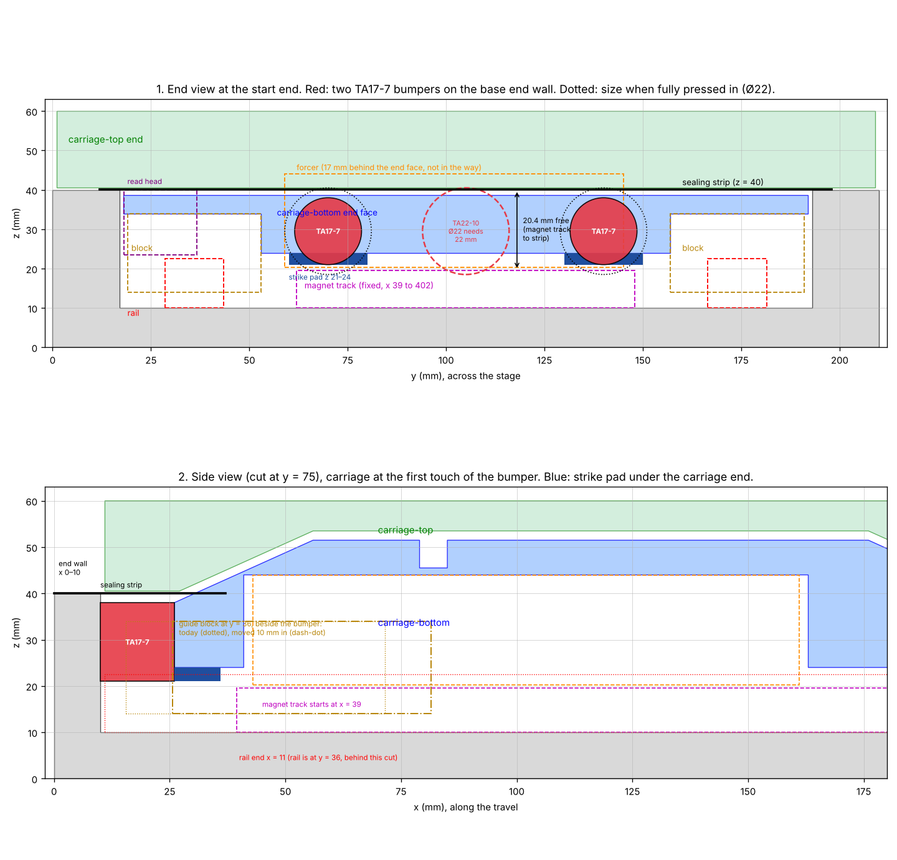

# 2026-10-21 — Where the end bumpers fit in the compact stage

**Role(s):** engineering, cad

## Goal

Find a place in the compact stage for an ACE TUBUS TA22-10 bumper at each end, or for two smaller
bumpers per end. Check if the guide blocks can move 10 to 20 mm closer together, to win travel and
make room. This is a study. No CAD file was changed.

## Short answer

- **The TA22-10 does not fit.** Inside the base, the free height between the magnet track and the
  sealing strip is 20.4 mm. A TA22-10 is 22 mm wide, and the carriage cannot give it a 22 mm face
  to hit.
- **Two TA17-7 per end do fit.** They sit side by side between the two rows of guide blocks, at the
  height of the bottom carriage. Together they take 12 J per stroke (18 J in an emergency). That
  is enough for the 2 m/s top speed (10 J). It is not enough for 3 m/s (22.5 J).
- **Moving the guide blocks closer is needed, and it is possible.** Today the blocks stick out
  10.45 mm past each end of the bottom carriage. With a bumper, the blocks would run off the end of
  the rail before the bumper is fully pressed in.
- **10 mm closer is enough for bumpers on the base end walls.** The usable travel is then 206 mm,
  11 mm less than the 217 mm the stage has today without any end stop.
- **20 mm closer wins the travel back.** It lets the bumpers sit in pockets in the carriage ends.
  The usable travel is then 220 mm. That is the least travel the length rule STG-03 asks for at
  440 mm length and 60 mm height. The read head of the encoder must then move 4 mm, and the end
  wall at the cable end may need a notch for the forcer cable stub.

Top: the end of the stage seen along the travel, with the two TA17-7 bumpers (red), the size of a
TA22-10 (red dashes), and the free height. Bottom: side cut through a bumper, with the carriage at
the first touch.

## Work Done

### The only free space for a bumper

- **The base has a solid end wall at each end**, 10 mm thick and 30 mm high (x = 0 to 10 mm and
  430 to 440 mm). Its inner face is a good, flat face for a bumper to push on.
- **Above the base there is no room.** The top carriage passes 0.5 mm over the base, over its full
  width. The sealing strip lies on the base top. A bumper there would also break the 60 mm height
  limit (STG-02).
- **Below the bottom carriage, the rails and the magnet tracks run along the whole travel.** The
  rails reach z = 22.5 mm, the magnet tracks z = 19.6 mm.
- **So a bumper must sit between z = 19.6 mm and z = 40 mm**, and between the two rows of guide
  blocks (y = 53 to 157 mm). That leaves a space 20.4 mm high and 104 mm wide at each end.
- **Two bumpers fit side by side in that space, at y = 70 mm and y = 140 mm.** At the cable end,
  the motor cable comes out near the middle (y = 90 to 127 mm), so the middle must stay free.
- **The end face of the bottom carriage is only 14.5 mm high there** (z = 24 to 38.5 mm). ACE asks
  for a face at least as wide as the bumper. A TA17-7 is 17 mm wide.

### Bumper sizes from the ACE manual

The sizes come from the ACE operating and mounting instructions for TUBUS TA (21_22_0019, issue
05.2022, page 3).

| Type | Energy per stroke | Emergency | Stroke | Length A | Width d1 | Width when pressed in d3 | Screw | Fits? |
| --- | --- | --- | --- | --- | --- | --- | --- | --- |
| TA12-5 | 2.0 J | 3 J | 5 mm | 11 mm | 12 mm | 15 mm | M3 | Yes, but too weak |
| TA17-7 | 6.0 J | 9 J | 7 mm | 16 mm | 17 mm | 22 mm | M4 | **Yes** |
| TA21-9 | 10.0 J | 16 J | 9 mm | 18 mm | 21 mm | 26 mm | M5 | No (21 > 20.4 mm) |
| TA22-10 | 11.5 J | 21 J | 10 mm | 19 mm | 22 mm | 27 mm | M6 | No (22 > 20.4 mm) |

ACE says the bumper grows to d3 when it is pressed in, and asks for room for that.

### Two ways to mount the TA17-7

**A. On the base end wall.** Each bumper screws into the inner face of the end wall, at z = 29.5 mm.
It hits the end face of the bottom carriage. A small strike pad, 3 mm thick, under each carriage
end makes that face 17 mm high (z = 21 to 38.5 mm). The pad stays 1.4 mm above the magnet track.
The pad lies inside the carriage length, so it costs no travel.

**B. In a pocket in each end of the bottom carriage.** Each bumper sits 7 mm deep in the carriage,
and only 9 mm sticks out. It hits the end wall of the base, which is 30 mm high, so no strike pad
is needed. The bumper rides 1.4 mm above the magnet track along the whole travel.

| | Today (no end stop) | A, blocks 10 mm closer | B, blocks 20 mm closer |
| --- | --- | --- | --- |
| Distance between the front and back blocks | 144.9 mm | 134.9 mm | 124.9 mm |
| Travel until the guide blocks reach the rail ends | 217.1 mm | 227.1 mm | 237.1 mm |
| Travel until the first touch of a bumper | — | 208 mm | 222 mm |
| Usable travel, 1 mm before each bumper | — | 206 mm | **220 mm** |
| Travel with the bumpers fully pressed in | — | 222 mm | 236 mm |
| Rail left under each block at full press | — | 2.55 mm | 0.55 mm |
| Length rule STG-03 (at least 220 mm) | not met | not met | **met, no margin** |

- In way A, the blocks must move at least 3.5 mm in at each end. 10 mm closer in total is enough.
- In way B, the blocks must move 10 mm in at each end. With less, the blocks leave the rail before
  the bumpers are fully pressed in.
- Way A could win 10 mm more travel by sinking each bumper 5 mm into the end wall. The hole would
  then need room for the 22 mm bulge, and it would cut through the top of the wall, where the
  sealing strip lies. Ask ACE first.

### What happens at an impact

Calculated with the damper sizing page model: 5.0 kg, motor off, ACE TA curve, two bumpers in
parallel.

| Impact speed | Energy | Two TA17-7 | One TA22-10 (for comparison) |
| --- | --- | --- | --- |
| 2.0 m/s | 10.0 J | 6.2 mm of 7 mm, 2.62 kN, 53 g | 9.2 mm of 10 mm, 1.77 kN, 36 g |
| 2.2 m/s (trip at 10 % over the top speed) | 12.1 J | fully pressed in, at the 12 J limit | fully pressed in, 0.6 J left |
| 3.0 m/s | 22.5 J | fully pressed in, 10.5 J left | fully pressed in, 11 J left |

- **At the 2 m/s top speed, two TA17-7 do the job.** They use 83 % of their rating.
- **The peak force is 48 % higher than with one TA22-10**, because the stroke is 7 mm, not 10 mm.
- **The trip speed should stay at about 2.2 m/s or less.** There, the energy is at the limit per
  stroke, and at 67 % of the emergency rating.

### What moving the blocks closer changes

- **The blocks fit.** They run in a channel along the whole bottom carriage, so only the screw
  holes and the pockets over the blocks move. The forcer and the sealing strip are not in the way.
- **At 10 mm closer, the read head still has 3.45 mm of space** to the nearest block. At 20 mm
  closer, it would hit the block, so the read head must move 4 mm towards the other block. The
  head then keeps 2.45 mm to one block and 13.9 mm to the other.
- **The encoder scale can stay.** Over the usable travel, the read window stays on the clean part of
  the 270 mm scale. It only leaves the scale when the bumpers are pressed in.
- **The carriage tilts more easily.** With the blocks 10 or 20 mm closer, the blocks resist a tilt
  of the carriage about 13 % or 26 % less, and the tilt from a rail error is about 7 % or 16 %
  larger. Check this against STG-06 (rotational error motion) and STG-13 (lateral load).

## Decisions Made

- None yet. Niels chooses between way A and way B, and how far to move the blocks.

## Open Questions

- **The TA17-7 is too small for 3 m/s.** If the stage must survive an impact at 3 m/s, the drive
  must limit the speed near the ends, or the stage needs a different end stop.
- **Way B: the bumper hangs 3 mm below the carriage, 1.4 mm above the magnets.** Is that enough
  space when the carriage moves with chips or dust around?
- **The pocket for way B weakens the carriage end.** The 2.6 kN impact force goes in there. The
  stress case of the bottom carriage should be run again, with the blocks in their new places.
- **When a bumper is fully pressed in, it bulges to 22 mm.** Then it just reaches the sealing strip
  (0.5 mm). This only happens in a crash.
- **The sealing clamps have no geometry yet.** The top carriage sticks out 15 mm past the bottom
  carriage. At full press, its end comes within 4 mm of the base end in way A. In way B, it goes
  3 mm past the base end. The clamps must stay below z = 40.5 mm, or fit in that space.
- **Way B: the forcer cable stub may touch the end wall.** At the cable end, the forcer sticks out
  5 mm past the bottom carriage. In way B, it would reach the end wall 2 mm before the bumpers are
  fully pressed in, if it sits in front of the wall. A 6 mm deep notch in that end wall, at the
  stub, solves this. In way A, 4 mm of space stays.
- **The exact shape of the forcer cable stub was not checked.** The parts library model of the
  forcer could not be loaded in this session. Check that the stub stays between y = 90 and
  127 mm, clear of the bumpers and of the strike pads.
- **53 g of deceleration** must be checked against the shock rating of the encoder read head and the
  static rating of the QEH15SA blocks.

## Next Steps

1. Choose way A or way B, and move the guide blocks 10 or 20 mm closer together in the CAD.
2. For way B, move the read head 4 mm, draw the bumper pockets in the carriage ends, and check the
   forcer cable stub against the end wall.
3. For way A, draw the strike pads, and the M4 holes in the end walls.
4. Add the bumpers and their interfaces to the architecture and the assembly.
5. Run the stress case of the bottom carriage again.

Technical notes

- Coordinates are base coordinates: x along the travel (0 to 440 mm), y across (0 to 210 mm), z up
  from the base bottom. Positions come from the assembly fingerprint
  (`compact-stage.fingerprint.json`) and from sections of the base, carriage-bottom and
  carriage-top bodies, cut in FreeCAD 26.3 (conda-forge build) with `freecadcmd`. The parts of
  `modules/stoq/` (rails, blocks, motor, encoder) are LFS files that this session could not fetch,
  so their sizes are the bounding boxes in the fingerprint.
- Carriage-bottom placement used for the sections: rotation 90° about z, base = (301.6, 1, 24).
  Carriage-top: no rotation, base = (211.6, 105, 40.5). Both match the fingerprint boxes.
- Base end walls: pocket ends at x = 10 and 430 for y = 29 to 181 mm, and at x = 4 and 436 near
  the side walls. Rails EGR15U418H: x = 11 to 429. Magnet tracks MK2-180: x = 39.43 to 402.13,
  top z = 19.6. Blocks QEH15SAZAP+E2: 56.0 mm long with the E2 unit, x = 111.15 to 167.15 and
  256.05 to 312.05, top z = 34. Carriage-bottom: x = 121.6 to 301.6, end face y = 18 to 192,
  z = 24 to 38.5 between the block rows. Carriage-top: x = 106.6 to 316.6, z = 40.5 to 60.
  Forcer MK21 (with cable stub): x = 138.6 to 306.6, cable end at +x. Read head AL32B050-30MUL:
  x = 195.06 to 247.60.
- Travel formulas, with 420 mm between the end walls and the 180 mm bottom carriage. Way A: first
  touch = 420 − 180 − 2 × 16 = 208 mm; full press = 420 − 180 − 2 × (16 − 7) = 222 mm. Way B, 9 mm
  out of the carriage: first touch = 420 − 180 − 2 × 9 = 222 mm; full press = 420 − 180 − 2 × 2 =
  236 mm. Rail-limited travel = 418 − block span (200.9 mm today).
- STG-03: length ≤ travel + 340 − 2 × height, so 440 mm needs at least 220 mm travel at 60 mm.
- Encoder window, from the log of 2026-10-20: 12.15 to 28.55 mm ahead of the carriage centre
  today. Clean scale: x = 117 to 359 mm.
- Impact numbers: `solveBumper()` from `simulation/cases/damper-sizing/damper_model.js`, run from a
  scratch script, with `sBump` 0.007 m, `Ebump` 12 J, `EbumpMax` 18 J for two TA17-7.
- ACE source: [TUBUS TA operating and mounting instructions, 21_22_0019](https://www.acecontrols.co.uk/media/ace_pim/documents/ACE_TUBUS_TA_OPERATING-MOUNTING_EN_21_22_0019.PDF),
  performance table on page 3, and the TA22-10 product page. The drawing shows the bulge d3 near
  the middle of the bumper, and the impact face at about d1.
- Tilt numbers: moment capacity of a block pair grows with the block distance, and the tilt
  stiffness with its square: (134.9 / 144.9)² = 0.87, (124.9 / 144.9)² = 0.74.
- Mistake rules checked: [loop rate from a trade article](../mistakes/2026-09-29_loop-rate-from-a-trade-article.md)
  (all bumper sizes from the ACE manual itself), [reverted the tooling update](../mistakes/2026-09-22_reverted-the-tooling-update.md)
  (tooling folders left as they are), and the PowerShell rules (all shell work ran in bash).

