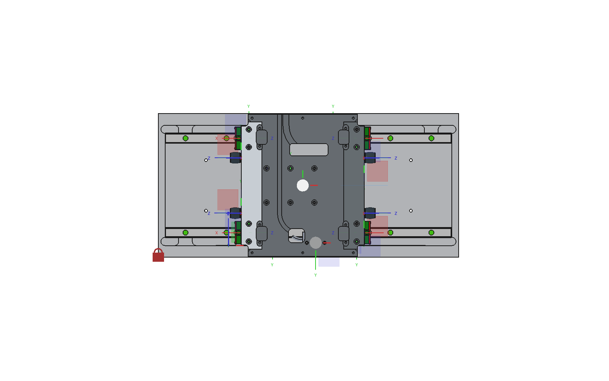

# 2026-10-22 — Four ACE TA17-7 end stop dampers on the carriage

**Role(s):** engineering

## Goal

Put a rubber-like end stop damper at each corner of the two carriage ends, so the carriage does not
hit the end walls of the base hard. The damper is the ACE TUBUS TA17-7. It has an M4 stud and is
held by a standard M4 square nut in a slot in carriage-bottom. This follows way B of
[the study of 2026-10-21](2026-10-21_space-for-end-bumpers.md), with the dampers on the carriage
ends and hitting the end walls of the base.

## Short answer

- The TA17-7 is now in the parts library (stoq), with ACE's STEP file, the ACE operating and
  mounting instructions, and a FreeCAD file with one mounting frame. This is on branch
  `feat/ace-ta-damper` of the library, not yet merged.
- The four dampers sit in the compact stage assembly. Each one is fixed to a mounting frame on
  carriage-bottom.
- **The damper height changed.** The nut slots were 7 mm deep. That put the damper axis 3.5 mm
  above the bottom face of the carriage, and the lowest point of the damper 0.6 mm below the top of
  the motor stators. The dampers would have hit the stators. The slots are now 9 mm deep. The
  damper axis is 5.5 mm above the bottom face, 29.5 mm above the base floor. That is the height
  the study of 2026-10-21 planned.
- **One damper hits the motor cable stub.** The mover has a stub about 8.5 mm across that reaches
  5 mm past the start end of the carriage, at y = 62 to 70.5 mm and z = 27.8 to 36.3 mm. The study
  of 2026-10-21 could not load the mover and assumed the stub sat at y = 90 to 127 mm. It does not.
  It overlaps the damper at position "a, start". That damper must move, or the cable must leave
  elsewhere. A decision is needed.

## Why 29.5 mm

Two limits decide the height. Both are measured from the floor of the base.

| Limit | Value | Damper at 29.5 mm |
| --- | --- | --- |
| Top of the motor stators, under the path of the dampers | 19.6 mm | Lowest point of the 17 mm body at 21.0 mm, so 1.4 mm clear |
| Top of the end wall of the base | 40 mm | Top of the body at 38.0 mm, so the whole body meets the wall |

The damper grows to 22 mm across when it is fully compressed (ACE manual, page 3). At the wall that
bulge reaches 40.5 mm, where it just touches the sealing strip. This only happens in a crash.

The value is `damper_axis_z` = 5.5 mm in a new `Params` sheet in carriage-bottom. The slot depth is
`damper_axis_z` plus half the nut size, `square_nut_s` = 7 mm (DIN 562 and DIN 557). The four
frames read their height from the same value, so the dampers follow when it changes.

## What the datasheet says

ACE operating and mounting instructions 21_22_0019, issue 05.2022, pages 3 and 4: stroke 7 mm,
length 16 mm, body 17 mm, impact face 15 mm, 22 mm when fully compressed, M4 stud 4 mm long,
1.7 Nm at most, 6 Nm per stroke, 9 Nm per stroke for an emergency stop, 0.004 kg. The ACE web shop
says 0.006 kg. Secure the stud with Loctite.

## Open Questions

- **The damper at "a, start" collides with the cable stub of the mover.** Move both start dampers
  sideways, move only that one, or route the cable elsewhere?
- **The guide blocks still run off the rails before the dampers are fully pressed in.** The blocks
  stick out 10.45 mm past the carriage ends, and the dampers stick out their full 16 mm, not 9 mm as
  in way B of the study. The blocks reach the rail ends after about 4.6 mm of the 7 mm damper
  stroke. As the study found for dampers that stick out 16 mm, the blocks must move at least
  3.5 mm in at each end, 10 mm closer in total. That is not done yet.
- **Thread engagement is short.** The stud is 4 mm long and goes through a 2 mm wall, so only about
  2 mm of thread is in the nut. A DIN 562 nut is 2.2 mm thick. Check if that holds 1.7 Nm and the
  impact load, or make the wall thinner.
- Is 6 Nm per stroke enough for the moving mass and the top speed? This needs the carriage mass and
  speed, then the ACE calculation.
- ACE does not allow sharing their files in writing. They are shared until ACE objects, the same as
  for HIWIN and LAMOTION. Niels Bosmans approves that in the library pull request.

## Next Steps

- Decide on the cable stub collision.
- Move the guide blocks closer together.
- Merge the library branch, then move the library pin in this repository to that commit.
- Order four TA17-7 and four M4 square nuts.

Technical notes

- Library: brand `ace`, family `ta-damper`, part `TA17-7`, in `stoq` and `stoq-private`. Wrapper
  `cad/parts/TA17-7.FCStd` with frame `IF_mount`: origin at the centre of the back face, z along
  the damper axis out of the impact face, x along the z axis of the STEP file.
- Until the library is merged, `modules/stoq/modules/ace/` in this repository holds an uncommitted
  copy of the same files, so the assembly can open the damper.
- carriage-bottom: new `Params` sheet; `Pocket020.Length = Params.damper_axis_z +
  Params.square_nut_s / 2`; frames `IF_damper_a_start_mount`, `IF_damper_b_start_mount`,
  `IF_damper_a_end_mount`, `IF_damper_b_end_mount`. x reads the slot centre line of `Sketch033`
  (`Geometry[12]`), mirrored around `w_carrier / 2` for the "a" side.
- Assembly: links `TA17-7_a_start` and so on, fixed joints `Fixed_damper_*` from each carriage frame
  to the damper frame. The carriage was put back at its earlier position after the solve.
- SysML: `DamperMountInterface_v1`, four ports on `CarriageBottom`, part def `EndStopDamper` with
  port `mount`. BOM row `MEC-001`.
- `doqs wrap` crashed FreeCAD twice: see
  [the mistake note](../mistakes/2026-10-22_wrap-crashed-the-open-freecad.md). Its macro also fails
  on this STEP file with "Cannot add a group object to itself", so the wrapper was built by hand
  with the same steps.

