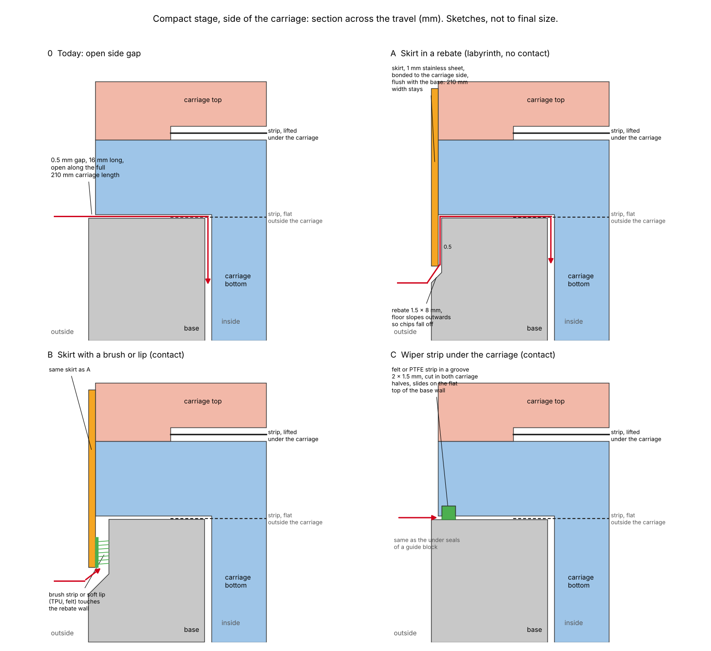
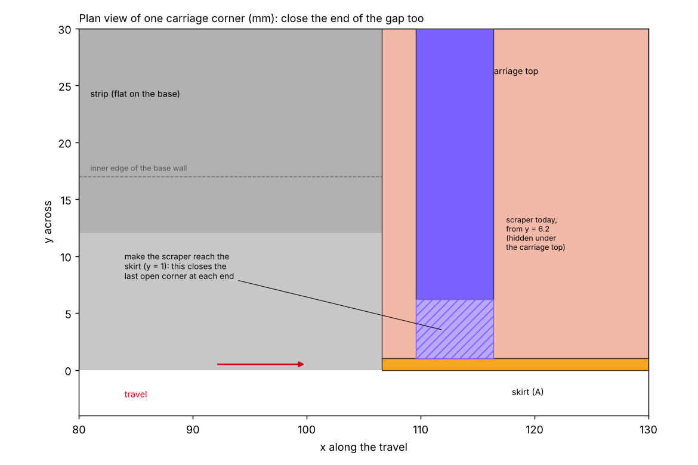

# 2026-10-28 — How to close the gap at the sides of the carriage

**Role(s):** engineering, cad

## Goal

The steel strip closes the slot in the top of the base, but nothing closes the sides of the
carriage. Find out how other makers and patents close this kind of gap, and sketch ways to do it
in the compact stage.

## Short answer

- **The gap is real, and it is open along the whole carriage.** On each side, the carriage floats
  0.5 mm above the top of the base wall. The gap is 16 mm deep, from the outside of the base to
  the slot. It is open along the full 210 mm length of the carriage. Under the carriage the strip
  is lifted, so dirt that crosses the wall top falls straight into the stage.
- **The stage may not get wider.** The requirement for the stage width is at most 210 mm, and the
  base is already 210 mm. The carriage sits only 1 mm inside the base edge. So a seal cannot hang
  outside the base. It must fit in that 1 mm, or in a step cut into the base.
- **Recommended: a skirt in a step of the base (concept A).** A thin stainless sheet on each side
  of the carriage hangs down into a step milled along the top outer edge of the base. The gap
  then opens downwards and turns twice before it reaches the inside. It does not touch, so it
  adds no friction, which matters for a precise stage. This is a labyrinth seal (a gap with
  several turns).
- **If coolant still gets in, add a brush or a soft lip to the skirt (concept B).** This touches
  the base and adds some friction.
- **A wiper strip under the carriage (concept C) is the cheapest test.** It is a felt or PTFE
  strip in a shallow groove in the underside of the carriage. It slides on the flat top of the
  base wall. It needs no change to the base.
- **The ends need closing too.** The scrapers start 6.2 mm from the side. Extend them to the skirt,
  or the corner at each end stays open.

## How others do it

| Who | How they close the sides | Source |
| --- | --- | --- |
| THK, KRF actuator | A second steel strip on each side cover, held by magnets, next to the strip on top. The stage is fully closed. | [THK KRF page](https://www.thk.com/us/en/contents/pages/special/actuator/krf/), KRF catalogue 375E |
| THK, patent US 8650978 | Two dust belts close two side openings. Rollers on the table lift each belt, like our strip. | [US 8650978](https://patents.google.com/patent/US8650978) |
| Aerotech, PRO stages | Seals on the vertical sides, not on the top. Aerotech say this sends dirt away from the stage. | [Aerotech PRO, Design News](https://www.designnews.com/aerospace/aerotech-pro-series-hard-cover-side-sealed-linear-stages) |
| Bosch Rexroth, CKK compact module | A cover plate and two cover strips. The ball screw version has two polyurethane sealing strips against dust and liquids. | [Rexroth CKK/CKR](https://www.boschrexroth.com/en/us/products/product-groups/goto-products/goto-linear-motion/ckk-ckr-compact-modules/) |
| NTN-SNR, patent EP 2865907 | The cover band snaps into side grooves, away from the slot. Two ribs per side leave no straight path for dirt. | [EP 2865907 A1](https://data.epo.org/publication-server/rest/v1.2/patents/EP2865907NWA1/document.html) |
| Festo DGC-K, Parker OSP | A band in the slot, a steel cover strip held by magnets, and wipers on the carriage. | [Festo DGC-K](https://www.packagingdigest.com/machinery-equipment/festo-introduces-the-dgc-k-rodless-pneumatic-drive-for-simple-drive-functions-where-installation-space-is-limited), [Parker OSP-P](https://discover.parker.com/OSPPSeries) |
| Guide blocks, for example US 5149205 | Under seals: a lip under the block, on each side, that slides on the rail or the base. Concept C copies this. | [US 5149205](https://patents.google.com/patent/US5149205) |
| Yamaha single axis robots | A stainless top cover, and an air purge option that blows air out of the gaps. | [Yamaha catalogue](https://global.yamaha-motor.com/business/robot/download/catalog/pdf/Robonity_catalog_202604-BE.pdf) |

Two patterns repeat. Either the side gap gets its own strip (THK, Aerotech), or the gap is made
long, with turns and a wiper (Rexroth, NTN-SNR, guide blocks). No source gives a gap size for a
side labyrinth, so the sizes below are first proposals.

## The sketches

The sections use the real outline of the base and the carriage at 180 mm along the base, where
there is no screw. The new parts are drawn by hand and not checked in CAD.

### Concept A: skirt in a step of the base

- A stainless sheet, 1 mm thick, on each side of the carriage, 210 mm long. It fills the 1 mm
  between the carriage side and the base edge, so the stage stays 210 mm wide.
- Bond it to the carriage. A screw head would stick out past the 210 mm width.
- Mill a step, 1.5 mm wide and 8 mm deep, along the full top outer edge of the base, on both sides.
  The skirt hangs 7 mm into it. The gap to the base is 0.5 mm.
- Slope the floor of the step outwards. A flat floor would collect chips, and the skirt would push
  them along.
- Dirt now has to go 7 mm upwards in a 0.5 mm gap, turn, and cross the 16 mm wall top. Chips and
  coolant that fall from above cannot reach the opening.
- It stops chips and splashes well. It does not fully stop a fine coolant mist.

### Concept B: concept A with a brush or soft lip

- The same skirt and step, with the step 3 mm wide. A brush strip or a soft lip (TPU or felt) on
  the inside of the skirt touches the wall of the step.
- This also stops mist and slow drops. It adds friction and wear, and the friction must be
  measured, because it adds a small force that changes with direction.

### Concept C: wiper strip under the carriage

- A groove, 2 mm wide and 1.5 mm deep, along the underside of the carriage at 0.5 to 2.5 mm from
  its side. It runs through both carriage halves, over the full 210 mm.
- A felt or PTFE strip in the groove stands out about 0.6 mm and slides on the flat, milled top of
  the base wall. That top face runs the full travel, so it is a good surface to slide on.
- No change to the base. It is the fastest thing to test.
- The groove must stay clear of the M4 screw holes, which sit about 6.5 mm from the side. It also
  adds friction, like concept B.

### Not recommended

- **A tongue in a groove on the wall top.** The groove is open along the whole travel, fills with
  chips, and the tongue pushes them along.
- **A second steel strip on each side, like THK.** The two carriage halves join outside the strip,
  at the sides. A side strip would need the joint and the whole carriage drawn again.

### Extra, for any concept

- **Sealing air.** A small flow of clean, dry air into the stage makes air leave through every
  gap, so dirt cannot enter. This works best after the gap is made long and narrow, because the
  air needed grows with the open area. The amount of air has not been worked out.
- **A drain hole** at the lowest point of the base, so any coolant that gets in can leave.

## Decisions Made

No decision yet. These are proposals for Niels Bosmans to choose from.

## Open Questions

- Which concept? A for no friction, C for the cheapest first test, B if coolant mist is a problem.
- Can a bonded 1 mm skirt stay on? The coolant (SAMNOS AL, pH 7.4) and the adhesive must suit
  each other. Ask the adhesive maker.
- Does the base have holes or features near its top outer edge that the step would cut into?
  Check in CAD before the step is drawn.
- How much friction does a brush or felt strip add? Measure it on a test piece before it goes on
  the stage.

## Next Steps

1. Choose a concept.
2. Draw it in CAD: the step in the base and the skirt for A or B, or the groove in both carriage
   halves for C.
3. Extend the scrapers to the side, so the end corners close.
4. Test a short piece in coolant spray before the full part is made.

Technical notes

- Geometry read from the committed `.FCStd` files with OCP (Open CASCADE for Python), placed as
  in the assembly: carriage-bottom turned 90° and moved to (301.6, 1, 24) mm, carriage-top moved
  to (211.6, 105, 40.5) mm.
- Base: walls y 0–17 and 193–210 mm, wall top z 40 mm. Carriage underside over the walls:
  z 40.5 mm, from y 1 mm. Carriage-bottom inner face y 18 mm, 1 mm from the base wall.
  Carriage-top x 106.6–316.6 mm. Strip edge at y 12 mm (186 mm strip).
- At the middle screw (x 211.6 mm) the carriage-top side wall is only 1.5 mm thick beside the
  M4 counterbore. That is why concept A does not cut the carriage side back.
- `STG-01` in `modules/compact-stage/architecture/compact-stage.sysml`: width at most 210 mm.
- The sketches were drawn with matplotlib. The script is not in the repository.
- Mistake rules checked: the PowerShell rules (all shell work ran in bash), reverted the tooling
  update (the tooling folders were left as they are), and the rule to open a source before
  quoting how a part behaves (every maker claim above links its source; no friction or air flow
  number is given, because none was found).

