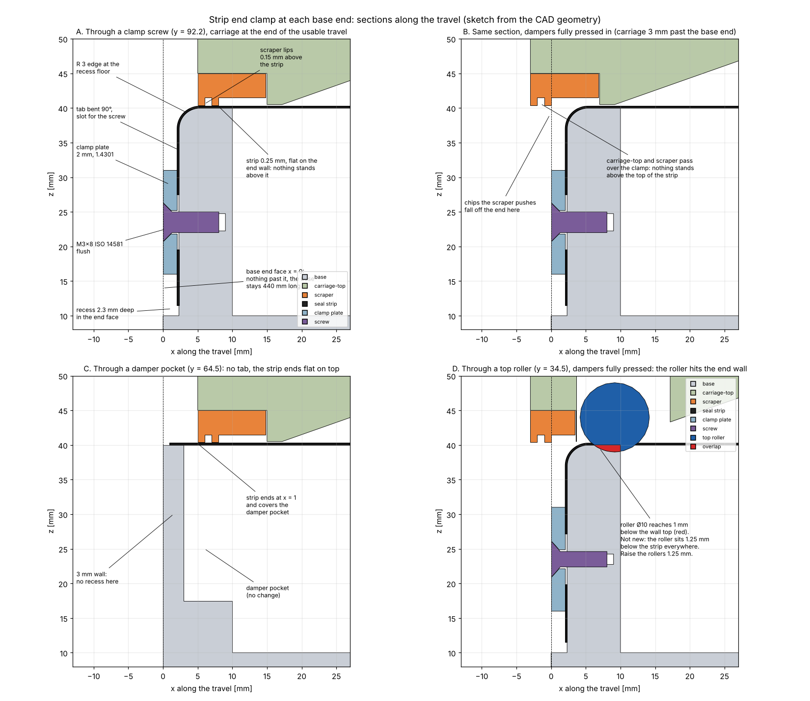
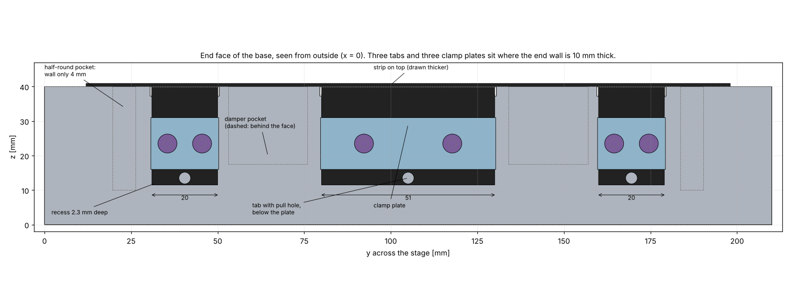
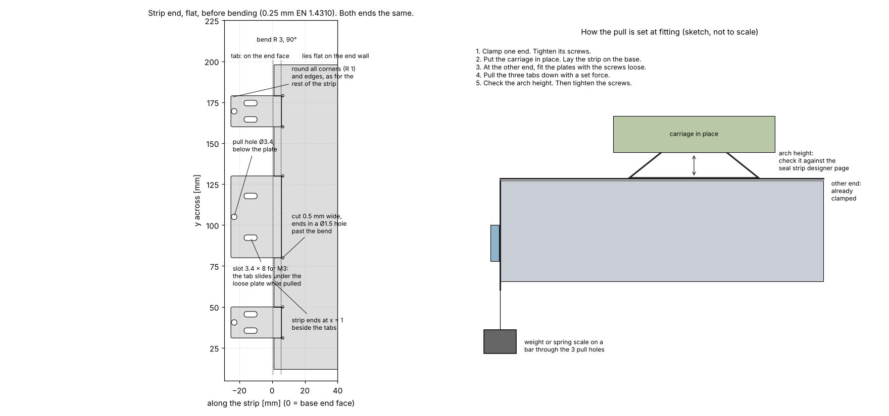

# 2026-10-28 — Clamping the seal strip ends and setting the pull, together with the scraper

**Role(s):** engineering, cad

## Goal

Design how each end of the seal strip is held and how the pull in the strip is set. It must fit
with the scraper at the carriage ends, the end stop dampers and the length limit of the stage.
The earlier plan used countersunk screws in off-centre holes on top of the strip. That would put a
point load on the thin strip, and a screw head on top of the strip is in the path of the scraper.

## Short answer

- **The strip stays flat over the end wall. Nothing stands above it.** The scraper and the
  carriage pass over the end of the base as they pass over the rest of the strip. The scraper needs
  no change.
- **The strip bends down over a rounded edge and is clamped on the end face of the base.** Three
  tabs at the strip end bend 90° over an R 3 mm edge. Each tab sits in a pocket 2.3 mm deep in the
  end face. A stainless plate, 2 mm thick, presses it flat with two M3 countersunk screws.
- **The base stays 440 mm long.** That is the length limit, with no margin. The plates and the
  screw heads stay 0.05 mm inside the end face.
- **The pull is set by force at fitting, not by a hole position.** One end is clamped first.
  At the other end, the three tabs are pulled down with a weight or a spring scale, and the screws
  are tightened. The arch height under the carriage is the check.
- **No hole edge carries the pull.** The plate holds the tab by friction. The screws pass through
  slots in the tab with play.
- **It fits.** A fit check on the real CAD geometry finds no overlap, and every pocket stays in
  solid material.
- **Risk 1: the top rollers hit the end wall when the dampers press in fully.** This is not caused
  by the clamp. The rollers sit 1.25 mm below the top of the strip everywhere. They must move up.
- **Risk 2: the hard strip must survive the 90° bend.** At R 3 mm the bend is far beyond the
  elastic range of the strip, so the bend is permanent. Whether the strip cracks there must be
  checked with a test bend.

## Work Done

### Why the clamp goes on the end face

The space around the strip end was read from the CAD files:

- Above the strip there is no room. The underside of carriage-top is 0.25 mm above the strip.
  The scraper lips are 0.15 mm above it. With the dampers fully pressed in, carriage-top runs 3 mm
  past the end of the base. So anything on top of the strip, even a countersunk screw head that
  stands out a little, is in the path of the scraper.
- Past the end there is no room either. The stage length rule allows 440 mm for 220 mm of travel,
  and the base is already 440 mm.
- The end wall is 10 mm thick, but not everywhere. The damper pockets leave only 3 mm of wall.
  A half-round pocket in each inside corner (y = 17 to 29 mm and 181 to 193 mm) leaves 4 mm.
- The end face itself is free and 40 mm high. That is where the clamp goes.

### The design

| Part | What it is |
| --- | --- |
| Base, each end | Three pockets in the end face, 2.3 mm deep, from z = 10 mm up to the top, open at the top. Widths 20, 51 and 20 mm, at y = 30.5 to 50.5, 79.5 to 130.5 and 159.5 to 179.5 mm. Bottom corners R 2 mm. The edge between the pocket floor and the wall top is rounded R 3 mm. Two M3 tapped holes per pocket, 6.7 mm deep, at z = 23.5 mm. |
| Strip, each end | Beside the tabs, the strip ends flat on top, 1 mm from the end face, and covers the damper pockets. Three tabs (19, 50 and 19 mm wide) bend down over the R 3 edge and run down the pocket floor to z = 11.5 mm. Each tab has two slots, 3.4 × 8 mm, for the screws, and one Ø3.4 mm hole below the plate to pull on. A cut, 0.5 mm wide, separates each tab from the flat part and ends in a Ø1.5 mm hole just past the bend. All corners rounded. |
| Clamp plate | Three per end, EN 1.4301, 2 mm thick, 15 mm high, 0.2 mm narrower than the pocket on each side. Two countersunk holes. |
| Screws | ISO 14581 M3 × 8, the same type as the scraper screws. Six per end. The head sits flush with the plate. The tip stays 1.95 mm short of the inside face of the end wall. |

The pockets sit only where the end wall is 10 mm thick. Next to a damper pocket, 3 mm of wall
stays, as before.

### How the pull is set

1. Clamp the first end. Tighten its six screws.
2. Put the carriage in place. Lay the strip on the base.
3. At the other end, fold the tabs down, and fit the plates with the screws loose.
4. Pull the three tabs down with a set force: a bar through the three pull holes, with a weight
   or a spring scale.
5. Check the arch height under the carriage against the seal strip designer page. Then tighten
   the screws.

This sets a force, not a travel. That matters because the pull changes fast with travel: the
designer page gives 54 N at 1.0 mm and 169 N at 1.5 mm. A hole position error of 0.2 mm would
change the pull by a factor of two.

The weight at the tabs must be a little higher than the target pull, because the strip rubs on the
R 3 edge and on the magnets. How much higher is not known. So the arch height is the real check.

To set the pull again later, loosen the screws at one end and repeat steps 4 and 5.

### Why the strip can carry this

- The pull spreads over the strip, so the stress at the end is very low. 54 N over the three tabs
  (88 mm wide, 0.25 mm thick) is about 2.5 MPa. The fatigue limit of the strip is about 775 MPa.
- The bend over the R 3 edge is static. No roller runs over it, so it sees no fatigue cycles.
- The clamp holds by friction between the plate, the tab and the base. Even with low values for
  the screw force and the friction, six M3 screws hold many times the pull. The exact values were
  not checked, and are not needed at this margin.

### What the scraper sees

- At the end of the usable travel the scraper lips stay 0.15 mm above the strip, the same as
  everywhere else.
- With the dampers fully pressed in, the lips run past the end of the strip. Chips that the scraper
  pushes along fall off the end of the base over the rounded edge.
- The strip covers the open tops of the damper pockets, so chips cannot fall into them.

## Decisions Made

No decision yet. This is a proposal for Niels Bosmans.

## Open Questions

- **The top rollers.** With the dampers fully pressed in, each top roller reaches 1 mm into the
  top of the end wall. Even at the end of the usable travel, the roller pushes the strip 1.25 mm
  down into the slot, right next to the end wall. The strip then bends over the inside edge of the
  end wall at every travel end. Moving the rollers up by at least 1.25 mm solves both problems.
  The roller pocket has room for it: the top of the roller would stay 1.25 mm under the pocket
  ceiling. This was already an open question in the scraper log.
- **Does the strip crack in the bend?** At R 3 mm the outer side of the strip stretches by about
  4 %. A tensile test of this strip shows only a small stretch before it breaks, but a bend is not
  the same test. The Alleima data sheet for 11R51 has bending charts that the search could not
  read. Read them, or bend a test piece of the real strip over R 3. If it cracks, a larger radius
  does not fit the 3 mm walls. The fallback is a short soft stainless tab welded to the strip end,
  as steel belts are joined.
- **The strip edges are not pulled directly.** The outer tabs start 19 mm in from each strip edge,
  because of the half-round pockets. The pull spreads sideways within a short length, but the last
  20 mm of the strip edges may stay a little slack. Check that the magnets hold them flat.
- **What target pull?** The strip width (186 mm here, 150 mm on the designer page) and the target
  pull are still to be chosen.

## Next Steps

- [ ] Decide on the top roller height.
- [ ] Read the Alleima bending charts, or make a test bend at R 3 mm.
- [ ] Draw the pockets, the R 3 edges and the tapped holes in the base, at both ends.
- [ ] Draw the clamp plate as the sealing-clamp part, and add the tab shape to the sealing strip.
- [ ] Choose the target pull, and work out the weight for fitting.

Technical notes

- Case: `modules/compact-stage/simulation/cases/strip-end-clamp/`. It reuses `fcstd_shapes.py`,
  `scraper.py` and `render.py` from `scraper-fit`. It builds the end at x = 0 only.
- Base geometry read from `base.FCStd`: end wall x = 0 to 10 mm, top z = 40 mm. Damper pockets
  x = 3 to 10 mm, y = 52.5 to 76.5 and 133.5 to 157.5 mm, floor z = 17.5 mm. Half-round pockets
  centre about (10, 23) and (10, 187), R about 6 mm, z = 10 to 40 mm. Guide rails start at x = 11 mm.
- Carriage positions: carriage-top end face at x = 5 mm (usable travel end) and x = -3 mm
  (dampers fully pressed). Damper length 16 mm, worked out from the 434 mm between the pocket back
  faces and the 222 mm of travel until the first damper touch.
- The top roller model is from `scraper-fit`: Ø10 × 20 mm, axis 12.17 mm from the carriage-top
  end face, z = 44 mm.
- Bend strain: t / (2R + t) = 0.25 / 6.25 = 4 %. The 0.5 % stretch before breaking comes from the
  decision on the strip material, 2026-09-22.
- Pull figures (54 N at 1.0 mm, 169 N at 1.5 mm) are from the seal strip designer log, 2026-09-28,
  for a 150 mm strip.
- No friction value or screw force is given as a fact. The margin is large enough that typical
  values are not needed to make the point.
- Mistake rules checked: the fatigue mistake (no material value given as fact without a data
  sheet; the bend is flagged as unchecked), the PowerShell rules (all shell work ran in bash), and
  the reverted tooling update (the tooling folders were left as they are).

