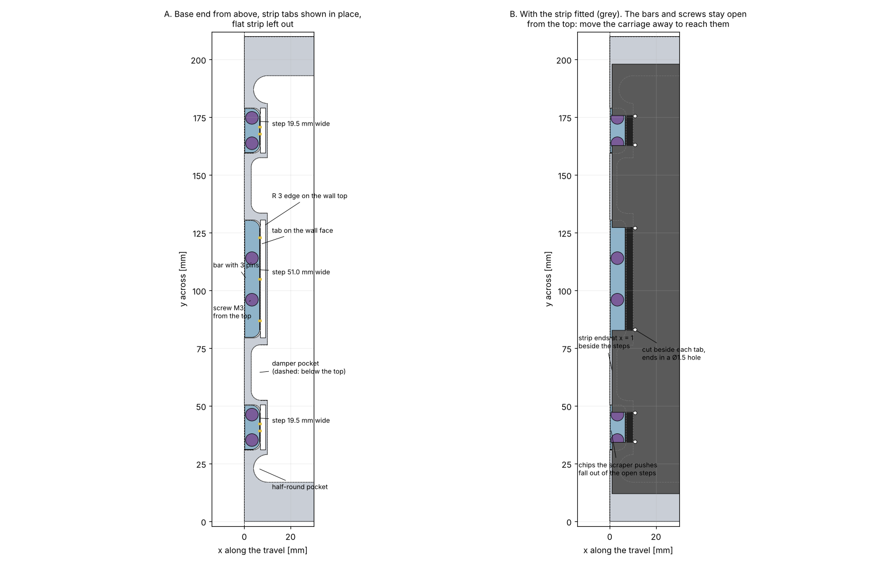

# 2026-10-28 — Clamping the seal strip ends and setting the pull, together with the scraper

**Role(s):** engineering, cad

## Goal

Design how each end of the seal strip is held and how the pull in the strip is set. It must fit
with the scraper at the carriage ends, the end stop dampers and the length limit of the stage.
Two more rules came from Niels Bosmans after the first version:

- For maintenance, only the top and the long sides of the stage can be reached. So the strip must
  come loose from the top.
- The base must be machined from the top only. Holes from the sides need a horizontal milling
  centre. Slots milled from the top are preferred, like the slots for the damper nuts.

The earlier plan used countersunk screws in off-centre holes on top of the strip. That would put a
point load on the thin strip, and a screw head on top of the strip is in the path of the scraper.

## Short answer

- **Version 2 does everything from the top.** At each end of the base, three steps are milled
  down into the end wall. The strip bends down into each step, and its tab hangs on the pins of a
  small bar. Two vertical M3 screws pull the bar down.
- **Turning the screws sets the pull.** A quarter turn moves the bar 0.125 mm. The arch height
  under the carriage is the check.
- **To take the strip out**, move the carriage to the other end, loosen the screws from the top,
  and lift the bars out.
- **The base needs no hole from the side.** The steps are milled from the top, and the tapped
  holes go straight down into the step floor.
- **Nothing stands above the top of the base, and nothing sticks out past its end.** The scraper
  and the carriage pass over the clamp. The scraper needs no change. The base stays 440 mm long.
- **No point load buckles the strip.** The tab lies flat between the wall and the bar. Each Ø2 pin
  carries about 8 N.
- **It fits.** A fit check on the real CAD geometry finds no overlap, and every step and hole stays
  in solid material.
- **Risk 1: the top rollers hit the end wall when the dampers press in fully.** This is not caused
  by the clamp. The rollers sit 1.25 mm below the top of the strip everywhere. They must move up.
- **Risk 2: the hard strip must survive the 90° bend at R 3 mm.** This must be checked with a test
  bend.

## Work Done

### The space around the strip end

The space was read from the CAD files:

- Above the strip there is no room. The underside of carriage-top is 0.25 mm above the strip.
  The scraper lips are 0.15 mm above it. With the dampers fully pressed in, carriage-top runs 3 mm
  past the end of the base.
- Past the end there is no room either. The stage length rule allows 440 mm for 220 mm of travel,
  and the base is already 440 mm.
- The end wall is 10 mm thick, but not everywhere. The damper pockets leave only 3 mm of wall. A
  half-round pocket in each inside corner (y = 17 to 29 mm and 181 to 193 mm) leaves 4 mm.
- So the clamp must sit inside the end wall, below its top, where the wall is 10 mm thick.

### Version 1, dropped

The first version bent the tabs down over the outer edge of the end wall and clamped them with
plates and screws on the end face. It fitted, but the screws could only be reached from the end,
and the tapped holes ran sideways into the base. Both break the rules above.

### Version 2: the design

| Part | What it is |
| --- | --- |
| Base, each end | Three steps milled from the top into the end wall, 16 mm deep (floor at z = 24 mm), from the end face to x = 7 mm. They are open towards the end face, so 3 mm of wall stays on the inside. Widths 19.5, 51 and 19.5 mm, at y = 31 to 50.5, 79.5 to 130.5 and 159.5 to 179 mm. Each step is at least 2 mm from the damper and half-round pockets. Inside corners R 3 mm, for a 6 mm end mill. The edge where the strip goes down is rounded R 3 mm. Two M3 tapped holes per step, drilled straight down into the floor, 12 mm deep. |
| Strip, each end | Beside the steps, the strip ends flat on top, 1 mm from the end face, and covers the damper pockets. Three tabs (12.5, 44 and 12.5 mm wide) bend down over the R 3 edge and lie flat on the wall face of the step. Each tab has two or three Ø2.1 mm holes for the pins. A cut, 0.5 mm wide, separates each tab from the flat part and ends in a Ø1.5 mm hole just past the bend. All corners rounded. The tabs are bent before fitting. |
| Bar | Three per end, aluminium, 6.35 mm long in the travel direction, 7 mm high, 0.2 mm narrower than its step on each side. Two or three ISO 8734 dowel pins, Ø2 × 4 mm, pressed in from the wall side. They stick out 0.3 mm into the tab holes. The pin holes are drilled in the loose bar, not in the base. |
| Screws | ISO 4762 M3 × 16 with a thread locking patch, two per bar, six per end. The head sits on the bar, 2 mm under the top of the base. |

### How the pull is set

1. Move the carriage to the middle. Lay the strip on the base.
2. At each end, hook each tab on the pins of its bar, and drop the bar into its step.
3. Put in the screws. Turn them until the heads just touch the bars.
4. Turn the screws of one end in equal steps. M3 has a 0.5 mm pitch, so a quarter turn moves the
   bar 0.125 mm down. Near 54 N that is about 15 N more pull.
5. Check the arch height under the carriage against the seal strip designer page. Stop when it is
   right.

This sets a travel, not a force, but in fine steps and with a check at every step. The bar can
move 4 mm down and 2 mm up, which covers the pull and the tolerance on the strip length. The
locking patch keeps the screws from turning loose.

If a set force is wanted instead, a small coil spring can go under each screw head. The screw is
then tightened until the spring has a marked length, and the spring sets the pull. This is an
option and is not drawn.

### How the strip comes out

1. Move the carriage to the other end. The bars and screws of the free end are now open from the
   top.
2. Loosen the screws. The strip goes slack.
3. Lift the bars out, unhook the tabs, and lift the strip away.

### Why the strip can carry this

- The pull is low compared with the strip strength. 54 N over seven pins is about 8 N per pin.
  On a Ø2 hole in 0.25 mm strip that is about 16 MPa on the hole edge.
- The tab lies flat, between the wall face and the bar, with 0.1 mm of play. It cannot buckle.
- The holes and the bend are in the static part of the strip. No roller runs there, so they see
  no fatigue cycles.

### What the scraper sees

- At the end of the usable travel the scraper lips stay 0.15 mm above the strip, the same as
  everywhere else. With the dampers fully pressed in, the lips run past the end of the strip.
- The steps are open to the end face. Chips that the scraper pushes into a step can fall out at
  the end of the base.
- The strip covers the open tops of the damper pockets, so chips cannot fall into them.

## Decisions Made

No decision yet. This is a proposal for Niels Bosmans. Version 1 is dropped because it needed
access from the end and holes from the side.

## Open Questions

- **The top rollers.** With the dampers fully pressed in, each top roller reaches 1 mm into the
  top of the end wall. Even at the end of the usable travel, the roller pushes the strip 1.25 mm
  down into the slot, right next to the end wall. The strip then bends over the inside edge of the
  end wall at every travel end. Moving the rollers up by at least 1.25 mm solves both problems.
  The roller pocket has room for it: the top of the roller would stay 1.25 mm under the pocket
  ceiling. This was already an open question in the scraper log.
- **Does the strip crack in the bend?** At R 3 mm the outer side of the strip stretches by about
  4 %. A tensile test of this strip shows only a small stretch before it breaks, but a bend is not
  the same test. The Alleima data sheet for 11R51 has bending charts that the search could not
  read. Read them, or bend a test piece of the real strip over R 3. A larger radius does not fit,
  because only 3 mm of wall stays behind the step.
- **The strip edges are not pulled directly.** The outer tabs start about 22 mm in from each strip
  edge, because of the half-round pockets. The pull spreads sideways within a short length, but
  the last 20 mm of the strip edges may stay a little slack. Check that the magnets hold them flat.
- **Open steps or closed slots?** The steps are open to the end face, so chips can leave. If a
  clean end face is wanted, the steps can be closed slots with a 1.5 mm outer wall, like the
  damper nut slots. The bar then gets 1.5 mm shorter.
- **What target pull?** The strip width (186 mm here, 150 mm on the designer page) and the target
  pull are still to be chosen.

## Next Steps

- [ ] Decide on the top roller height.
- [ ] Read the Alleima bending charts, or make a test bend at R 3 mm.
- [ ] Draw the steps, the R 3 edges and the tapped holes in the base, at both ends.
- [ ] Draw the bar as the sealing-clamp part, and add the tab shape to the sealing strip.
- [ ] Choose the target pull.

Technical notes

- Case: `modules/compact-stage/simulation/cases/strip-end-clamp/`. It reuses `fcstd_shapes.py`,
  `scraper.py` and `render.py` from `scraper-fit`. It builds the end at x = 0 only.
- Base geometry read from `base.FCStd`: end wall x = 0 to 10 mm, top z = 40 mm, solid down to the
  floor where there is no pocket. Damper pockets x = 3 to 10 mm, y = 52.5 to 76.5 and 133.5 to
  157.5 mm, floor z = 17.5 mm. Half-round pockets centre about (10, 23) and (10, 187), R about
  6 mm, z = 10 to 40 mm. Guide rails start at x = 11 mm.
- Bar at its nominal height: z = 28 to 35 mm. Pins at z = 31.5 mm. Tab ends at z = 29.5 mm.
  Screws at x = 3.3 mm; at y = centre ± 5.5 mm (narrow bars) or ± 9 mm (wide bar). Pins at
  centre ± 1.5 mm (narrow) or centre and ± 18 mm (wide).
- Carriage positions: carriage-top end face at x = 5 mm (usable travel end) and x = -3 mm
  (dampers fully pressed). Damper length 16 mm, worked out from the 434 mm between the pocket back
  faces and the 222 mm of travel until the first damper touch.
- The top roller model is from `scraper-fit`: Ø10 × 20 mm, axis 12.17 mm from the carriage-top
  end face, z = 44 mm.
- Bend strain: t / (2R + t) = 0.25 / 6.25 = 4 %. The small stretch before breaking comes from the
  decision on the strip material, 2026-09-22.
- Pull figures (54 N at 1.0 mm, 169 N at 1.5 mm, so about 130 N per mm near 54 N) are from the
  seal strip designer log, 2026-09-28, for a 150 mm strip.
- Mistake rules checked: the fatigue mistake (no material value given as fact without a data
  sheet; the bend is flagged as unchecked), the PowerShell rules (all shell work ran in bash), and
  the reverted tooling update (the tooling folders were left as they are).

