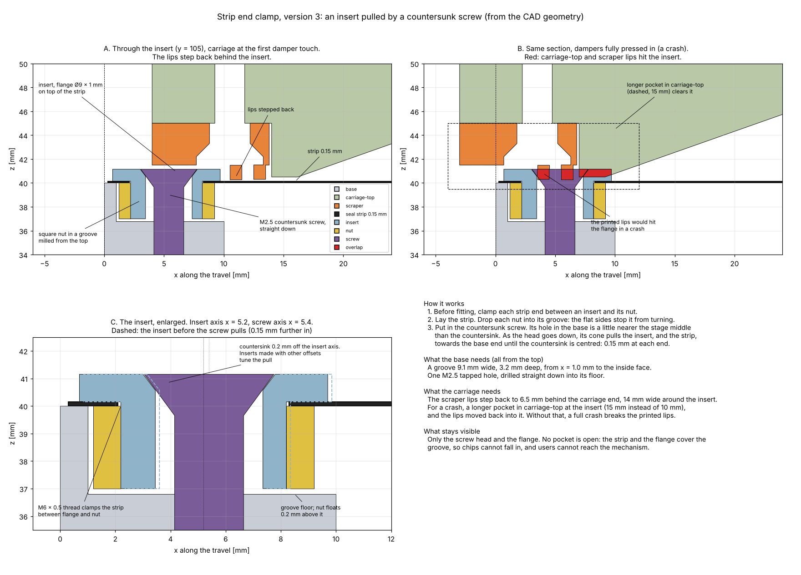

# 2026-10-28 — Clamping the seal strip ends and setting the pull, together with the scraper

**Role(s):** engineering, cad

## Goal

Design how each end of the seal strip is held and how the pull in the strip is set. It must fit
with the scraper at the carriage ends, the end stop dampers and the length limit of the stage.
The rules from Niels Bosmans, collected during the day:

- For maintenance, only the top and the long sides of the stage can be reached.
- The base is machined from the top only. Slots are preferred, like the slots for the damper nuts.
- Few parts, no open pockets where chips can fall in, and a mechanism users cannot reach.
- The strip is now 0.15 mm thick.
- Check his concept: one insert at each strip end, with a flange on top of the strip and a nut
  below it. A countersunk screw pulls the insert by centring its countersink. The nut has flat
  sides in a groove, so it cannot turn. The scraper steps back where the insert is.
- Is there enough travel for 125 N? He expects that pull to keep the strip down, so that it does
  not hit carriage-top between the bottom rollers.

## Short answer

- **The strip is now 0.15 mm thick everywhere it is set.** It is in the requirements model and
  in a new decision record. The scraper check uses it too.
- **The insert concept fits.** The base needs only a groove and one tapped hole at each end, both
  from the top. The flange stands 1 mm above the strip. The scraper lips step back 6.5 mm around
  the insert. Carriage-top needs no change for normal use.
- **There is enough travel for 125 N.** Both strip ends together must move only 0.11 to 0.24 mm
  from hand-tight to 125 N. The countersink gives 0.15 mm at each end.
- **But the travel sets the pull far too sharply.** Near 125 N, 0.1 mm more travel adds 50 to
  100 N. So the positions of the holes in the strip and the base decide the pull, to a few
  hundredths of a millimetre. The fix is a set of inserts with different countersink offsets,
  chosen at fitting.
- **125 N does not keep the strip off carriage-top.** The strip bows about 2 mm above the bottom
  rollers, and the room there is only 0.35 mm. It presses on carriage-top with about 186 N at any
  pull up to 250 N. Tape under carriage-top would turn that into a friction force of 9 to 37 N
  (typical friction values, not measured), against 180 N of continuous motor force.
- **A ceiling 1.5 to 2 mm higher solves it.** The force on carriage-top then drops to 2 to 16 N,
  and a lower pull is enough.
- **In a crash, carriage-top and the scraper lips hit the insert.** A 15 mm pocket in carriage-top
  at the insert, instead of 10 mm, clears carriage-top. The lips must then move back into it.

## Work Done

### Versions 1 and 2, dropped

- **Version 1** clamped bent-down tabs on the end face of the base. The screws could only be
  reached from the end, and the tapped holes ran sideways into the base.
- **Version 2** hung bent-down tabs on the pins of a bar in steps milled from the top. Niels
  Bosmans rejected it: the bar is not guided, so the pins may not hold the tab; the cut corners
  beside the tabs may tear; the sharp 90° bend of a hard strip needs high forces; it has many
  parts; chips fall into the open steps; and users can reach the mechanism.

### Version 3: the insert

| Part | What it is |
| --- | --- |
| Base, each end | A groove 9.1 mm wide (y = 100.45 to 109.55 mm) and 3.2 mm deep, milled from the top, from x = 1 mm to the inside face of the end wall. Corners R 1 mm (2 mm end mill). One M2.5 tapped hole, 6 mm deep, drilled straight down into its floor at x = 5.4 mm. The end wall is 10 mm thick there. |
| Insert | Steel. Flange Ø9 × 1 mm on top of the strip. Body Ø6 mm through a Ø6.2 mm hole in the strip, with an M6 × 0.5 thread. A 90° countersink for the screw, 0.2 mm off the insert axis, towards the stage middle. |
| Nut | Steel, 9 × 8 × 3 mm, threaded M6 × 0.5, corners rounded R 1.5 mm. Its flat sides slide in the groove with 0.05 mm of play, so it cannot turn. It floats 0.2 mm above the groove floor. |
| Screw | ISO 14581 M2.5 × 8, Torx countersunk. The head sits flush in the flange. |
| Strip, each end | Ends flat on the end wall, 0.3 mm from the end face. One Ø6.2 mm hole on the centre line. No bend, no cut tabs. |
| Scraper | Over 14 mm of width around the insert, the lips step back to 6.5 to 9.5 mm behind the carriage end face. Two short side lips close the step. The scraper plate still clears the flange by 0.35 mm. |

The insert sits on the centre line of the stage. That is the only place on the end wall that is
clear of the top roller lanes and the damper pockets.

How it works:

1. Before fitting, clamp each strip end between an insert and its nut.
2. Lay the strip. Drop each nut into its groove.
3. Put in the countersunk screw. Its hole in the base is 0.15 mm nearer the stage middle than
   the countersink. As the head goes down, its cone pulls the insert, and the strip, 0.15 mm
   towards the base end, until the countersink is centred.

The strip is held by friction between the flange and the nut, around the hole. No hole edge
carries the pull, so there is no point load on the strip.

### Is there enough travel for 125 N?

The strip model is the solver of the seal strip designer page. This time it uses the real
carriage, read from the CAD: the top roller at the low edge of the carriage-top slope, the bottom
roller on the high edge of the carriage-bottom slope, 112 mm between the bottom rollers, and both
carriage faces around the strip as walls. The strip is 0.15 mm thick and 186 mm wide.

| From hand-tight (10 N) to 125 N | Travel of both ends together |
| --- | ---: |
| Ceiling as drawn | 0.11 mm |
| Ceiling 1 mm higher | 0.13 mm |
| Ceiling 2 mm higher | 0.24 mm |

The countersink gives 0.15 mm at each end, so 0.30 mm together. That is enough.

The difficulty is the other way round. Near 125 N, 0.1 mm more travel adds 50 to 100 N. The
travel is fixed by where the holes are: the two holes in the strip, the two holes in the base, and
the countersink offsets. A laser cut hole is typically placed to about ±0.05 to 0.1 mm. That alone
can move the pull by tens of newtons. Temperature adds a little: the aluminium base grows about
0.03 mm more than the steel strip per 10 °C over 430 mm.

The fix: make the inserts in a set, with countersink offsets in steps of 0.05 mm. At fitting,
clamp the first end. At the second end, pull the strip with a spring scale to the target and
measure how far the strip hole lies from the base hole. Choose the insert that matches.

### Does 125 N keep the strip off carriage-top?

No. Between the bottom rollers the room above the roller tops is only 0.35 mm. The strip leaves
the 19° slope over each bottom roller and overshoots. With nothing above it, it would bow:

| Pull | Bow above the bottom roller tops |
| ---: | ---: |
| 50 N | 3.6 mm |
| 125 N | 2.0 mm |
| 250 N | 1.2 mm |
| 500 N | 0.8 mm |

A bow of 1.3 mm needs about 250 N, and the strip still touches. With carriage-top in place, the
strip lies against the ceiling and presses on it with about 186 N, for both carriage ends together.
This hardly depends on the pull. The pull cannot do this job.

| Ceiling | Force of the strip on carriage-top at 125 N |
| --- | ---: |
| As drawn | 186 N |
| 0.5 mm higher | 60 N |
| 1 mm higher | 20 N |
| 1.5 mm higher | 4 N |
| 2 mm higher | 2 N |

Two ways to live with it:

- **Tape or a plastic strip under carriage-top, as drawn.** The strip slides on it with 186 N.
  PTFE on steel typically has a friction coefficient of 0.05 to 0.2, which gives 9 to 37 N. That
  is 5 to 20 % of the 180 N continuous force of STG-10. The friction also changes direction with
  the motion, which costs positioning accuracy. The tape wears.
- **A ceiling 1.5 to 2 mm higher, over the strip width, between the slopes.** The force drops to
  2 to 16 N, depending on the pull. The pull can then be lower, for example 50 N. That also lowers
  the stress at the rollers. The plate of carriage-top above the strip is 6.5 mm thick now and
  would become 4.5 to 5 mm. The same room can come from lowering the bottom rollers and the flat
  top of carriage-bottom instead.

### What the strip carries

At 125 N the tightest radius is about 20 mm and the highest stress about 710 MPa. The fatigue
limit of the 301 strip at 0.15 mm is about 900 MPa, extrapolated from Alleima's measured values at
0.25 and 0.50 mm. At 250 N the stress reaches 860 MPa, which leaves almost no margin.

## Decisions Made

- The seal strip is 0.15 mm thick. Niels Bosmans decided this. See
  [the decision record](../decisions/2026-10-28_seal-strip-0-15-mm.md).
- Versions 1 and 2 of the clamp are dropped.
- No decision yet on version 3. It is a proposal for Niels Bosmans.

## Open Questions

- **The carriage-top ceiling.** Raise it by 1.5 to 2 mm, or lower the bottom rollers, or accept
  contact with tape? This decides the pull and the friction.
- **How proud do the bottom rollers stand?** The 0.35 mm of room assumes 1.5 mm, the same as the
  top rollers. No roller is in the CAD yet. Every number in the table above depends on it.
- **One insert pulls only the middle of a 186 mm strip.** Near the ends the strip edges get less
  pull. Near the insert the strip is squeezed sideways, and a 0.15 mm strip may wrinkle there. The
  magnets help to hold it flat. Check on a test piece. A second insert per end does not fit beside
  the top roller lanes.
- **The crash case.** Accept that a full crash may break the printed lips, or make the pocket in
  carriage-top 15 mm long at the insert and move the lips back into it?
- **The top rollers** still reach 1.15 mm below the top of the strip, and hit the end wall when
  the dampers press in fully. They must move up. This is not caused by the clamp.

## Next Steps

- [ ] Decide on the ceiling or the bottom roller height.
- [ ] Put the bottom and top rollers in the CAD, so the room around the strip can be measured.
- [ ] Choose the target pull again once the ceiling is decided.
- [ ] Draw the groove and the tapped hole in the base, and the insert, nut and screw as parts.
- [ ] Make a test piece: strip, insert, nut, groove. Check that the strip does not slip or wrinkle.

Technical notes

- Case: `modules/compact-stage/simulation/cases/strip-end-clamp/`. It reuses `fcstd_shapes.py`,
  `scraper.py` and `render.py` from `scraper-fit`, and `strip_model.js` from the designer page.
- `strip_model.js` got an `opts.walls` option (straight walls as upper or lower bounds) and
  returns `wallF`. The contact solver may now take up to 50 000 steps instead of 1 000. The
  designer page checks still pass. Some points with the ceiling raised 2 mm do not settle (70 and
  50 N); they are left out.
- Carriage faces at y = 105 mm, assembly coordinates: carriage-top flat underside z = 40.5 to
  x = 118.77, slope to (147.1, 50.5), ceiling z = 53.5 from x = 147.1 to 276.1. Carriage-bottom
  slope (121.6, 39.5) to (155.6, 51.5), flat top z = 51.5 to x = 267.6.
- Strip model input: a = 36.83 mm (top roller to bottom roller), b = 112 mm, bottom roller axis
  z = 48.0, top roller raised so it just touches the strip, magnet bed 20 N/mm³ and 0.005 N/mm²,
  strip length 430 mm.
- Scraper-fit with 0.15 mm: lips 1.2 mm high, 0.15 mm above the strip; scraper to the base walls
  0.30 mm (was 0.40); screw heads 1.65 mm above the strip (was 1.55).
- Friction values for PTFE on steel are typical textbook values, not from a data sheet.
- Mistake rules checked: the fatigue mistake (the 0.15 mm fatigue limit is flagged as
  extrapolated; friction flagged as typical), the PowerShell rules (all shell work ran in bash),
  and the reverted tooling update (the tooling folders were left as they are).

