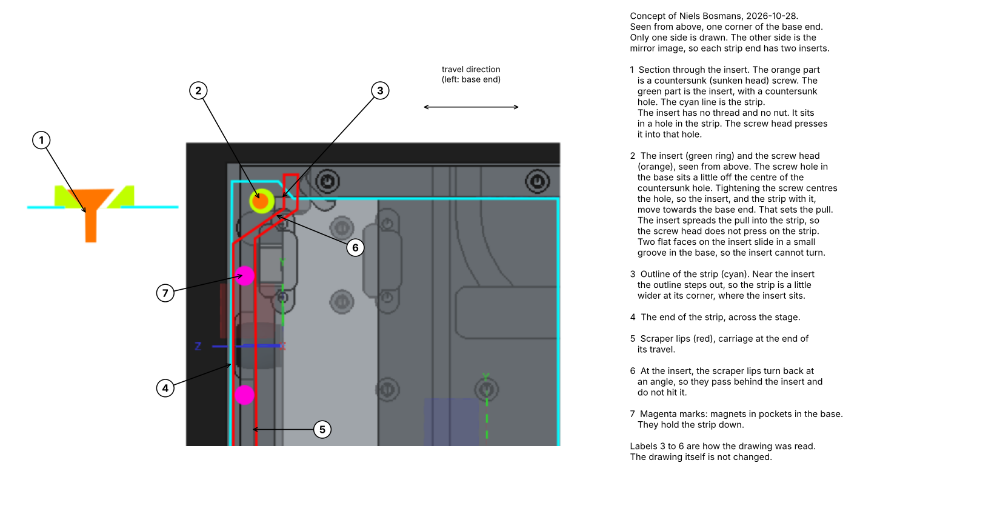
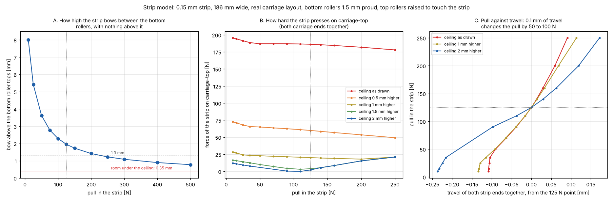
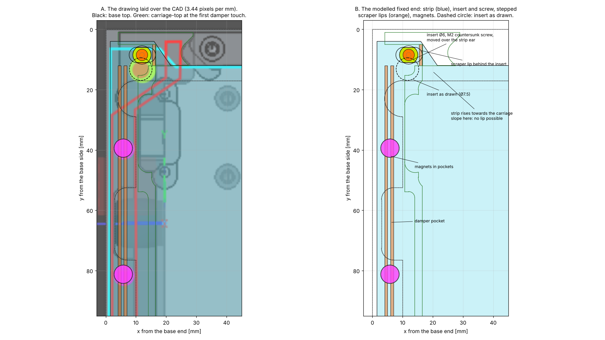
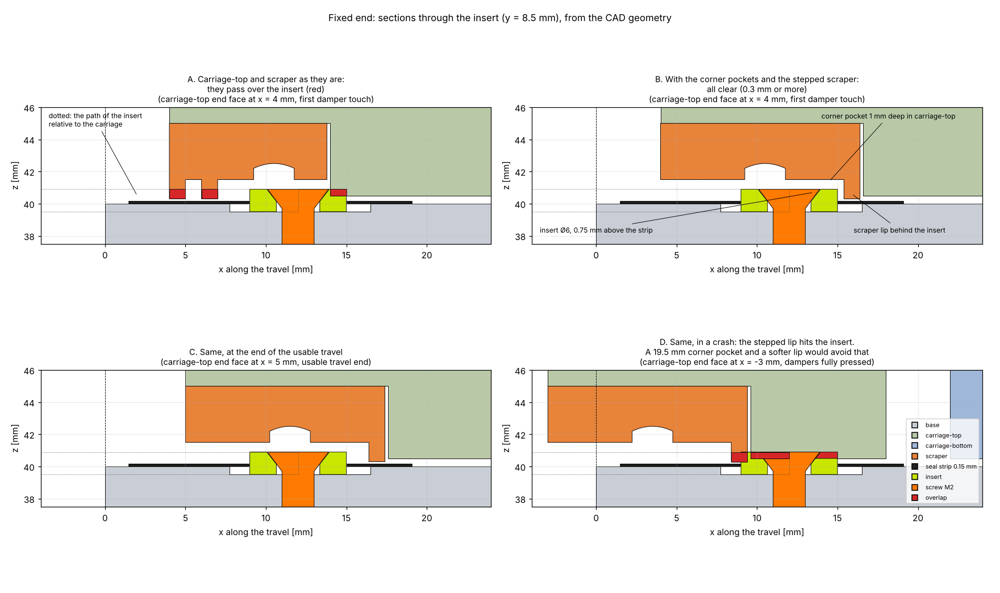
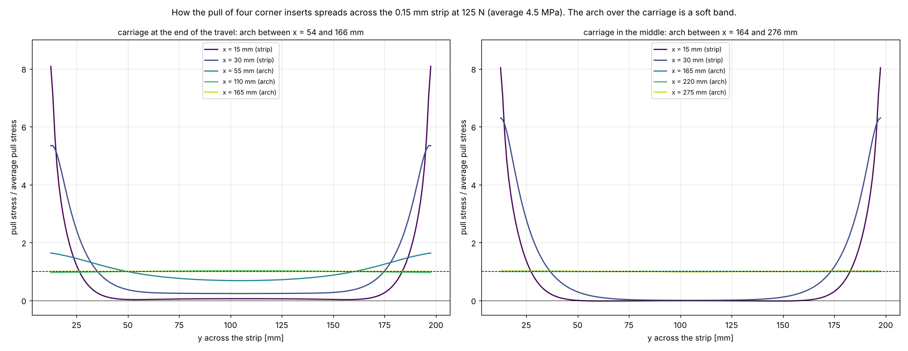
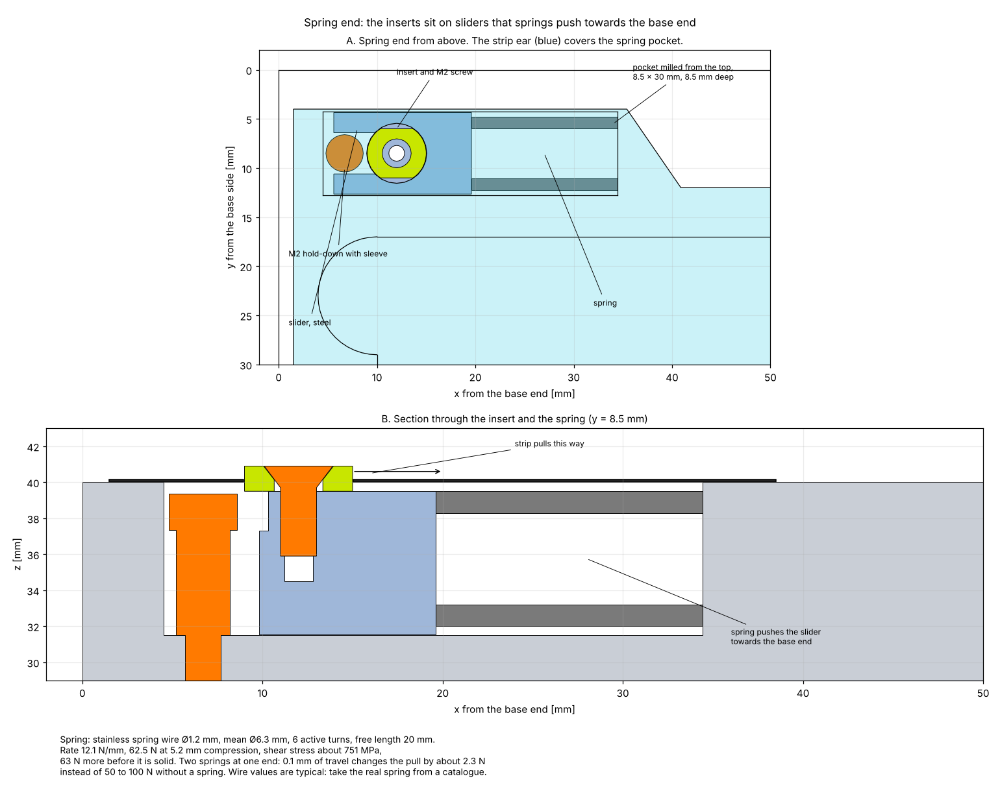

# 2026-10-28 — Clamping the seal strip ends and setting the pull, together with the scraper

**Role(s):** engineering, cad

## Goal

Design how each end of the seal strip is held and how the pull in the strip is set. It must fit
with the scraper at the carriage ends, the end stop dampers and the length limit of the stage.
The rules from Niels Bosmans, collected during the day:

- For maintenance, only the top and the long sides of the stage can be reached.
- The base is machined from the top only. Slots are preferred, like the slots for the damper nuts.
- Few parts, no open pockets where chips can fall in, and a mechanism users cannot reach.
- The strip is now 0.15 mm thick.
- Record his concept for the strip ends, shown in his own drawing below.
- Is there enough travel for 125 N? He expects that pull to keep the strip down, so that it does
  not hit carriage-top between the bottom rollers.

## Short answer

- **The strip is now 0.15 mm thick everywhere it is set.** It is in the requirements model and
  in a new decision record. The scraper check uses it too.
- **The concept of Niels Bosmans is recorded in his own drawing, with notes.** Two inserts at
  each strip end, one near each side edge. Each insert sits in a hole in the strip, with no thread
  and no nut. A countersunk screw presses it into the hole. The screw hole in the base sits a
  little off the centre of the countersink, so tightening the screw pulls the strip.
- **The concept is feasible as drawn, with the insert above the strip.** A flush insert is not
  possible, Niels Bosmans says. The carriage passes over the insert on its way to the end of the
  travel, so carriage-top and the scraper need room for it:
  - a corner pocket in carriage-top, 1 mm deep and 12 mm long from the end face (19.5 mm to also
    survive a crash);
  - scraper lips that step back behind the insert, as drawn, to about 11.3 mm from the end face.
- **The insert moves over the strip ear and gets a little smaller.** The lip behind it must stay
  off the strip where the strip rises towards the carriage slope. So the insert moves from 13.2 to
  8.5 mm from the base side, and goes from Ø7.5 with M2.5 to Ø6 with M2.
- **A spring at one strip end sets the pull by force.** The two inserts of that end sit on
  sliders, pushed by springs in pockets milled from the top into the side wall. Then 0.1 mm of
  travel changes the pull by about 2.3 N instead of 50 to 100 N. Hole tolerances, temperature,
  settling and creep then hardly change the pull.
- **Under the carriage the pull is even across the width,** although it enters at the four
  corners. With the carriage at the end of its travel, the first bottom roller sees 68 % of the
  average pull in the strip middle and 164 % at the edges. Within 30 mm of the strip ends the
  middle of the strip carries almost no pull, so the magnets must hold it flat.
- **Little travel is needed for 125 N.** Both strip ends together must move only 0.11 to 0.24 mm
  from hand-tight to 125 N.
- **But the travel sets the pull far too sharply.** Near 125 N, 0.1 mm more travel adds 50 to
  100 N. So the positions of the holes in the strip and the base decide the pull, to a few
  hundredths of a millimetre.
- **125 N does not keep the strip off carriage-top.** The strip bows about 2 mm above the bottom
  rollers, and the room there is only 0.35 mm. It presses on carriage-top with about 186 N at any
  pull up to 250 N. Tape under carriage-top would turn that into a friction force of 9 to 37 N
  (typical friction values, not measured), against 180 N of continuous motor force.
- **A ceiling 1.5 to 2 mm higher solves it.** The force on carriage-top then drops to 2 to 16 N,
  and a lower pull is enough.

## Work Done

### Versions 1 and 2, dropped

- **Version 1** clamped bent-down tabs on the end face of the base. The screws could only be
  reached from the end, and the tapped holes ran sideways into the base.
- **Version 2** hung bent-down tabs on the pins of a bar in steps milled from the top. Niels
  Bosmans rejected it: the bar is not guided, so the pins may not hold the tab; the cut corners
  beside the tabs may tear; the sharp 90° bend of a hard strip needs high forces; it has many
  parts; chips fall into the open steps; and users can reach the mechanism.

### Version 3: the concept of Niels Bosmans

The drawing above is his, unchanged. The numbers and the text beside it are notes added to it.
His original drawing is kept as [image 03](images/2026-10-28-03.png).

- Each strip end has two inserts, one near each side edge. The drawing shows one side; the
  other side is the mirror image.
- The insert has no thread and no nut. It sits in a hole in the strip. A countersunk (sunken
  head) screw presses it into that hole.
- The screw hole in the base sits a little off the centre of the countersunk hole in the insert.
  Tightening the screw centres the hole, so the insert, and the strip with it, move towards the
  base end. That sets the pull. The insert spreads the pull into the strip, so the screw head
  does not press on the strip.
- Two flat faces on the insert slide in a small groove in the base, so the insert cannot turn.
- Near the insert the strip is a little wider, so the insert sits on a corner of the strip.
- The scraper lips turn back at an angle at the insert, so they pass behind it.
- Magnets in pockets in the base hold the strip down.

A first reading of this concept on the same day put one insert, with a flange and a nut, on the
centre line. That was a misreading, and it is removed.

### Is the concept feasible?

The concept was built from the drawing in the case
[`strip-end-insert`](../../modules/compact-stage/simulation/cases/strip-end-insert/) and checked
against the CAD of the base, both carriage halves, the scraper and the top rollers. The scale of
the drawing comes from the 74.1 mm pitch of the carriage-top screws in it: 3.44 pixels per mm.
Laid over the CAD at that scale, the half-round pocket, the damper pocket and the carriage screws
of the drawing fall on the CAD.

**Why the carriage hits the insert.** The carriage comes from the middle of the stage. Every part
of carriage-top and the scraper that ends up beyond the insert at the end of the travel has
passed over it on the way. The underside of carriage-top is only 0.35 mm above the strip, and the
insert stands 0.75 mm above it. The scraper pocket in carriage-top reaches 10 mm from the end face,
and the insert reaches 11 mm. The first check of this concept looked at three carriage positions
only and missed this. The check now uses the insert drawn out towards the base end: everything
the carriage passes over.

**A corner pocket in carriage-top solves it.** It is 1 mm deep, over 7 mm of width around the
insert. At 12 mm long from the end face it clears the insert up to the first damper touch, with
0.3 mm to spare. At 19.5 mm long it also clears it in a crash. It takes away about 25 mm³ of
aluminium.

**The scraper lips must step back, as drawn.** A lip that passes over the insert hits it. So in
front of the insert there is no lip, and a lip behind it, 11.3 mm or more from the end face,
catches the chips instead. The scraper then grows into a deeper corner pocket in carriage-top,
4.5 mm deep like the scraper pocket. The check found one limit: from about 10 mm behind the end
face, the strip proper (12 mm and more from the base side) rises towards the carriage slope. A lip
there would touch it. So the lip behind the insert, and the insert, must sit beside the strip
proper, over the ear. That is why the insert moves.

| Part | Size used |
| --- | --- |
| Insert | Ø6 mm, 1.4 mm high, 0.75 mm above the strip, at 12.0 mm from the base end and 8.5 mm from the base side (drawing: Ø7.5 at 11.6 and 13.2 mm). Two flat faces 5 mm apart. |
| Screw | ISO 14581 M2 × 5, countersunk, straight down into the side wall. The insert can travel 0.25 mm before it is centred. |
| Groove | 5.1 mm wide, 0.5 mm deep, milled from the top along the travel, with round ends. |
| Strip corner | Strip end 1.5 mm from the base end. The ear reaches 4 mm from the base side. Ø6.1 mm hole for the insert. |
| Magnets | At 5.8 mm from the base end, 39.4 and 81.2 mm from the base side, as drawn. Ø6 × 2 mm assumed. |
| Carriage-top | Corner pocket 1 mm deep, 12 mm long (19.5 mm for a crash). Under the stepped scraper, the scraper pocket grows into the corner, 4.5 mm deep, up to 12.6 mm from the end face. It keeps 3.2 mm to the roller pocket and the slope opening. |
| Scraper | No lips in front of the insert, over 7 mm of width. A lip behind it, 11.4 to 12.4 mm from the end face. |

What the fit check found:

- **The base can carry it.** The groove, the tapped hole and the magnet pockets are made from the
  top and stay in solid material. The groove keeps 5.95 mm of wall. The magnet pockets keep only
  1.1 mm to the inside face of the end wall; moving them 0.5 mm towards the base end gives 1.6 mm.
- **With the corner pockets and the stepped scraper, nothing touches the insert** up to the first
  damper touch. Carriage-bottom and the top rollers never touch it.
- **In a crash, the stepped lip hits the insert** (3.6 mm³). A lip of soft material (TPU) would
  bend and survive. A lip further back does not fit beside the slope opening.

### How the pull spreads from four corner inserts

The pull enters the strip at four points near its corners. A plane stress model of the whole strip
shows how it spreads across the 186 mm width. Almost all the travel of the inserts goes into
flattening the arch over the carriage, so the arch is modelled as a soft band (750 N/mm for the
whole width, from the strip model). Friction and magnets are left out.

| Place | Carriage at the end of the travel: middle / highest | Carriage in the middle: middle / highest |
| --- | ---: | ---: |
| 15 mm from the strip end | 0.06 / 8.1 | 0.00 / 8.0 |
| 30 mm from the strip end | 0.24 / 5.3 | 0.00 / 6.3 |
| First bottom roller | 0.68 / 1.64 | 0.99 / 1.01 |
| Middle of the arch | 1.02 / 1.02 | 1.00 / 1.00 |

Values are shares of the average pull stress, 4.5 MPa at 125 N.

- Under the carriage the pull is even. The strip is stiff in its own plane and the arch is soft,
  so the strip spreads the pull before it reaches the carriage.
- With the carriage at the end of the travel, the first bottom roller sees an uneven pull. The
  strip middle may then bow a little higher there than the edges.
- Near the strip ends the middle carries almost no pull, and beside the inserts the strip is
  squeezed sideways by up to 10 MPa. A free 50 mm wide panel of 0.15 mm steel buckles at about
  6 MPa, so the strip may wrinkle there. The base under it and the magnets of the drawing must
  hold it flat. A test piece will show it.
- The strip itself is not loaded hard anywhere. The bearing stress in the insert hole is about
  68 MPa, and the stress on the strip edge beside the insert about 36 MPa.

### Creep, and setting the pull by force

The pull is set by travel: where the holes in the strip and in the base end up. Near 125 N, 0.1 mm
of travel changes the pull by 50 to 100 N. So anything that changes the length by a few
hundredths of a millimetre changes the pull a lot:

| Cause | Size | Pull change, set by travel | With the springs |
| --- | --- | ---: | ---: |
| Hole positions in the strip and the base, typical laser or drilling tolerance | ±0.05 to 0.1 mm | ±25 to 100 N | ±1 to 2.5 N |
| Temperature, aluminium base and steel strip, 10 °C | 0.03 mm | 15 to 30 N | 0.7 N |
| Settling of the contacts: insert, groove, countersink | about 0.01 mm | 5 to 10 N | 0.2 N |

The temperature row assumes an aluminium base. Its material is not chosen yet.

Creep of the steel itself is not the problem. The pull gives only 4.5 MPa on average and about
36 MPa next to the inserts, far below the stresses at which steel at room temperature creeps.
What does change the length: temperature, settling of the contacts, wear, and a strip that takes a
small permanent bend at a parking position.

**The fix is a spring in series with the strip, much softer than the arch.** Then the spring sets
the pull, and a change in length only moves the spring a little.

- **Where:** at one strip end only. The other end stays as drawn, with the eccentric screw. At the
  spring end, each insert is screwed onto a slider instead of into the base. A compression spring
  pushes the slider towards the base end. Each slider and spring sit in a pocket milled from the
  top into the side wall: 8.5 mm wide, 30 mm long, 8.5 mm deep, with 4.25 mm of wall around it. The
  strip ear grows to 35 mm long and covers the pocket, so chips cannot get in and users cannot
  reach the spring.
- **Spring:** stainless spring wire Ø1.2 mm, mean Ø6.3 mm, 6 active turns, 20 mm free length:
  about 12 N/mm, 62.5 N at 5.2 mm compression, 63 N more before it is solid. Two springs at one end
  give 24 N/mm, against 500 to 1000 N/mm for the arch. The wire stress is about 750 MPa, which
  stainless spring wire takes under a steady load. These are typical wire values: take the real
  spring from a maker's catalogue.
- **Hold-down:** the strip pulls the insert 4 mm above the spring axis, so the slider wants to
  tip. An M2 screw with a sleeve, in a slot at the front of the slider, holds it down and still
  lets it slide.
- **Setting the pull:** the spring length sets it. The position of the slider in its pocket shows
  the spring length, so a mark on the slider is a gauge of the pull at fitting and at every
  inspection.
- **Fitting:** hold the slider back with a pin or a tool while the strip is laid and the screws
  go in, then let go.

A simpler option without a spring: pull the strip with a known force at fitting (a spring scale on
the insert), then clamp the insert. That takes away the hole tolerance, but the temperature and
settling rows still apply.

One limit stays with any method: the strip rubs on the magnets. That friction can hold different
pulls in different parts of the strip until the carriage moves it. The model leaves friction out.

### Is there enough travel for 125 N?

The strip model is the solver of the seal strip designer page. This time it uses the real
carriage, read from the CAD: the top roller at the low edge of the carriage-top slope, the bottom
roller on the high edge of the carriage-bottom slope, 112 mm between the bottom rollers, and both
carriage faces around the strip as walls. The strip is 0.15 mm thick and 186 mm wide.

| From hand-tight (10 N) to 125 N | Travel of both ends together |
| --- | ---: |
| Ceiling as drawn | 0.11 mm |
| Ceiling 1 mm higher | 0.13 mm |
| Ceiling 2 mm higher | 0.24 mm |

The difficulty is the other way round. Near 125 N, 0.1 mm more travel adds 50 to 100 N. The
travel is fixed by where the holes are: the two holes in the strip, the two holes in the base, and
the screw offsets. A laser cut hole is typically placed to about ±0.05 to 0.1 mm. That alone
can move the pull by tens of newtons. Temperature adds a little: the aluminium base grows about
0.03 mm more than the steel strip per 10 °C over 430 mm.

### Does 125 N keep the strip off carriage-top?

No. Between the bottom rollers the room above the roller tops is only 0.35 mm. The strip leaves
the 19° slope over each bottom roller and overshoots. With nothing above it, it would bow:

| Pull | Bow above the bottom roller tops |
| ---: | ---: |
| 50 N | 3.6 mm |
| 125 N | 2.0 mm |
| 250 N | 1.2 mm |
| 500 N | 0.8 mm |

A bow of 1.3 mm needs about 250 N, and the strip still touches. With carriage-top in place, the
strip lies against the ceiling and presses on it with about 186 N, for both carriage ends together.
This hardly depends on the pull. The pull cannot do this job.

| Ceiling | Force of the strip on carriage-top at 125 N |
| --- | ---: |
| As drawn | 186 N |
| 0.5 mm higher | 60 N |
| 1 mm higher | 20 N |
| 1.5 mm higher | 4 N |
| 2 mm higher | 2 N |

Two ways to live with it:

- **Tape or a plastic strip under carriage-top, as drawn.** The strip slides on it with 186 N.
  PTFE on steel typically has a friction coefficient of 0.05 to 0.2, which gives 9 to 37 N. That
  is 5 to 20 % of the 180 N continuous force of STG-10. The friction also changes direction with
  the motion, which costs positioning accuracy. The tape wears.
- **A ceiling 1.5 to 2 mm higher, over the strip width, between the slopes.** The force drops to
  2 to 16 N, depending on the pull. The pull can then be lower, for example 50 N. That also lowers
  the stress at the rollers. The plate of carriage-top above the strip is 6.5 mm thick now and
  would become 4.5 to 5 mm. The same room can come from lowering the bottom rollers and the flat
  top of carriage-bottom instead.

### What the strip carries

At 125 N the tightest radius is about 20 mm and the highest stress about 710 MPa. The fatigue
limit of the 301 strip at 0.15 mm is about 900 MPa, extrapolated from Alleima's measured values at
0.25 and 0.50 mm. At 250 N the stress reaches 860 MPa, which leaves almost no margin.

## Decisions Made

- The seal strip is 0.15 mm thick. Niels Bosmans decided this. See
  [the decision record](../decisions/2026-10-28_seal-strip-0-15-mm.md).
- Versions 1 and 2 of the clamp are dropped.
- Version 3 is the concept of Niels Bosmans. It is checked against the CAD and is feasible.
- The insert stands above the strip. Niels Bosmans ruled out a flush insert.
- No decision yet on the spring end.

## Open Questions

- **The carriage-top ceiling.** Raise it by 1.5 to 2 mm, or lower the bottom rollers, or accept
  contact with tape? This decides the pull and the friction.
- **How proud do the bottom rollers stand?** The 0.35 mm of room assumes 1.5 mm, the same as the
  top rollers. No roller is in the CAD yet. Every number in the table above depends on it.
- **Spring end or not?** With a spring at one end, the pull hardly depends on hole tolerances,
  temperature or settling. Without it, the pull must be set by force at fitting and will drift.
- **Corner pocket length.** 12 mm for normal travel, or 19.5 mm so that carriage-top survives a
  crash. The stepped scraper lip hits the insert in a crash either way, unless it is made of a
  soft material.
- **Insert position.** Is moving it over the strip ear (from 13.2 to 8.5 mm from the base side,
  Ø6 instead of Ø7.5) acceptable?
- **Does the strip end stay flat?** Its middle carries almost no pull near the ends, and it is
  squeezed sideways beside the inserts. The magnets must hold it. Check on a test piece.
- **The top rollers** still reach 1.15 mm below the top of the strip, and hit the end wall when
  the dampers press in fully. They must move up.

## Next Steps

- [ ] Decide on the ceiling or the bottom roller height.
- [ ] Put the bottom and top rollers in the CAD, so the room around the strip can be measured.
- [ ] Choose the target pull again once the ceiling is decided.
- [ ] Decide on the spring end and the corner pocket length.
- [ ] Choose a real spring from a catalogue, and check its force tolerance.
- [ ] Draw the inserts, the grooves, the screws, the magnet pockets, the corner pockets in
      carriage-top, the stepped scraper and the spring pockets in the CAD.
- [ ] Make a test piece of the strip corner with an insert. Check that the strip does not slip or
      wrinkle.

Technical notes

- Strip model: `modules/compact-stage/simulation/cases/strip-pull/`. It uses `strip_model.js`
  from the designer page. The clamp geometry of versions 1 to 3 is no longer in the repository;
  it is in the git history of this branch.
- Concept check: `modules/compact-stage/simulation/cases/strip-end-insert/`. It reuses
  `fcstd_shapes.py` and `scraper.py` from `scraper-fit`. The membrane model uses bilinear plane
  stress elements of 1 mm (scipy). The soft band has 2 990 MPa along the travel and steel values
  across and in shear. The 6 MPa buckling value is the plate formula with k = 4 for a 50 mm
  panel, as an order of size.
- Sweep check: the insert is extended towards the base end (x down to -10 mm) and checked against
  carriage-top and the scraper at the end positions of the carriage. That covers every position
  on the way.
- Spring: k = G d⁴ / (8 D³ n) with G = 70 000 MPa; shear stress 8 F D / (π d³) times the Wahl
  factor (1.29 at index 5.25). The arch stiffness of 500 to 1000 N/mm comes from the strip-pull
  case. Thermal: (23 − 16) × 10⁻⁶ per °C over 430 mm, typical expansion values for aluminium and
  1.4310.
- Images 03 and 04: the drawing of Niels Bosmans, and the same drawing with notes. The notes were
  added with a short matplotlib script that is not in the repository.
- `strip_model.js` got an `opts.walls` option (straight walls as upper or lower bounds) and
  returns `wallF`. The contact solver may now take up to 50 000 steps instead of 1 000. The
  designer page checks still pass. Some points with the ceiling raised 2 mm do not settle (70 and
  50 N); they are left out.
- Carriage faces at y = 105 mm, assembly coordinates: carriage-top flat underside z = 40.5 to
  x = 118.77, slope to (147.1, 50.5), ceiling z = 53.5 from x = 147.1 to 276.1. Carriage-bottom
  slope (121.6, 39.5) to (155.6, 51.5), flat top z = 51.5 to x = 267.6.
- Strip model input: a = 36.83 mm (top roller to bottom roller), b = 112 mm, bottom roller axis
  z = 48.0, top roller raised so it just touches the strip, magnet bed 20 N/mm³ and 0.005 N/mm²,
  strip length 430 mm.
- Scraper-fit with 0.15 mm: lips 1.2 mm high, 0.15 mm above the strip; scraper to the base walls
  0.30 mm (was 0.40); screw heads 1.65 mm above the strip (was 1.55).
- Friction values for PTFE on steel are typical textbook values, not from a data sheet.
- Mistake rules checked: the fatigue mistake (the 0.15 mm fatigue limit is flagged as
  extrapolated; friction flagged as typical), the PowerShell rules (all shell work ran in bash),
  and the reverted tooling update (the tooling folders were left as they are).

