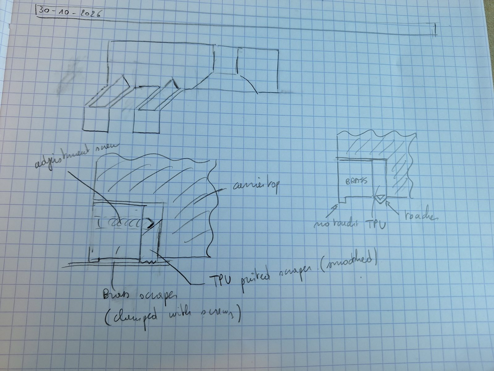

# 2026-10-30 — Scraper: what other makers do, why not felt, and a brass and TPU design

**Role(s):** engineering, cad

## Goal

Find out how other makers design the scrapers or wipers that keep dirt off a cover strip or a
guide. Do they touch? How much friction? Which materials? Can a felt wiper do the job? Then check
whether the aluminium of carriage-top, or a metal insert, can be the hard first scraper. Niels
Bosmans then drew a design with a brass scraper and a TPU lip.

## Short answer

- **Most makers use two stages.** A hard part at the front keeps a small gap and stops the large
  chips. A soft lip behind it touches the surface and wipes off fine dirt and fluid.
- **Felt is used, but only as an extra inner layer.** It is full of oil or grease and rides on the
  guide or the cylinder body, not on a thin cover strip. No maker uses felt as the only wiper.
- **Felt alone does not suit this stage.** It soaks up the water-based coolant, it holds metal grit
  against the strip, it does not stop chips, and its friction changes as it gets wet or dirty.
- **The edge of carriage-top can only give a gap of about 0.35 mm, not 0.15 mm.** A separate metal
  insert can be set to 0.15 mm with shims. Brass is the best choice for the insert.
- **Niels drew that design (sketch below):** a brass scraper at the front that does not touch, and
  a printed TPU lip behind it that touches the strip. It matches what the makers do.

## Work Done

### How other makers do it

| Who / what | Touches? | Material | Source |
| --- | --- | --- | --- |
| THK, KRF actuator (fully covered, steel strip held by magnets) | The table does not touch the top of the strip. THK: "less likely to generate dust by avoiding the contact" | Steel strip, magnet in the side cover | [THK KRF page](https://www.thk.com/us/en/contents/pages/special/actuator/krf/) |
| THK and HIWIN guide blocks, scraper options ZZ and KK | The metal scraper keeps a tiny gap. The rubber end seal behind it touches. HIWIN: the scraper protects the seal from "hot chips or sharp-edged dirt" | Steel plate and NBR rubber lip | [THK codes (Scribd)](https://www.scribd.com/document/639976365/THK-Linear-Guideways), [HIWIN seals](https://reiman.pt/pt/hiwin-sealing-systems-hiwin-sealing-systems) |
| NSK, patent US 4963038 | "A scraper having a minute clearance" to the rail, in front of a rubber wiper | Metal and rubber | [US 4963038](https://patents.justia.com/patent/4963038) |
| THK LaCS | Touches. A scraper of three layers that cleans in stages, for welding and cutting dirt | Not published | [THK FAQ](https://store-na.thk.com/ResourceCenter/ProductKnowledgeBaseFAQs) |
| Parker Origa OSP-P band cylinder | The wipers on the carrier are "Plastic". Felt only in the guide option: "polymer and felt wiper elements to remove dirt and lubricate the slideways", with grease nipples | Plastic; polymer and oiled felt on the guide | [OSP-P catalog](https://cdn.dzwigi.net.pl/b/v2/OSPP25C000000380000000000/Document/Rodless-Cylinders-OSP-P-675ff59df2bbd.pdf) |
| CKD MRL2 rodless cylinder | A cloth part catches dust and wear powder. A thin tube feeds grease into it | Cloth and grease | [CKD MRL2](https://bibus.my/products-solutions/pneumatics/actuators/rodless-cylinders/ckd-series-mrl2) |
| Festo DGC and DGC-K | Parts lists include a "wiper seal". The cover strip is held by magnets. No material or contact detail found | Polyurethane sealing band, steel cover strip | [Festo DGC-K catalog](https://ftp.festo.com/public/PNEUMATIC/SOFTWARE_SERVICE/Documentation/2019/EN/DGC-K_EN.PDF), [Design World](https://www.designworldonline.com/?p=174824) |
| Way wipers on machine tools (Tsubaki, Hennig) | Touch, pressed 1 to 2 mm into the surface. A pre-wiper of "stainless spring steel or brass" protects the lip from hot chips. No felt | NBR or polyurethane lip on a steel or aluminium carrier | [Tsubaki](https://tsubaki-kabelschlepp.com/products/guideway-protection/way-wiper-systems), [Hennig](https://www.hennigworldwide.com/wiper-systems/) |
| A patent on the outer cover band of a cylinder | Felt pressed on the band gives a "relatively large degree of friction" | Felt | Seen only in a search summary; the full text did not open |
| A patent on a low-dust linear module | A slide that rubs on a steel strip makes particles that fall inside | Steel strip | [US 10935075](https://patents.google.com/patent/US10935075) |

Three points come back again and again:

- A hard part goes first and keeps a gap. Its job is to stop chips, not to seal.
- The soft lip that touches is made of rubber (NBR) or polyurethane, not felt.
- Felt sits behind the lip, full of oil or grease. It oils the guide and catches fine powder.
  Users on [Hobby-Machinist](https://hobby-machinist.com/threads/felt-wipers.16213) and the
  [Model Engineer forum](https://www.model-engineer.co.uk/?p=10579) put felt in the same place.
  One says felt "gets hold of gunge and acts as an abrasive tool". Another does not want
  water-based coolant "festering in the felt".

### How much friction

Only one data sheet value was found. A HIWIN HG15 end seal has at most 1.18 N of friction per
seal ([HG catalog, Scribd copy](https://www.scribd.com/document/446507442/HG-Series-Catalog-pdf)).
That seal is about as wide as a small rail. Our scraper is 198 mm wide. No data was found for a
lip that wide, or for felt on a steel strip. The friction must be measured.

### Why felt alone does not suit this stage

1. **It soaks up the coolant.** SAMNOS AL is mixed with water. Wet felt stays wet against the strip
   and the aluminium, and its friction is different wet and dry.
2. **It holds grit.** Chips stick in the fibres, and the felt then rubs the strip like polishing
   paper on every pass. The strip already has a small fatigue margin: about 710 MPa against a limit
   of about 900 MPa, and that limit is extrapolated. Scratches along the strip are less harmful
   than scratches across it, but any surface damage takes from that margin.
3. **It does not stop chips.** A chip goes under the felt or sticks in it.
4. **The strip cannot take much pressure.** It is 0.15 mm thick and spans a 176 mm open slot. Only
   the magnets at the edges and the pull hold it. Near the strip ends the middle carries almost no
   pull. A felt pressed across the full width pushes the middle of the strip down into the slot.
5. **Its force is not constant.** Felt takes a permanent set, gets wet and fills with dirt. Each
   change shifts the friction. That friction changes direction each time the carriage turns, which
   is the worst kind of force for a servo stage that must suppress chatter.

### Can carriage-top itself be the hard first scraper?

Today the scraper pocket is open at the end face. If the pocket starts 1.5 to 2 mm behind the end
face instead, a thin aluminium wall stays across the full width, in front of the printed lips.

- **The gap is about 0.35 mm and cannot be smaller.** The underside of carriage-top is 0.5 mm above
  the base, and the strip is 0.15 mm thick. Milling only takes material away.
- **The gap depends on how the carriage sits** on the guide blocks. It cannot be shimmed.
- **Space at the rollers is tight.** The scraper is only 6.4 mm long there. A 2 mm wall leaves
  about 4.4 mm for the plate and the lips.
- **The wall is thin and long** (1.5 to 2 mm thick, 4.5 mm high, 198 mm long). It can bend away from
  the cutter, and it needs a sharp edge without a burr.
- It costs no extra part. It stays a backup option.

### A separate metal insert

A straight bar, about 1.5 to 2 mm thick, at the front of the same pocket, with shims or slotted
holes.

- The gap can be set to 0.15 mm with shims and a feeler gauge.
- A milled bar stays much flatter over 198 mm than a printed part, and it can be replaced.
- **Brass is the best choice.** Tsubaki use stainless spring steel or brass for their pre-wipers.
  Brass is softer than the hardened strip and does not rust in coolant. Aluminium can smear onto
  steel when the two rub. Stainless steel is as hard as the strip. These are general rules; no
  hardness data sheet was checked.
- **One risk for any hard edge.** A chip as thick as the gap can get stuck between the edge and the
  strip, and the edge then drags it and scratches a line. A plastic lip gives way a little. Keep
  the gap small and the edge sharp.

### The sketch by Niels Bosmans

This is how the sketch reads. Niels should check this reading.

- **Bottom left, a section through the carriage end.** Carriage-top is hatched. In the pocket, the
  brass scraper sits at the front, at the end face. Screws clamp it. Behind it sits a printed TPU
  scraper, smoothed. The TPU touches the strip. A small step under the front of the brass is marked
  as the part that does not touch. An "adjustment screw" runs through the brass towards the TPU.
- **Bottom right, a closer section.** The brass fills most of the pocket. A thin TPU lip sits in a
  narrow slot between the brass and the inner wall of the pocket. Its tip is a V that "touches" the
  strip. The brass is marked "no touch".
- **Top, a 3D view of the end of carriage-top**, with the parts of the scraper and what looks like a
  roller and its slot. Sizes cannot be read from it.

## Decisions Made

No decision yet. The direction is the sketch: brass at the front with a gap, TPU behind it with
light contact. The design is not in CAD yet.

## Open Questions

- **What does the adjustment screw move?** It may push the TPU lip down, or set the brass. The
  sketch does not show this clearly.
- **How is the 0.15 mm gap of the brass set?** With shims under the brass, with slotted holes, or
  with the adjustment screw?
- **How hard may the TPU press?** The strip spans a 176 mm open slot, so a strong press pushes the
  middle down. Measure the friction and the press-in on a test piece, dry and wet with coolant.
- **Does it all fit at the rollers?** The scraper has only 6.4 mm of length there, for the brass,
  the TPU and the slot.
- **Will carriage-top be anodised?** A hard anodised edge is much harder than bare aluminium. No
  finish is given in the repository yet.

## Next Steps

- [ ] Niels confirms the reading of the sketch and the job of the adjustment screw.
- [ ] Draw the brass bar, the TPU lip and the new pocket in CAD, and check the fit at the rollers
      with the scraper fit case.
- [ ] Print a short TPU lip and measure its friction on a piece of strip, dry and with coolant.
- [ ] After the first run, look for a track on the strip behind the brass and the TPU.

Technical notes

- Research by web search on 2026-10-30. The OSP-P catalog was read in full as text. The THK KRF
  catalog (375E) is a scanned PDF and gave no text. The full OSP-P repair manual was blocked. The
  felt friction patent did not open. The Festo DGC and DGC-K catalogs give no wiper material.
- Gap of carriage-top to the strip: underside of carriage-top at z = 40.5 mm, base top at z = 40 mm,
  strip 0.15 mm thick, so 0.35 mm. From the scraper fit log of 2026-10-22 and the strip thickness
  decision of 2026-10-28.
- Slot width 176 mm: base walls at y 0 to 17 mm and 193 to 210 mm, from the side seal log of
  2026-10-28.
- Strip stress 710 MPa and fatigue limit about 900 MPa at 0.15 mm (extrapolated): from the strip
  thickness decision of 2026-10-28.
- The photo was scaled from 4080 x 3060 to 1600 x 1200 pixels to keep the repository small.
- Related: [scraper at the carriage ends](2026-10-22_scraper-at-the-carriage-ends.md),
  [side seal of the carriage](2026-10-28_side-seal-of-the-carriage.md),
  [seal strip 0.15 mm](../decisions/2026-10-28_seal-strip-0-15-mm.md).
- Mistake rules checked: the fatigue mistake (no material value given as fact without a data
  sheet; hardness ranking marked as a general rule), and the rule to open a source before quoting
  how a part behaves (every maker claim links its source).

