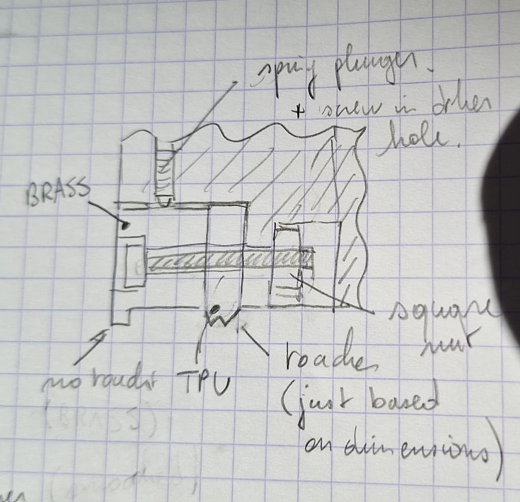
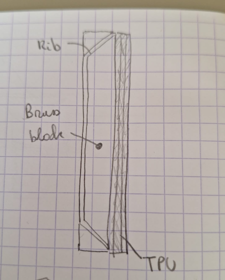

# 2026-11-10 — Scraper: brass block with height adjustment and a TPU wiper, first sketches

**Role(s):** engineering, cad

## Goal

Niels Bosmans drew a new scraper for each end of carriage-top (sketches below). He asked for
sketches of it, and for research on the best edge shape for the TPU wiper. He also asked for
MISUMI spring plungers. A felt strip at the side was part of the first request. He then dropped it
for now: it cannot touch the seal strip, because the strip must lift under the carriage.

## Short answer

- **The design fits the stage as it is in CAD.** No part touches another part. The brass rib stays
  0.15 mm above the strip.
- **The brass block** sits at the end face. Two MISUMI M4 spring plungers push it down. Two M2.5
  pull screws from the top hold it up. So the two pairs set its height. Four horizontal M3 bolts
  then lock it, through vertical slots in the brass and through the TPU, into carriage-top.
- **The rib turns 45° inward near each side**, so the screw that clamps each strip corner can
  enter the corner without touching it. Up to the first damper touch the screw head keeps 0.8 mm
  to the brass.
- **The TPU wiper gets two thin lips that lean apart**, not a solid block that is squashed. A thin
  lip bends, so its force stays low and changes little with tolerances. Each lip is 0.7 mm thick
  and 3.6 mm long. The front lip leans to the outside, the rear lip to the inside. Both press
  0.4 mm into the strip.
- **The pocket in carriage-top must be 9.5 mm deep instead of 4.5 mm.** The locking bolt and its
  slot need that height. Around the middle M5 hole for a cross table, it stays 4.5 mm deep.
- **In front of each top roller there is only 6.6 mm of room instead of 10 mm.** There the brass
  is 3 mm and the TPU 3.4 mm long (figure "Why the brass and the TPU are thinner").
- Results and all figures:
  [brass-tpu-scraper results](../../modules/compact-stage/simulation/results/brass-tpu-scraper/summary.md).

## Work Done

### What makes a good wiper edge

| Source | What it says |
| --- | --- |
| Wiper patent [US 6722658](https://image-ppubs.uspto.gov/dirsearch-public/print/downloadPdf/6722658) | The lip works best sharp, or with a radius of 0.2 mm or less. A lip that is too sharp scrapes hard and strips all fluid. |
| Wiper patent [US 9951870](https://image-ppubs.uspto.gov/dirsearch-public/print/downloadPdf/9951870) | A lip length of more than 5 times its thickness. This is the only ratio found. |
| Trelleborg [Turcon Excluder DC](https://www.trelleborg.com/seals/Products-and-Solutions/Aircraft-Seals/Aircraft-Scrapers-and-Wipers/Turcon-Excluder-DC) | Two lips on one ring. The outer lip keeps dirt out, the inner lip keeps the oil film in. |
| Guide block seal patents [US 9169875](https://patents.google.com/patent/US9169875), [US 5871282](https://patents.google.com/patent/US5871282) | Double seals have one lip facing out and one facing in. If the lips touch each other, one can lift the other and trap dirt. A single lip can be pushed open by a large chip. |
| Tsubaki Kabelschlepp [way wipers](https://tsubaki-kabelschlepp.com/products/guideway-protection/way-wiper-systems) | A pre-wiper of stainless spring steel or brass in front of the lip protects it from hot chips. Our brass block does the same. |
| Hennig [aluminium wipers](https://hennigworldwide.com/aw-aluminum-wipers) | A wiper for two directions of travel, heavy coolant and chips: a polyurethane lip of 85 Shore A on an aluminium carrier. |
| Windshield wiper patents [US 5044042](https://patents.google.com/patent/US5044042), [US 10322697](https://patents.google.com/patent/US10322697) | The lip flips over at each change of direction. A steady press over months bends the lip for good. |
| Raise3D [TPU design guide](https://wiki.raise3d.com/en/RMS220Series/RMS220printer/TPUDesignGuide) | The thinnest TPU wall is 0.6 mm. Thick walls become stiff. |

No source gave a press-in value for a flat wiper, a force for a printed TPU lip, or any proof that
lips at an angle in plan view push chips to the side.

From this, the sketch uses:

- **Thin lips that bend**, 0.7 mm thick and 3.6 mm long (5.2 times their thickness). A solid block
  squashed by 0.4 mm would press much harder, and its force would follow every height tolerance.
- **Two lips that lean apart**, at 20° from vertical, with room between them, so one cannot lift the
  other. 20° instead of 45°: at 45° the lips would not fit in the 3.4 to 3.8 mm of TPU length.
- **A sharp edge.** The lip ends in a flat cut, so the leading edge is sharp.
- **Print the TPU standing on its flat top face**, so the lips are the last layers and they bend
  across the layer lines.

### MISUMI spring plungers

The MISUMI pages refused the download, so the values below come only from search result summaries.
They must be checked in the MISUMI configurator before an order.

| Part | Thread | Load at the start and at full stroke (not checked) | Link |
| --- | --- | --- | --- |
| MPJH4-3 (miniature, heavy load, 3 mm stroke) | M4 | 3.43 N, 5.3 N | [MISUMI](https://us.misumi-ec.com/vona2/detail/110300143170/?HissuCode=MPJH4-3) |
| PJLW4-4 (stainless, light load, 4 mm stroke) | M4 | 0.6 N, about 2.1 N | [MISUMI](https://us.misumi-ec.com/vona2/detail/110300142830/?HissuCode=PJLW4-4) |

The brass block weighs about 67 g (0.66 N, with a typical density for brass). Two plungers only
need to hold it down against the pull screws, so either part is strong enough if the values hold.
The body length of either part is not known yet. The sketch draws a 10 mm body.

### Made for the process

- The pocket corners have the 2 mm radius of the end mill.
- The TPU part has a flat top face to stand on the build plate.
- Not done yet: the brass has a few inside corners in plan view (where the corner wing meets the
  main bar, and behind the rib) that also need the cutter radius. That comes with the CAD part.

## Decisions Made

- The felt strip is dropped for now (Niels Bosmans). It may come back later, under carriage-bottom.
- The square nuts of the hand sketch become tapped holes in carriage-top (Niels Bosmans).
- All other sizes are proposals, not decisions.

## Open Questions

- **Is 20° lean good enough, or does Niels want 45°?** 45° only fits if the TPU gets longer.
- **How hard do the lips press, and how much friction do they add?** Print a short piece and
  measure it on a piece of strip, dry and with coolant.
- **A TPU part clamped by a bolt slowly gives way**, and the bolt can then lose its clamp. A metal
  sleeve in the TPU around each bolt would stop that. It does not fit with the sizes of today.
- **Which plunger, and how long is its body?** Check MPJH4-3 and PJLW4-4 in the configurator.
- **In a crash the corner screw head hits the angled rib and carriage-top**, as it already hits
  carriage-top today. Accept it, or make the corner pocket longer.
- **The walls next to the new holes are thin** at the end face: 1.35 mm next to the plunger and
  0.75 mm next to the pull screw counterbore.
- **Interfaces:** the brass, the TPU and the screws get their interfaces in the architecture when
  they become CAD parts. No sizes are fixed yet.

## Next Steps

- [ ] Niels Bosmans reviews the sketches and the lip choice.
- [ ] Choose the plunger in the MISUMI configurator.
- [ ] Print a short TPU piece and measure its force and friction on the strip.
- [ ] Draw the brass block, the TPU wiper and the deeper pocket in CAD.

Technical notes

- New case `modules/compact-stage/simulation/cases/brass-tpu-scraper/`. It builds everything in
  memory from the committed `.FCStd` files and changes no CAD file.
- Carriage-top is placed at x = 104.58 mm in the assembly today. The older case `scraper-fit`
  still uses 106.6 mm, from before the carriage moved by 2.02 mm. Its results are relative to the
  carriage, so they still hold.
- The strip top is at z = 40.0 mm (the strip lies in a 0.15 mm pocket), not 40.15 mm as in
  `scraper-fit`. So carriage-top is 0.5 mm above the strip.
- Corner screw head: ISO 7380-2 M4 shape from the assembly, Ø10.17 mm, top at z = 42.2 mm, at
  x = 6 mm, y = 8 and 202 mm. The angled rib (front face xr + y = 17.9 mm) is tangent to the head
  path plus 0.5 mm at the first damper touch.
- Research on wiper edges by web search on 2026-11-10. The MISUMI pages and PDFs returned HTTP 403.
- Mistake rules checked: sharp milled corners (pocket rounded; brass corners still to do), no load
  or material value as fact without a data sheet (plunger loads and brass density marked), open a
  source before quoting it (MISUMI marked as not opened), the tooling folders were left as they are.

