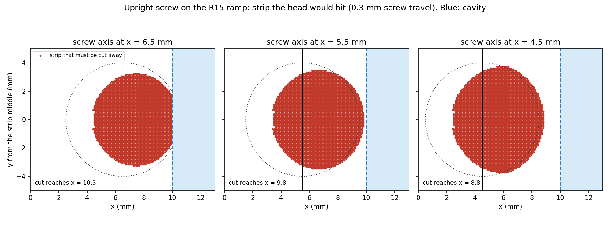
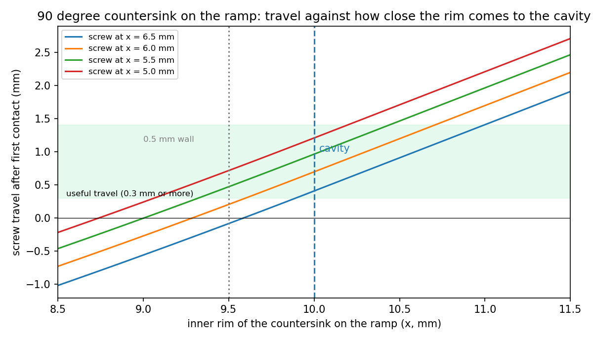
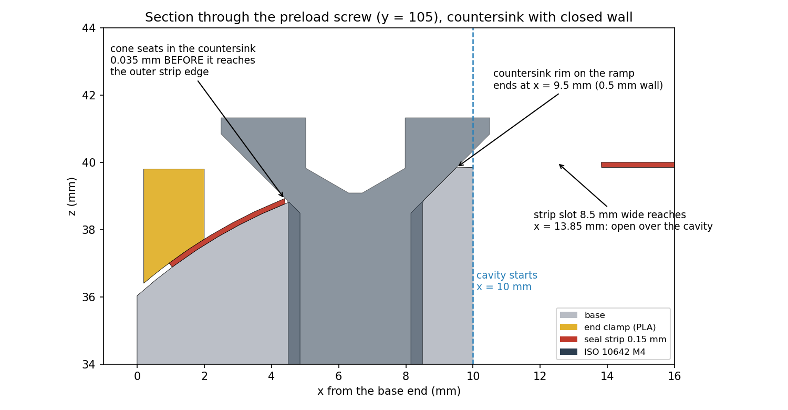
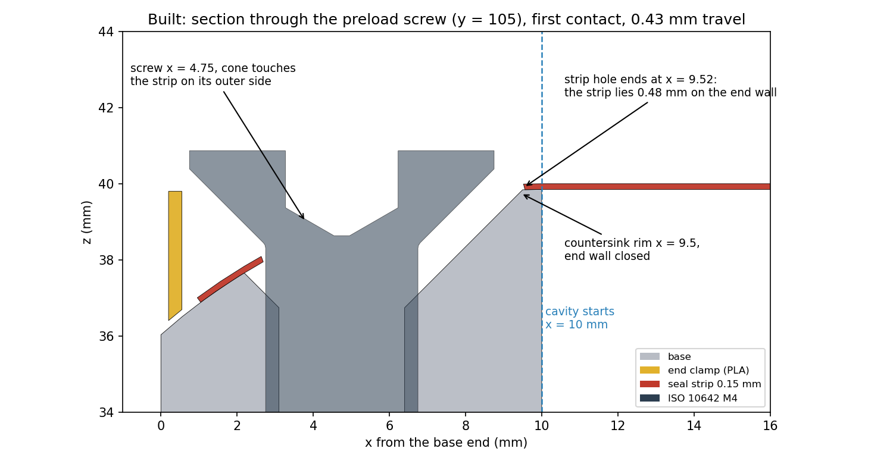
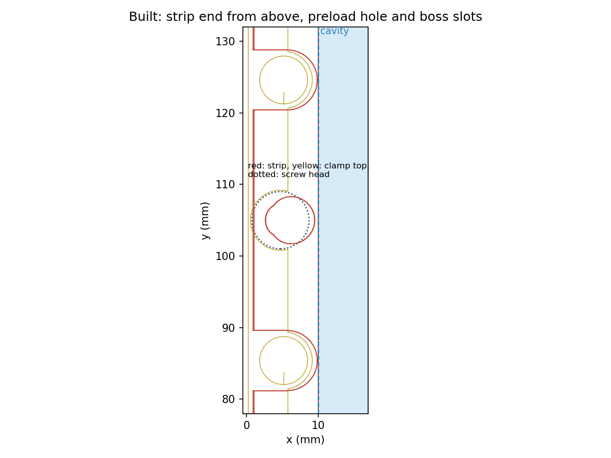

# 2026-11-20 — Preload screw on the ramp: the strip closes the base cavity again

**Role(s):** cad

## Goal

The 8.5 mm preload slot of the previous step reached x = 13.85 mm, over the base cavity, which
starts at x = 10 mm. The Ø9 counterbore also broke through the end wall. Niels Bosmans asked to
close the cavity again with three changes: a smaller strip hole, a countersink instead of the
counterbore, and as a last resort the M4 screw further out. He asked to see the limits in
pictures first, then chose the option that seals.

## Short answer

- **The cavity is closed again.** Next to the screw, the strip hole ends at x = 9.52 mm, so the
  strip lies 0.48 mm on the end wall. The countersink rim ends at x = 9.5 mm, so the end wall
  stays closed.
- **The preload still pulls.** The cone first touches the two points where the two circles of the
  strip hole meet, 0.96 mm outside the screw axis, and pushes the strip outwards. The screw can
  then sink 0.43 mm before it reaches the inner side of the hole. The 270 N pull needs about
  0.1 mm per end, plus the hole tolerances.
- **All three changes were needed.** The screw moved from 6.5 to 4.75 mm from the base end. The
  base has a 90° countersink. The strip hole is a small circle on the screw axis joined to a
  larger circle further in.
- **The clamp hole over the screw is now 8.4 mm**, and the clamp keeps a 0.35 mm wall at its outer
  edge there. That is thin for a printed part.

## What limits the design

The strip rises towards the middle under the screw (about 20° at x = 4.75 mm). An upright head
therefore needs almost its whole inner half free of strip. The pictures show the limits.

With the screw at 6.5 mm, the cut reaches x = 10.3 mm, into the cavity. At 5.5 mm it reaches
9.8 mm, and at 4.5 mm 8.8 mm.

A 90° countersink is parallel to the screw cone, so the head seats in it. With the rim 0.5 mm
before the cavity, the screw at 6.5 mm seats 0.035 mm before it reaches the strip (picture
below). Further out the travel grows: about 0.7 mm at 5.0 mm.

## What was built

- Parameters: `preload_screw_x` 4.75 mm, `strip_preload_hole_d` 4.3 mm, `strip_preload_relief_d`
  6.4 mm, `strip_preload_relief_x` 1.5 mm (all seen from above), `clamp_notch_d` 8.4 mm. The
  slot length is gone.
- Base: the counterbore is gone. The M4 hole has its own sketch and a 90° countersink. Its
  diameter is computed in the parameter sheet from the end wall, a 0.5 mm wall and the ramp, so
  its rim always stays 0.5 mm before the cavity: 9.82 mm at the base top. The end wall thickness
  of the cavity is now a parameter too.
- Strip: both circles are cut square to the strip. On the strip as cut they are larger by
  1 / cos(slope): 4.59 and 6.61 mm. Without this, the small circle is only 4.08 mm wide seen from
  above, and the shank touches it.
- Clamp: the 8.4 mm hole follows the screw.
- Assembly: the preload screws rest at the first contact, head top at z = 40.87 mm, 0.56 mm clear
  of the clamp.

## Checks

- Base, strip and clamp are each one valid solid. All changed sketches are fully constrained.
- First contact and travel were found by lowering the screw in the assembly, on both ends.
- Seal: at y = 105 the strip runs from the hole edge at x = 9.52 mm over the cavity edge. The base
  is solid up to its top at x = 9.6 and 9.9 mm.
- `doqs check`: all gates pass.

## Open questions

- The clamp keeps only 0.35 mm of plastic at its outer edge next to the screw. It may break when
  printed or tightened. Splitting the clamp in two halves there is an option.
- Only 1.6 mm of strip stays between the hole and the strip end, under the clamp.
- The strip slots round the clamp bosses still end at x = 9.9 mm, 0.1 mm before the cavity. Niels
  Bosmans chose to keep the 0.5 mm slide room.
- The cone pushes on two points, mostly sideways (about 65° from the pull direction). The pull
  force on the screw is therefore higher than with a single point in line with the pull.

Technical notes

- The search used a model of the strip surface on the ramp and the ISO 10642 M4 cone
  (radius = z − head top + 4.48 mm), with the strip pushed out as far as the screw sinks.
- `Hole002` now uses `PreloadHoleSketch`; the preload circles left `Sketch007`, so the strip
  pocket has no islands.
- The preload screw joints use the M4 hole edges at the bottom of the countersink.
- The chart titles use "degree" in words: the degree sign broke when FreeCAD read the script.

