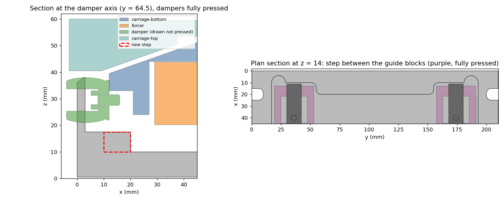

# 2026-11-24 — A low step on each base end wall, under the carriage

**Role(s):** cad

## Goal

Niels Bosmans saw empty room between the base end wall and the magnet tracks, between the two
rails. He asked if the wall could be 10 mm thicker there, to make the base stronger and to move the
preload screw inward.

## Short answer

- **Most of that room is crash room.** Between the rails, carriage-bottom goes down to z = 24 mm.
  When both dampers are fully pressed, its end face is 2 mm from the wall at x = 10 mm. A thicker
  wall over the full height would take crash room 1 for 1. The safe increase there is 0 mm.
- **Under the carriage there is room.** Niels Bosmans chose a low step: each end wall now has a
  step 10 mm deep (to x = 20 mm), from the cavity floor (z = 10 mm) up to z = 17.5 mm, from y = 55 to
  155 mm. Both ends together add 15,000 mm³, about 42 g.
- **The preload screw, the clamp notch and the strip hole stay as they are.** The step is too low
  to carry the screw.
- **The forcer does not hit the far end wall.** At full damper stroke it stays 4 mm from the base.

## What limits the step

| Moving part, dampers fully pressed | Lowest z | Clearance to the step |
| --- | --- | --- |
| Damper bulge (22 mm at full press) | 18.5 | 1.0 mm (same as the damper pocket floor) |
| Forcer MK21 | 20.3 | 9.4 mm |
| carriage-bottom | 24.0 | 6.3 mm |
| Guide blocks (to y = 53 and 157) | 14.0 | 2.0 mm to the side |

- The step top is level with the damper pocket floor (`damper_pocket_floor_z`). The pressed damper
  bulges down to z = 18.5 mm, beyond the pocket and over the step.
- The step stops 2 mm before the guide blocks. At full stroke their ends reach x = 11.55 mm.
- The four inside corners at the wall have a 4 mm radius, for an 8 mm cutter.
- Travel does not change (222 mm). The 230 mm tape still sets it.

## What was built

- Base `Params` sheet: `end_wall_step_t` 10 mm, `end_wall_step_top_z` = `damper_pocket_floor_z`,
  `end_wall_step_y0` 55 mm, `end_wall_step_r` = `damper_pocket_r`. They stay in the base sheet,
  like the damper pocket values, because no other part uses them.
- Base: `EndWallStepSketch` (both ends, fully constrained, tied to `end_wall_t` and the base
  length) and the pad `EndWallStep`, from z = 5 mm up to the step top. It is the new tip.
- End-stop crash case: base mass 3.907 kg (was 3.884), centre of mass z = 12.07 mm. The README
  says that the stress results are from the base before the step.

## Checks

- The base is one valid solid. The sketch has 0 degrees of freedom.
- Sections at z = 10.5, 17 and 17.6 mm: the step is where it should be; nothing changed above
  z = 17.5 mm.
- Assembly at full damper stroke on both ends: no moving part touches the step (table above).
- `doqs check`: see the pull request.

## Open questions

- The crash stress analysis (`run_fem.py`, about an hour) has not run on the new base. The wall
  stress should go down. The carriage peaks at a metal hit can go up a little.
- The real damper shape at full press is not in the CAD. The 1 mm clearance uses the 22 mm bulge
  from the damper pocket design.
