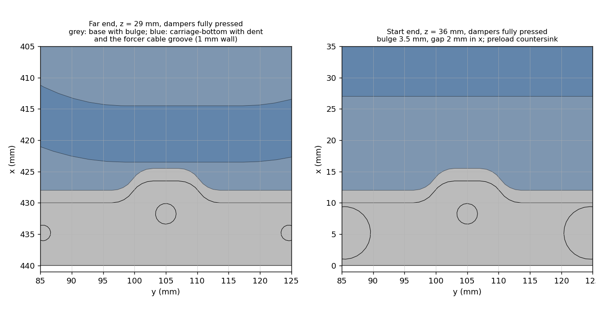

# 2026-11-24 — Preload screw moved in, on a bulge of the base end wall

**Role(s):** cad

## Goal

Niels Bosmans asked for a small bulge ("bult") on each base end wall round the preload screw, and
a dent in carriage-bottom so the carriage does not hit it in a crash. Then the preload screw can
move inward. The forcer must not move, and carriage-bottom must keep at least 1 mm of wall at the
forcer cable slot.

## Short answer

- **The bulge and the dent are 3.5 mm deep.** At the far end, the forcer cable runs in a curved
  groove under carriage-bottom, only 4.5 mm behind its end face at y = 96 to 118 mm and
  z = 24 to 34 mm. A 3.5 mm dent leaves exactly 1.0 mm. Niels Bosmans chose the same 3.5 mm at
  both ends (at the start end about 10 mm would have fitted).
- **The crash gap stays 2 mm.** With the dampers fully pressed, the bulge front and the rest of
  the end face meet the wall at the same moment, at both ends.
- **The preload screw moved from x = 4.75 to 8.25 mm.** The countersink stays 9.8 mm and its rim
  stays 0.5 mm from the cavity.
- **The clamp is stronger.** Its hole over the screw moved with it. The clamp now keeps 3.85 mm of
  plastic at its outer edge next to the screw (was 0.35 mm). A smaller cut in its inner edge is
  still needed: a clamp without any cut needs the screw at x ≥ 13.9 mm.
- **The strip hole is one round hole now**, 7.2 mm seen from above, centred 1.1 mm inward from the
  screw axis. The cone touches only its outer point, in line with the pull. Before, it pushed on
  two points about 65° off the pull direction.

## What limits the bulge

Left: at the far end, the dent in carriage-bottom (blue) stops 1.0 mm before the cable groove (the
darker band). Right: at the start end the bar behind the end face is solid, 15 mm thick.

## The preload, checked

The strip is almost flat at the new screw position (about 7° slope, was about 20°). With the old
two-circle hole the cone would have touched higher up the head, with the head top at z = 41.57 mm
at first contact, 0.7 mm higher than before. A search over round holes gave:

| | Old (x = 4.75 mm, two circles) | New (x = 8.25 mm, one round hole) |
| --- | --- | --- |
| Head top at first contact | 40.87 mm | 40.89 mm |
| First contact | two points, about 65° off the pull | one point, in line with the pull, 2.5 mm out |
| Screw travel before a point pushes inwards | 0.43 mm | 0.42 mm |
| Strip on solid base round the hole | 0.48 mm | 0.56 mm |
| Strip between the hole and the strip end | 1.6 mm | 4.8 mm |

The pull of 270 N needs about 0.1 mm of travel per end, plus the hole tolerances. The head reaches
the countersink only after about 1.6 mm. The search used the CAD screw head (8 mm, 90° cone) and
the strip surface on the ramp.

## What was built

- Module parameters: `preload_screw_x` 8.25 mm; new `preload_bulge_t` 3.5 mm,
  `preload_bulge_flat` 4 mm, `preload_bulge_r` 4 mm (8 mm cutter); `strip_preload_hole_d` 7.2 mm;
  new `strip_preload_hole_x` 1.1 mm. `strip_preload_relief_d` and `strip_preload_relief_x` are gone.
- Base: `PreloadBulgeSketch` (both ends, fully constrained) and the pad `PreloadBulge`, up to the
  strip pocket floor. It sits before the preload hole in the tree, so the countersink cuts into it.
  The countersink formula now also works past the end of the ramp.
- carriage-bottom: `PreloadDentSketch` (both ends, fully constrained) and the pocket `PreloadDent`,
  16.5 mm up from the underside (0.5 mm above the base top). Same profile as the bulge.
- Strip: the build script cuts one round hole. The flat strip as cut has one circle at each end.
- Clamp: the hole follows the screw. The assembly screws follow the hole; head top z = 40.88 mm.
- Architecture note, bill of materials and the end clamp decision describe the new screw and hole.
- End-stop crash case: base mass 3.911 kg. The README notes the bulge.

## Checks

- Base, carriage-bottom, strip and clamp are each one valid solid. New sketches have 0 degrees of
  freedom.
- Wall from the dent to the cable groove: 1.0 mm (sections at 2 and 9.5 mm above the underside).
- Assembly, both ends: moving carriage-bottom 1.95 mm past full stroke gives no overlap; 2.05 mm
  does. So the gap is 2.0 mm, at the bulge and at the wall.
- At full stroke, nothing new comes within 2.5 mm of the bulge or the screw heads.
- `doqs check`: all gates pass.

## Open questions

- carriage-top still runs over the preload screw heads at full stroke, as before. The screws come
  out after the clamp screws are tight, so this matters only while fitting.
- The crash stress analysis has not run with the bulge and the step.
- The real cable groove may need a check with the real cable: the dent leaves 1.0 mm of wall.
