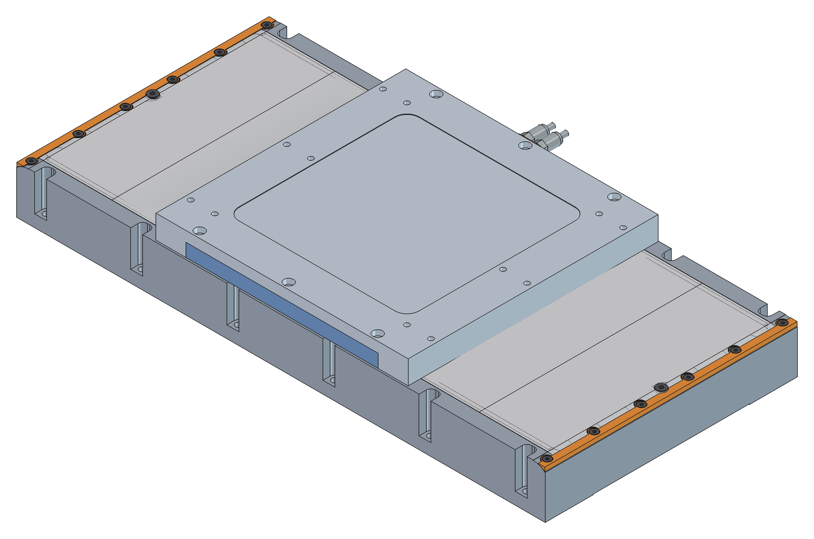
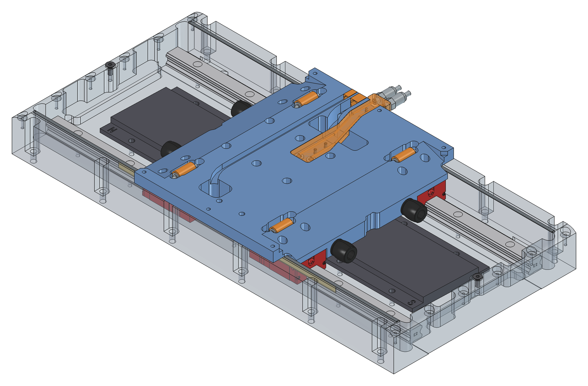

# Compact stage

A compact linear stage: a carriage that moves in a straight line, driven directly by an iron core
linear motor, with no screw or belt. The base is closed. A thin steel strip seals the slot between
the moving carriage and the base, so chips and coolant stay out. The stage is one family of the
[AQTUATOR](../../README.md) product line.



*The compact stage, isometric view from the CAD assembly. The light blue block on top is
carriage-top, where the load mounts. The orange strips at each end are the printed end clamps that
hold the seal strip. The two fittings on the side bring cooling water to the motor.*



*The same view without carriage-top, the seal strip and its clamps, with the base shown
see-through. You see carriage-bottom (blue), the two guide rails and the four red guide blocks, the
two dark magnet tracks of the motor, the black end-stop dampers, the four lower seal strip rollers
(orange) and the printed cooling block (orange).*

## Contents

- [Status](#status)
- [Main figures](#main-figures)
- [How the stage works](#how-the-stage-works)
- [Components](#components)
- [Where to find what](#where-to-find-what)
- [Working with the files](#working-with-the-files)
- [Licence](#licence)

## Status

On 2026-11-26 the stage is in the design phase. Version 0.1.0 (see [`okh.toml`](okh.toml)).

- **CAD:** every part we make has its geometry in FreeCAD. The assembly holds all parts, the bought
  parts included, in their place.
- **Requirements:** written as a SysML model (a text model of the system): the stage, the servo
  drive and the linear encoder. See [Architecture](#architecture-files).
- **Simulation:** seven design studies are done, for example the bend of carriage-bottom, a crash
  into the end stops, and the fit and the pull of the seal strip. See [`simulation/`](simulation/).
- **Bought parts:** the guide rails and blocks, the linear motor, the encoder and the end-stop
  dampers are chosen. They are in the CAD and the SysML model.
- **Servo drive:** not chosen yet. The candidates and their checks are on the
  [servo drive selection](../../docs/servo-drive-selection.md) page.
- **CE marking:** the stage is *partly completed machinery* under the EU Machinery Regulation. It is
  built into a customer machine. See the [decision](../../docs/decisions/2026-11-09_compact-stage-is-partly-completed-machinery.md)
  and the [CE assessment](../../docs/compact-stage-ce-assessment.md).
- **Hardware:** no stage has been built or measured yet.

The ODrive S1 drive and the Mekanika Pro milling machine are test equipment only. They are not
design constraints for this stage. See
[the decision record](../../docs/decisions/2026-10-02_odrive-is-for-testing-only.md).

## Main figures

These are the hard requirements from
[`architecture/compact-stage.sysml`](architecture/compact-stage.sysml). They are targets, not
measured values. An error value of "5 µm" means "within ± 5 µm".

| Requirement | Value |
| --- | --- |
| STG-01, STG-02 Width, height | at most 210 mm wide and 60 mm high |
| STG-03 Length | at most travel + 340 mm − 2 × height |
| STG-04 Positioning error | ± 5 µm over the full travel, without an error table in the controller |
| STG-05 Straightness and flatness | ± 2 µm |
| STG-06 Roll, pitch and yaw | ± 20 µrad |
| STG-07, STG-08 Repeatability | ± 0.1 µm from one direction, ± 0.3 µm from both directions |
| STG-09 Speed | at least 3 m/s |
| STG-10, STG-11 Force | at least 180 N continuous, 500 N peak |
| STG-12 Output power | at least 100 W |
| STG-13 Sideways load | at least 500 N at the centre of the carriage |
| STG-14 Screw hole grid | a pitch of 20, 40 or 80 mm at each mechanical interface |
| STG-15 End stops | stop the carriage with the largest payload at top speed, with the motor still pushing |

The current CAD base is 440 × 210 × 40 mm (`base_l`, `base_w`, `base_h` in
[`cad/params/default.csv`](cad/params/default.csv)). The encoder scale has a measuring length of
230 mm.

STG-15 limits the speed today: with no payload the end stops allow about 2.3 m/s, not 3 m/s. The
[CE assessment](../../docs/compact-stage-ce-assessment.md) has a table of the speed limit to set in
the drive for each payload.

## How the stage works

- **Guidance.** Two profile rails on the floor of the base carry four guide blocks under
  carriage-bottom.
- **Drive.** The forcer of the linear motor (the part with the coils) hangs under carriage-bottom.
  It moves over two magnet tracks, end to end on the floor of the base.
- **Position feedback.** An absolute linear encoder measures the position. The steel tape scale is
  stuck to the inside of a side wall of the base. The read head sits on carriage-bottom.
- **Two-part carriage.** carriage-bottom runs inside the base. carriage-top lies above the base and
  carries the load. Six M4 screws join the two halves through the slot in the top of the base.
- **Slot seal.** A 0.15 mm spring steel strip lies in a shallow pocket in the top of the base, level
  with the top face, and closes the slot over the whole length. Magnet strips in the base hold it
  flat. At the carriage the strip runs between the two carriage halves, guided by eight small
  rollers on ball bearings. A printed end clamp holds each end, and two preload screws pull the
  strip tight (270 N).
- **Motor cooling.** Water flows through a channel over the forcer, sealed with an O-ring. A printed
  cooling block brings the water to two push-in fittings on the side of the carriage.
- **End stops.** Four profile dampers on carriage-bottom, two at each end, stop the carriage. The
  stage has no limit switches.
- **Interfaces to the outside.** The base screws onto the machine with twelve M5 screws, on an
  80 mm grid. The load screws onto carriage-top with twelve M5 screws on the same grid. The outer
  rows of carriage-top fit the base of a second stage turned 90°, so two stages make a cross
  table.

## Components

### Parts we make

| Part | Qty | What it does | CAD |
| --- | --- | --- | --- |
| Base | 1 | The fixed body. It mounts on the machine and holds the rails, the magnet tracks and the encoder scale. | [`cad/parts/base/`](cad/parts/base/) |
| Carriage bottom | 1 | The moving part inside the base. It carries the guide blocks, the forcer, the read head, the dampers and four rollers. | [`cad/parts/carriage-bottom/`](cad/parts/carriage-bottom/) |
| Carriage top | 1 | The moving part above the base. The load mounts on it. It carries four rollers. | [`cad/parts/carriage-top/`](cad/parts/carriage-top/) |
| Sealing strip | 1 | Closes the slot in the top of the base. Spring steel EN 1.4310 (AISI 301), 0.15 mm. | [`cad/parts/sealing-strip/`](cad/parts/sealing-strip/) |
| Seal strip clamp | 2 | Presses each end of the strip on the ramp at the end of the base. Printed in PLA. | [`cad/parts/sealing-strip-clamp/`](cad/parts/sealing-strip-clamp/) |
| Roller sleeve | 8 | The outer tube of a seal strip roller. Precision tube 10 × 2 mm, cut to length. | [`cad/parts/roller-sleeve/`](cad/parts/roller-sleeve/) |
| Cooling block | 1 | Brings the cooling water from the forcer to the side of the carriage. Printed. | [`cad/parts/cooling-block/`](cad/parts/cooling-block/) |
| Motor cable clamp | 1 | Holds the motor cable where it leaves the carriage. | [`cad/parts/motor-cable-clamp/`](cad/parts/motor-cable-clamp/) |
| Read head cable clamp | 1 | Holds the encoder cable where it leaves the carriage. | [`cad/parts/read-head-cable-clamp/`](cad/parts/read-head-cable-clamp/) |

One seal strip roller is a sub-assembly: [`cad/assemblies/roller/`](cad/assemblies/roller/). The
whole stage is [`cad/assemblies/compact-stage/`](cad/assemblies/compact-stage/).

### Bought parts

The models of the bought parts come from the parts library in [`modules/stoq/`](../stoq/). Part
numbers are from the SysML model and the bill of materials (BOM).

| Part | Qty | Make and type |
| --- | --- | --- |
| Guide rail | 2 | HIWIN EGR15U, 418 mm long (EGR15U418H) |
| Guide block | 4 | HIWIN QEH15SAZAP+E2, with the E2 lubrication unit |
| Linear motor forcer | 1 | MAXWELL MK21, iron core, three phase |
| Magnet track | 2 | MAXWELL MK2-180, 180 mm long |
| Encoder read head | 1 | RSF Elektronik AK MC 15 B, absolute, BiSS C, 0.1 µm step |
| Encoder scale | 1 | RSF Elektronik MC 15 MK steel tape, 230 mm measuring length |
| End-stop damper | 4 | ACE TUBUS TA17-7 profile damper, 7 mm stroke |
| Roller bearing, axle, washer | 16, 8, 16 | NSK F692ZZ flanged ball bearing, ISO 8734 pin 2 × 28 mm, ISO 7092 washer |
| Magnet strip | 2 | Neodymium magnet tape 3 × 0.5 mm, cut to 417.5 mm |
| Cooling parts | — | Festo NPQH push-in fittings (2), Festo PUN-H 4 mm hose, NBR O-rings 5 × 1.5 and 90 × 2 mm |
| Screws | — | ISO 10642 countersunk screws: M4 preload screws, M3 clamp screws, M2.5 cooling block screws |

The BOM in [`bom/bom.csv`](bom/bom.csv) lists the encoder, the dampers, the roller parts, the magnet
strips, the cooling parts and some screws. It does not list the guide rails, the guide blocks and
the linear motor yet. The SysML model and the CAD assembly do hold them.

## Where to find what

```text
modules/compact-stage/
├── README.md              this page
├── okh.toml               manifest (Open Know-How format): name, version, licence, parts, outside interfaces
├── architecture/          SysML models: requirements, parts and the interfaces between parts
│   ├── compact-stage.sysml    the stage: STG-01 to STG-15, parts, one interface per pair of parts that touch
│   ├── motor-drive.sysml      the servo drive: DRV-01 to DRV-13 (hard), DRV-P1 to DRV-P7 (preferred)
│   └── linear-encoder.sysml   the linear encoder: ENC-01 to ENC-11
├── bom/bom.csv            bill of materials of the bought parts
├── cad/                   FreeCAD 1.1 models (stored with Git LFS)
│   ├── assemblies/        compact-stage (the whole stage) and roller (one seal strip roller)
│   ├── parts/<part>/      one folder per part we make: the .FCStd file, and build_model.py where the part is built by script
│   ├── params/default.csv the dimensions that drive the models, each with its unit and source
│   └── params-table.csv   generated from params/ for FreeCAD; do not edit by hand
├── docs/images/           the pictures on this page, and the script that renders them
└── simulation/            design studies
    ├── README.md          the list of studies and the question each one answers
    ├── cases/<study>/     the scripts of one study
    └── results/<study>/   the results, with a summary.md
```

| You want to… | Go to |
| --- | --- |
| Read the requirements | [`architecture/compact-stage.sysml`](architecture/compact-stage.sysml) (stage), [`motor-drive.sysml`](architecture/motor-drive.sysml) (drive), [`linear-encoder.sysml`](architecture/linear-encoder.sysml) (encoder) |
| See how two parts connect | The `port def` blocks in [`architecture/compact-stage.sysml`](architecture/compact-stage.sysml) |
| See how the stage mounts on a machine, or a load on the stage | The outside interfaces in [`okh.toml`](okh.toml) |
| Open the 3D model | [`cad/assemblies/compact-stage/compact-stage.FCStd`](cad/assemblies/compact-stage/) |
| Look up or change a dimension | [`cad/params/default.csv`](cad/params/default.csv) |
| See what to buy | [`bom/bom.csv`](bom/bom.csv) |
| Read a study result | [`simulation/README.md`](simulation/README.md), then `simulation/results/<study>/summary.md` |
| Know why a design choice was made | [`docs/decisions/`](../../docs/decisions/) in the repository root |
| Follow the work day by day | [`docs/log/`](../../docs/log/) in the repository root |
| Compare servo drives or encoders | [Servo drive selection](../../docs/servo-drive-selection.md), [linear encoder selection](../../docs/linear-encoder-selection.md) |
| Check safety and CE marking | [CE assessment](../../docs/compact-stage-ce-assessment.md) |

### Architecture files

Every pair of parts that touch has an interface: a versioned `port def` in
[`compact-stage.sysml`](architecture/compact-stage.sysml), a port on each part, and a connection in
the assembly. The two interfaces of the whole stage (the base on the machine, and the load on the
carriage) are also in [`okh.toml`](okh.toml).

## Working with the files

**Get the CAD files.** The `.FCStd` files are stored with Git LFS (Large File Storage). Clone with
submodules, so the parts library in `modules/stoq/` comes too:

```bash
git clone --recurse-submodules https://github.com/refaqt/aqtuator.git
```

**Open the model.** Use FreeCAD 1.1. Open
`modules/compact-stage/cad/assemblies/compact-stage/compact-stage.FCStd`. It finds the parts and
the bought parts by relative paths.

**Change a dimension.** Edit `cad/params/default.csv`, not the `.FCStd` file. Then, in the FreeCAD
Python console, run `exec(open("doqs/scripts/cad_sync_params.py").read())` and then
`sync_active()`.

**Run a study.** See [`simulation/README.md`](simulation/README.md). FreeCAD studies run with
`freecadcmd`, the FreeCAD program without a window. On Linux, run `bash setup-fem.sh` once from the
repository root.

**Render the pictures again.** From the repository root, with the FreeCAD 1.1 window program:

```bash
freecad modules/compact-stage/docs/images/render_views.py
```

The script colours the parts by role, writes the two PNG files and never saves a CAD file.

**Before a pull request.** Run `./doqs.sh pre-pr` from the repository root (`doqs.bat pre-pr` on
Windows). It generates files, runs the checks and saves the models.

Contributions are welcome. Read [`CONTRIBUTING.md`](../../CONTRIBUTING.md) first.

## Licence

The hardware design files of this module (CAD, architecture, BOM) are licensed under
[CERN-OHL-S v2.0](../../LICENSES/CERN-OHL-S-2.0.txt). The simulation code is licensed under
[GPL-3.0](../../LICENSES/GPL-3.0.txt). This page and the pictures in [`docs/`](docs/) are licensed
under [CC BY-SA 4.0](../../LICENSES/CC-BY-SA-4.0.txt). Bought-part models keep the terms of their
makers. The REFAQT and AQTUATOR names and logos are trademarks and are not covered by these
licences: see [`TRADEMARKS.md`](../../TRADEMARKS.md). The full overview is in the root
[`LICENSE`](../../LICENSE).
