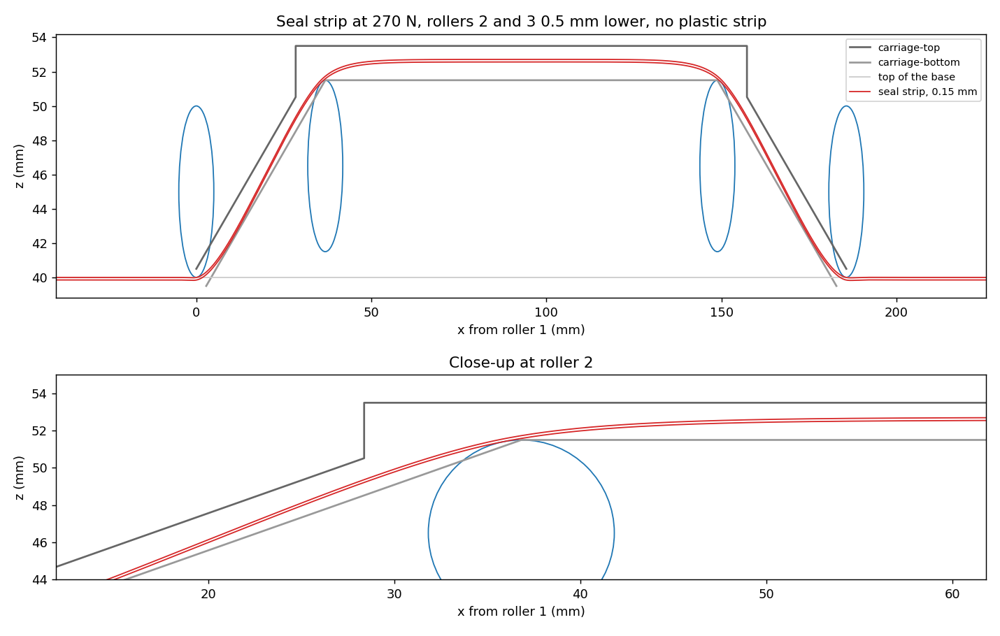
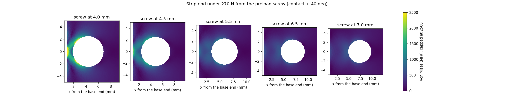

# strip-seal-fit

How far must seal strip rollers 2 and 3 go down, and which pull keeps the 0.15 mm strip off both
carriage halves with an infinite fatigue life? There is no plastic strip on the ceiling of
carriage-top.

**Tool:** Node 18 or newer, no packages. It uses the solver of the seal strip designer page,
[`strip_model.js`](../../../../../simulation/cases/strip-seal-designer/strip_model.js). The plot
needs Python with matplotlib.

```bash
node modules/compact-stage/simulation/cases/strip-seal-fit/fit.mjs
python modules/compact-stage/simulation/cases/strip-seal-fit/fig_strip.py
python modules/compact-stage/simulation/cases/strip-seal-fit/strip_end.py
```

`strip_end.py` needs numpy, scipy, matplotlib and the `gmsh.exe` that comes with FreeCAD (set
`GMSH` to its path if FreeCAD is not in `C:\Program Files\FreeCAD 1.1`).

It takes about 30 seconds. It writes `sweep.csv`, `fit.json`, `profile.csv` and `strip_fit.png`
to [`results/strip-seal-fit/`](../../results/strip-seal-fit/). The strip part
(`cad/parts/sealing-strip/build_model.py`) reads `profile.csv`.

## Inputs, from the CAD of 2026-10-29

| Input | Value | From |
| --- | --- | --- |
| Strip | EN 1.4310 (301), 0.15 mm, 185.6 mm wide | decision of 2026-10-28; 0.2 mm room on each side of the 186 mm slope openings |
| Strip pocket floor (the model profile) | z = 39.85 | base `Pocket005`, 0.15 mm deep |
| Rollers 1 and 4 | axis z = 45, bottom on the strip at z = 40 | assembly |
| Rollers 2 and 3 | axis z = 47 minus the drop | assembly, carriage-bottom `axle_slot_depth` |
| Roller 1 to 2, roller 2 to 3 | 36.83 mm, 112 mm | assembly |
| Carriage-top | underside z = 40.5 at roller 1, 19.44° slope, flat ceiling z = 53.5 | carriage-top |
| Carriage-bottom | 19.44° slope, flat top z = 51.5; it does not move with the rollers | carriage-bottom |
| Strip length between the preload screws | 427 mm | base `Hole002`, screws 6.5 mm from the base ends |
| Magnet bed under rollers 1 and 4 | 20 N/mm³, 0.005 N/mm² | page defaults, estimates |

The model has a new input for this: `stick23`, the stick-out of rollers 2 and 3 alone. Lowering
the rollers by a drop sets `dz = 2 − drop` and `stick23 = 0.5 − drop`, so carriage-bottom stays
where it is.

## Choice rule

1. No contact with carriage-top or carriage-bottom, and an infinite fatigue life.
2. The highest Goodman stress amplitude stays 20 % or more below the fatigue limit.
3. The pull is set by the hole positions, to tens of newtons. So the drop with the widest window
   of pulls that meet 1 and 2 wins, and the pull goes in the middle of that window.

## Results

| Drop of rollers 2 and 3 | Pulls with no contact | Pulls that also keep 20 % margin | Lowest stress (at the lowest pull) |
| --- | --- | --- | --- |
| 0 mm | 205 to 400 N | 205 to 315 N | 762 MPa at 205 N |
| **0.5 mm** | **190 to 400 N** | **190 to 350 N** | **718 MPa at 190 N** |
| 1.0 mm or more | none | none | the strip lies on the flat top of carriage-bottom (89 N) |

**Chosen: rollers 2 and 3 go 0.5 mm down, and the pull is 270 N.**

| At 270 N, drop 0.5 mm | Value |
| --- | --- |
| Highest stress (pull plus bending) | 796 MPa |
| Highest Goodman stress amplitude | 683 MPa |
| Fatigue limit at 0.15 mm (extrapolated) | 903 MPa: 32 % above the amplitude |
| Tightest radius | 17.6 mm |
| Smallest gap to carriage-top | 0.51 mm, at rollers 1 and 4 |
| Smallest gap to carriage-bottom | 0.09 mm, on the slope next to rollers 2 and 3 |
| Force on rollers 1 / 2 (both rollers of one place) | 380 N / 112 N |
| Travel of both strip ends together, from no pull | 0.21 mm |



- From 1 mm down, rollers 2 and 3 sit below the flat top of carriage-bottom. The strip then lies on
  the edge of that flat top, whatever the pull.
- At 0.5 mm the rollers are level with the flat top. The arch over them keeps the strip off it,
  but the gap to the slope of carriage-bottom stays small, about 0.09 mm.
- Without a drop, the gaps are larger (about 0.2 mm to both halves at 260 N), but the pull
  window is narrower (205 to 315 N).

## The strip end at the preload screw

While the pull is set, the cone of the countersunk screw pushes the outer edge of the strip hole
towards the strip end. The strip between the hole and the strip end (the bridge) then carries the
whole pull of that end, 270 N. `strip_end.py` is a plane stress model of that corner: linear
triangles down to 0.005 mm at the hole, the pull as a pressure on the hole edge over a short arc
(the 4.3 mm cone in a 5 mm hole touches over a short arc only; ±15° and ±40° bound it), and the
strip held 40 mm further in. A finer mesh changes the results by less than 2 %.

| Preload screw from the base end | Bridge | Highest stress at the strip end | Highest stress away from the contact |
| --- | --- | --- | --- |
| 4 mm (first drawing) | 0.85 mm | 3480 to 5080 MPa | same |
| 4.5 mm (M4 hole 0.5 mm from the magnet ring) | 1.35 mm | 2060 to 2790 MPa | same |
| 5.5 mm | 2.35 mm | 1000 to 1230 MPa | 1050 to 1710 MPa |
| **6.5 mm (magnet ring cut in two)** | **3.35 mm** | **630 to 730 MPa** | **810 to 1660 MPa** |
| 7 mm | 3.85 mm | 530 to 600 MPa | 750 to 1640 MPa |

The steel yields at 1975 MPa (Alleima 11R51). Only moving the hole 0.5 mm is not enough: the
bridge still yields. With the magnet ring cut in two, the screw can go to 6.5 mm, and the bridge
has a factor of 2.7 to yield. The higher values near the contact sit within about 0.5 mm of the
cone. There the steel may yield a little, which a one-time load can take. 7 mm gains little and
leaves only 1 mm of aluminium between the M4 thread and the slot face at 10 mm; 6.5 mm leaves
1.5 mm.



The load is static: the preload screws come out once the corner screws are tight.

## Limits

- The fatigue limit of 903 MPa at 0.15 mm is extrapolated from the Alleima values measured at
  0.25 and 0.50 mm. It also depends on the edge quality of the strip.
- The model is a 2D strip, the same across the width. In the CAD, rollers 1 and 4 sit over the
  open slot of the base, not on magnets. The magnet bed of the model is an estimate.
- The pull is taken as equal along the strip. Friction on the magnets is left out.
