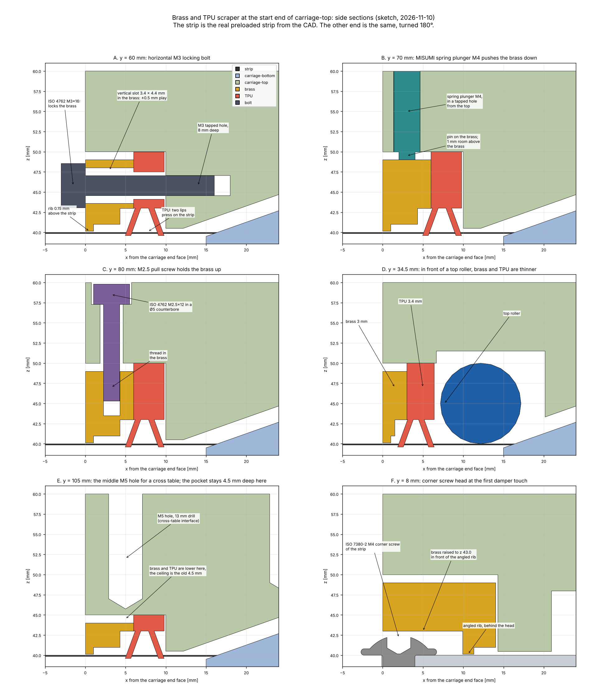
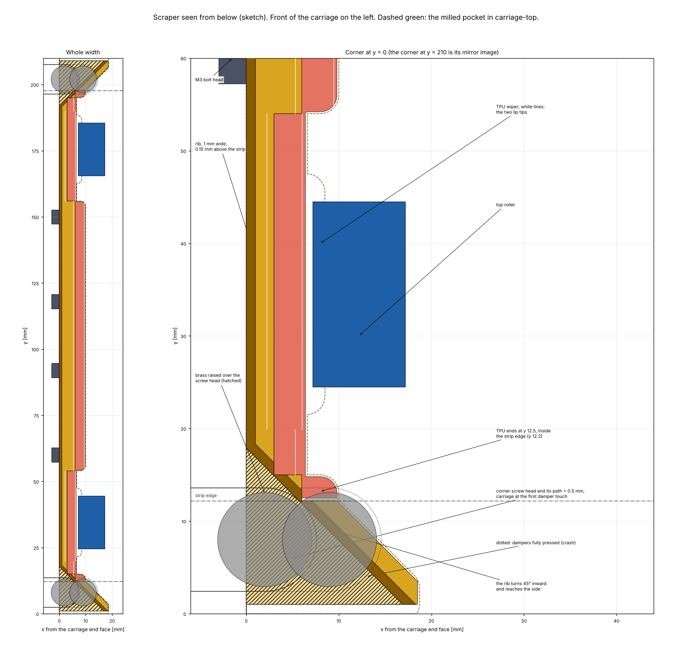
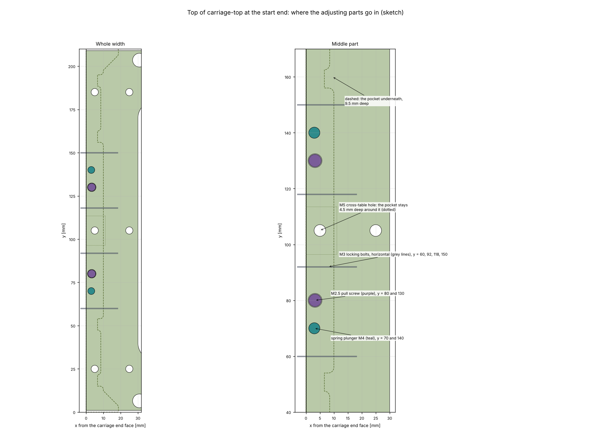
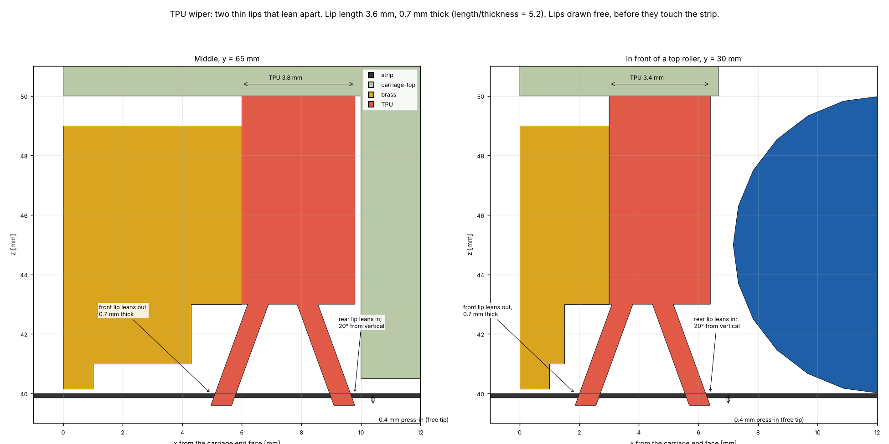
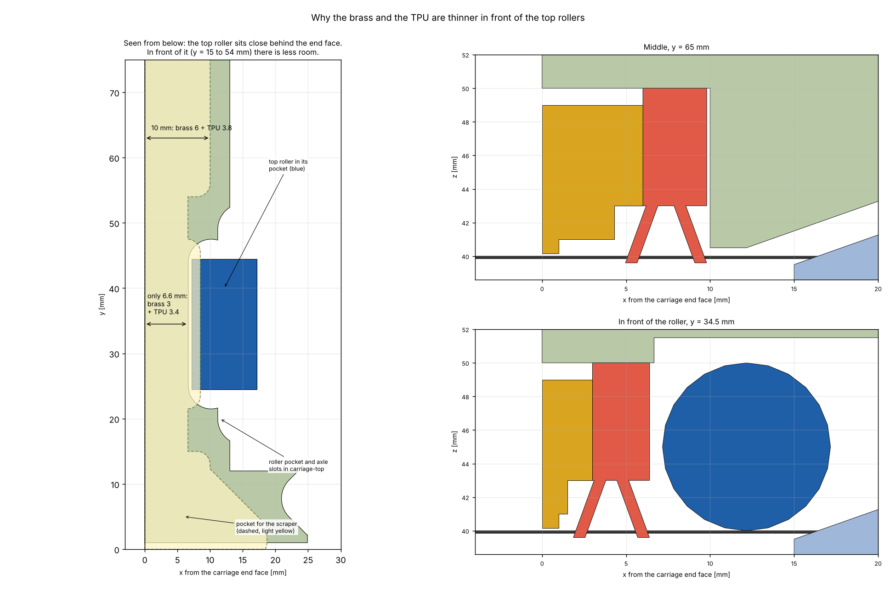
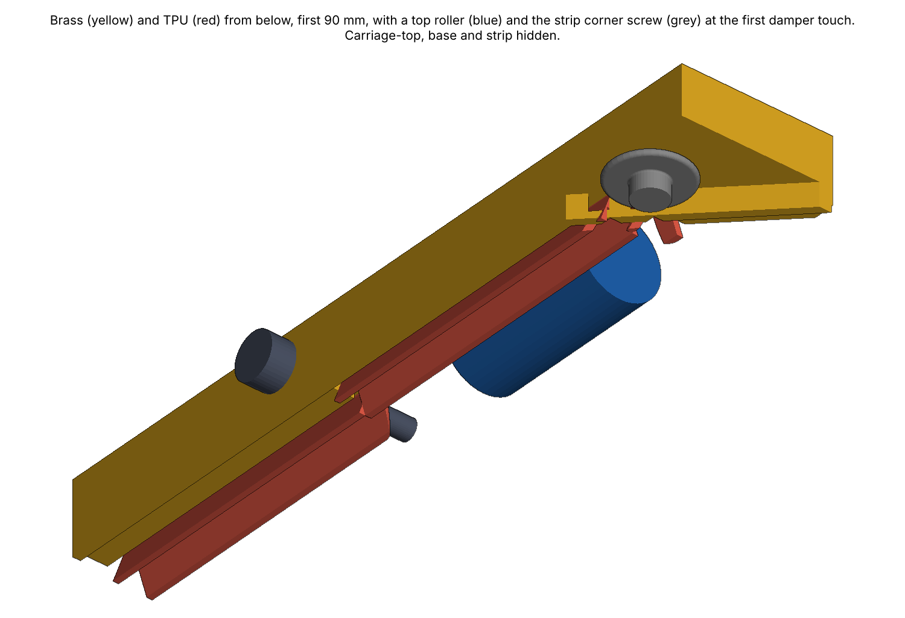
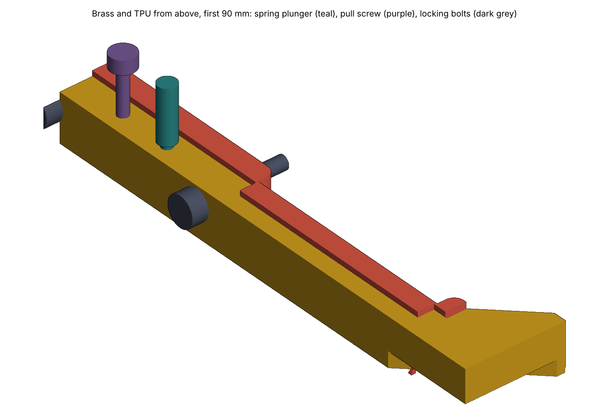

# brass-tpu-scraper — results

Sketch of the brass and TPU scraper of Niels Bosmans (2026-11-10), checked against the CAD.
Regenerated by:

```bash
python modules/compact-stage/simulation/cases/brass-tpu-scraper/run.py
```

## The short answer

- **It fits.** The brass, the TPU and all screws touch no other part. The brass rib stays 0.15 mm
  above the strip. The TPU stays 0.77 mm from each top roller.
- **The pocket gets deeper: 9.5 mm instead of 4.5 mm.** The brass needs that height for the
  locking bolt and its slot. It still leaves 1.74 mm under the drill points of the outer M5
  cross-table holes. Around the middle M5 hole the pocket stays 4.5 mm deep, and the brass and
  the TPU are lower there.
- **The rib turns 45° inward near each side, behind the strip corner screw.** Up to the first
  damper touch, the head keeps 0.8 mm to the brass. In front of the angled rib the brass is raised
  0.8 mm above the head.
- **In a crash, with the dampers fully pressed, the head hits the angled rib and carriage-top.**
  Carriage-top as it is today already hits it too. This is the same open point as before.
- **In front of each top roller the brass is 3 mm and the TPU 3.4 mm long, instead of 6 and
  3.8 mm.** There the scraper pocket runs into the roller pocket.
- **Height adjustment:** two MISUMI M4 spring plungers push the brass down. Two M2.5 pull screws
  from the top hold it up. Four horizontal M3 bolts go through vertical slots in the brass (±0.5 mm)
  and through the TPU into carriage-top. Tightened, they lock the brass.

## Sizes

| | Value |
| --- | ---: |
| Pocket depth from the underside of carriage-top | 9.5 mm (4.5 mm around the middle M5 hole) |
| Pocket length: middle / in front of the rollers / at the corners | 10 / 6.6 / up to 18.7 mm |
| Brass length: middle / in front of the rollers | 6 / 3 mm |
| Brass height, rib tip to top | 8.85 mm; 1 mm room up to the pocket ceiling |
| Rib width, gap to the strip | 1.0 mm, 0.15 mm |
| Brass mass (typical density 8.5 g/cm³) | 67 g, so 0.66 N |
| TPU length: middle / in front of the rollers | 3.8 / 3.4 mm |
| TPU lips | 2, each 0.7 mm thick and 3.6 mm long, 20° from vertical, leaning apart |
| TPU press-in (free lip tip below the strip top) | 0.4 mm |
| Spring plungers, M4 from the top | y = 70 and 140 mm, 3 mm behind the end face |
| Pull screws, ISO 4762 M2.5 × 12, Ø5 counterbore | y = 80 and 130 mm |
| Locking bolts, ISO 4762 M3 × 16, M3 thread 8 mm deep | y = 60, 92, 118 and 150 mm |

## Fit checks

| Check | Value |
| --- | ---: |
| Brass or TPU overlaps carriage-top, carriage-bottom, the base or a top roller | 0 mm³ |
| Brass overlaps the TPU, or the strip | 0 mm³ |
| TPU body (without the lips) overlaps the strip | 0 mm³ |
| Bolts, plungers and pull screws overlap any part | 0 mm³ |
| Rib tip above the strip | 0.15 mm |
| TPU to a top roller | 0.77 mm |
| Brass to the corner screw head, usable travel end and first damper touch | 0.8 mm |
| Brass, TPU, carriage-top over the head path + 0.5 mm, up to the first damper touch | 0 mm³ |
| Same, dampers fully pressed (crash): brass / TPU / carriage-top | 108 / 7 / 43 mm³ |
| Thinnest wall: M4 plunger hole to the end face | 1.35 mm |
| Thinnest wall: M2.5 counterbore to the end face | 0.75 mm |
| Thinnest wall: M3 tapped hole to the slope opening | 1.88 mm |
| Pocket to the drill point of the M5 hole at y = 25 and 185 mm | 1.74 mm |
| Pocket to the drill point of the middle M5 hole (y = 105 mm) | 0.74 mm |

All values: [`fit_checks.json`](fit_checks.json).

## Figures














