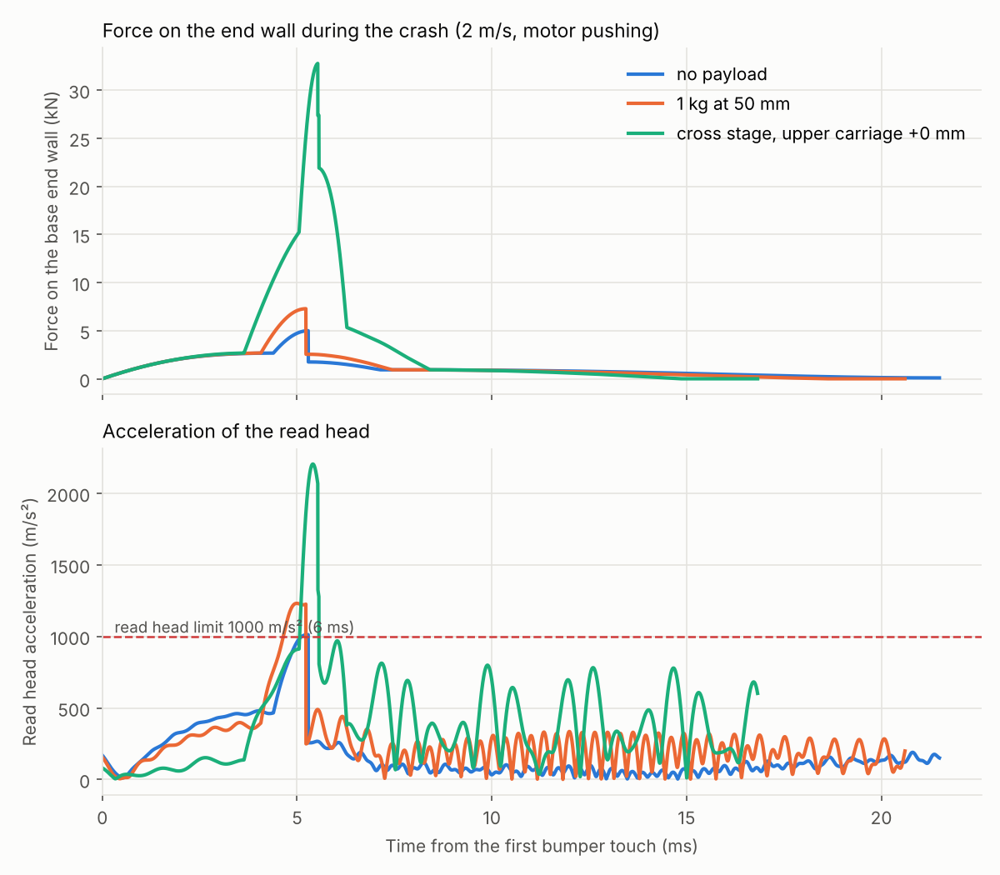
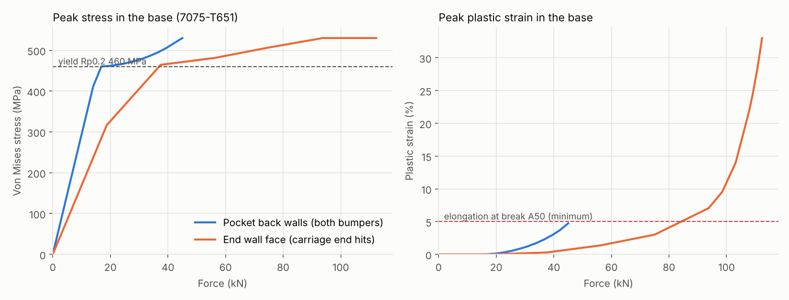
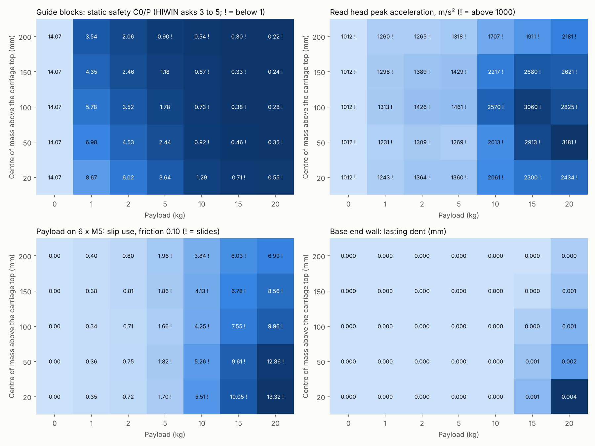

# end-stop-crash — results

A wrong position command makes the carriage of the compact stage run to one end at full motor force
(670 N). The drive holds the speed at 2 m/s, and the carriage hits the two TA17-7 bumpers at the end.
These are the results for the base, the guide blocks, the read head and the screw joints. Setup,
inputs and limits: [case README](../../cases/end-stop-crash/README.md). All numbers:
[`results.json`](results.json), [`payload-table.csv`](payload-table.csv), [`fem.json`](fem.json).

Regenerated by, from the repository root (after `bash setup-fem.sh` on Linux):

```bash
freecadcmd modules/compact-stage/simulation/cases/end-stop-crash/run_fem.py
```

```bash
freecadcmd modules/compact-stage/simulation/cases/end-stop-crash/evaluate.py
```

## The short answer

- **With no payload, the stage survives a crash, but only just.** The bumpers are pressed in
  slightly past their 7 mm stroke. The read head gets 1010 m/s², right at its 1000 m/s² rating.
  The guide blocks and the base have a large margin.
- **With 1 kg, the bumpers still hold, but the read head goes over its rating (1230 m/s²).** The
  six M4 screws between the two carriage halves are at their friction limit. The top carriage can
  shift on the bottom carriage by up to the play in the screw holes.
- **With a second stage on top (cross table), the crash breaks the stage.** Metal hits metal.
  The guide blocks get 1.4 to 1.8 times their static load rating, so the balls leave lasting marks
  in the tracks. The six M4 screws between the carriage halves are loaded past their shear strength.
  The upper stage slides on its six M5 screws, up to the play in the holes (about 0.25 mm).
- **The base itself is not the weak point.** In the 7075-T651 base, the wall behind the bumper pockets
  starts to yield at about 16 kN. The end wall face starts to yield at about 35 kN. In every case of
  this study, the lasting dent is 0.004 mm or less.
- **Stopping the motor matters most.** If the drive switches off the motor at the crash, the bumpers
  hold 0 kg and 1 kg with room to spare: the read head then gets 510 to 600 m/s².
- **For a crash at 2 m/s, keep the payload at 1 kg or less.** From 2 kg the base slides on the
  machine table if friction alone holds it, and with a high centre of mass the guide blocks fall
  below the HIWIN advice for shock. From 5 kg the payload slides on its screws, and from 10 kg metal
  hits metal. This agrees with the payload against speed table in the CE assessment (2.05 m/s for
  1 kg).

These numbers come from a model with several inputs that are not known yet, most of all the force
of a bumper past its 7 mm stroke. See [How sure are these numbers](#how-sure-are-these-numbers).



## The three named cases

All at 2 m/s, with the motor pushing 670 N through the whole crash.

| | No payload | 1 kg, centre of mass 50 mm above the top | Second stage on top |
| --- | ---: | ---: | ---: |
| Moving mass | 4.24 kg | 5.24 kg | 15.2 kg |
| Energy: speed + motor push | 8.5 + 4.9 J | 10.5 + 5.2 J | 30.4 + 6.2 J |
| Bumper rating, two bumpers (emergency) | 18 J | 18 J | 18 J |
| Travel past the first bumper touch | 7.4 mm | 7.7 mm | 9.3 mm |
| Metal hits metal | no | no | **yes, 0.24 mm into the wall** |
| Peak force of the bumpers (both) | 5.0 kN | 7.3 kN | 16.7 kN |
| Peak force of the metal hit | — | — | 16.0 kN |
| Peak force on the base end wall | 5.0 kN | 7.3 kN | **32.8 kN** |
| Peak deceleration | 104 g | 129 g | 215 g |
| Speed of the bounce back | 0.63 m/s | 0.73 m/s | 1.1 m/s |

In the second-stage case the upper carriage stands in the middle of its travel. With the upper
carriage at the end of its travel (108 mm off), the results are almost the same. The guide blocks get
a little more (see below).

## The base (EN AW-7075-T651)



| Load | Starts to yield | Plastic strain reaches 5 % (the elongation at break) | Wall gives way |
| --- | ---: | ---: | ---: |
| Both bumpers on the 3 mm wall behind their pockets | 16 kN | about 45 kN | not reached at 45 kN |
| Carriage end on the end wall face (z = 24 to 40 mm) | 35 kN | about 83 kN | 112 kN |

- **No payload and 1 kg:** 5.0 and 7.3 kN on the pocket walls, 147 and 214 MPa. Elastic. No lasting
  deformation.
- **Second stage on top:** 16.7 kN on the pocket walls, which is just at the yield point (0.02 %
  plastic strain). 16.0 kN on the end wall face, 270 MPa, elastic. No lasting dent you could measure.
- **Payload table:** the worst case, 20 kg at 20 mm, gives 0.43 % plastic strain at the end wall face,
  and a lasting dent of 0.004 mm.
- **The pocket walls are the weak spot of the base.** The force a flat bumper can pass on is limited
  by how far it can be pressed. In the spread of the unknown inputs (below), the second-stage case
  reaches up to 47 kN in total. That would crack the pocket wall.
- **The natural frequency of the end wall is 2.9 kHz** (a period of 0.35 ms). The metal hit lasts
  about 0.5 ms. So the wall answers that hit with some spring-back of its own, and a static load is
  only a fair estimate there. The bumper load (several ms) is well modelled as static.

## The guide blocks (HIWIN QEH15SA)

Static load rating C0 = 8790 N. HIWIN asks for C0/P of at least 3 to 5 under shock.

| | No payload | 1 kg at 50 mm | Second stage, carriage in the middle | Second stage, carriage at the end |
| --- | ---: | ---: | ---: | ---: |
| Highest load on one block, up/down | 0.52 kN | 1.04 kN | 6.97 kN | 6.35 kN |
| Highest load on one block, sideways | 0.05 kN | 0.06 kN | 3.66 kN | 7.36 kN |
| Equivalent load P, with its own moments | 0.62 kN | 1.26 kN | 12.2 kN | 15.4 kN |
| C0 / P | **14.1** | **7.0** | **0.72** | **0.57** |

- **Up to 1 kg the blocks are fine.** The crash uses less than a billionth of their rated life. That
  is because the high load only acts over a few millimetres of travel.
- **With the second stage on top, P is higher than C0.** The balls press lasting dents into the
  tracks (brinelling). The guide then runs rough and loses accuracy. Replace the blocks and check the
  rails after such a crash. The life of a dented guide cannot be calculated: HIWIN gives no rule for
  it.
- **Why so high:** the centre of mass of the upper stage sits 84 mm high and 39 mm to the side.
  The crash tips the carriage forward (pitch) and turns it (yaw). The blocks hold both.
- **The guide blocks of the upper stage** get 9.4 kN sideways in total. C0/P is 2.6 to 3.0, which is
  below the HIWIN advice of 3 to 5, but above 1. No lasting dents.
- **The blocks run past the rail ends.** When metal hits metal, the outer end of the leading blocks
  sticks out 1.7 mm past the rail end. The end with the E2 lubrication unit is then off the rail.
  The steel block body, with the balls, keeps 14 mm on the rail. This only holds if the E2 unit points
  outward. The CAD and the architecture disagree on that (see the next steps).

## The read head (RSF AK MC 15)

RSF rates the head for 1000 m/s², for 6 ms (half sine, EN 60068-2-27).

| | No payload | 1 kg at 50 mm | Second stage on top |
| --- | ---: | ---: | ---: |
| Peak acceleration | 1010 m/s² | 1230 m/s² | 2200 to 2300 m/s² |
| Length of the peak (above half of it) | 0.9 ms | 1.0 ms | 0.5 ms |
| Speed change of the whole crash | 2.7 m/s | 2.8 m/s | 3.1 m/s |
| Speed change of the RSF test pulse | 3.8 m/s | 3.8 m/s | 3.8 m/s |
| Side shift of the head (air gap change) | 0.1 µm | 0.1 µm | 6 to 9 µm |

- **The peak is above the rating from 1 kg on.** The pulse is much shorter than the 6 ms test pulse,
  and the total speed change stays below that of the test. So the head may well survive, but RSF does
  not promise it. Ask RSF whether a 1 ms pulse of 1500 to 2500 m/s² is allowed.
- **The air gap does not change in a way that matters.** 9 µm is small against 0.55 ± 0.25 mm.
- **The two M3 screws hold the head.** The side load is 50 to 120 N, and the friction can hold
  about 400 N.

## The screw joints

The slip use is the side force divided by what the friction of the clamped faces can hold. Above 1
the joint slips. The clamp force comes from class 8.8 table torques (M3 1.2 Nm, M4 3.0 Nm, M5
5.9 Nm). The joint friction is 0.10. In brackets: with friction 0.15.

| Joint | No payload | 1 kg at 50 mm | Second stage on top |
| --- | ---: | ---: | ---: |
| Payload or upper stage to carriage-top, 6 × M5 | — | 0.36 (0.24) | **7.9 (5.3): slides** |
| Carriage-top to carriage-bottom, 6 × M4 | 0.50 (0.33) | **1.19 (0.79): at the limit** | **13.8 (9.2): slides, screws shear off** |
| Forcer to carriage-bottom, 6 × M4 | 0.82 (0.54) | 0.93 (0.62) | **1.4 (0.94): at the limit** |
| One guide block to carriage-bottom, 2 × M4 | 0.21 | 0.27 | **opens and slides** |
| Read head, 2 × M3 | 0.13 | 0.16 | 0.28 |
| Base to the machine table, 12 × M5 | 0.58 (0.39) | 0.88 (0.59) | **4.8 (3.2): slides** |

- **The weakest joint is between the two carriage halves.** The bumpers sit in carriage-bottom, so
  everything on carriage-top (the top half and the payload) is stopped through these six M4 screws.
  With the second stage on top they carry 25 to 26 kN sideways. That is 1.3 to 1.5 times the shear
  strength of six 8.8 screws. They break.
- **The upper stage slides on its six M5 screws** (24 kN sideways). Once the holes take up the play,
  the screws carry the load in shear at 75 to 87 % of their strength. The upper stage moves by up to
  the hole play, about 0.25 mm, and stays there.
- **The forcer screws are close to slipping even without a payload.** They carry the 670 N motor push,
  and the 963 N magnetic pull lowers their clamp force. A shifted forcer changes the air gap of the
  motor. Thread locker does not help against slipping. More torque or 10.9 / 12.9 screws do.
- **The base slides on the machine table** with 2 kg or more, if it is held only by friction. Use
  dowel pins or a stop edge on the table to take the crash load.

## The payload table

Payload on 6 × M5 (the outer rows), at the centre of the carriage, from 0 to 20 kg, with the
centre of mass 20 to 200 mm above the carriage top. 2 m/s, motor pushing.



**Guide blocks, C0/P** (HIWIN asks at least 3 to 5; below 1 the balls leave dents):

| Height \ payload | 0 kg | 1 kg | 2 kg | 5 kg | 10 kg | 15 kg | 20 kg |
| --- | ---: | ---: | ---: | ---: | ---: | ---: | ---: |
| 20 mm | 14.1 | 8.7 | 6.0 | 3.6 | 1.3 | 0.7 | 0.5 |
| 50 mm | 14.1 | 7.0 | 4.5 | 2.4 | 0.9 | 0.5 | 0.3 |
| 100 mm | 14.1 | 5.8 | 3.5 | 1.8 | 0.7 | 0.4 | 0.3 |
| 150 mm | 14.1 | 4.4 | 2.5 | 1.2 | 0.7 | 0.3 | 0.2 |
| 200 mm | 14.1 | 3.5 | 2.1 | 0.9 | 0.5 | 0.3 | 0.2 |

**Peak force on the base: bumpers / metal hit (kN).** Metal hits metal from 10 kg on:

| Height \ payload | 0 kg | 1 kg | 2 kg | 5 kg | 10 kg | 15 kg | 20 kg |
| --- | ---: | ---: | ---: | ---: | ---: | ---: | ---: |
| 20 mm | 5.0 / 0 | 7.3 / 0 | 9.0 / 0 | 12.7 / 0 | 16.4 / 12.8 | 17.9 / 28.6 | 19.0 / 39.9 |
| 50 mm | 5.0 / 0 | 7.3 / 0 | 9.0 / 0 | 12.6 / 0 | 16.3 / 11.7 | 17.5 / 25.9 | 18.4 / 34.6 |
| 100 mm | 5.0 / 0 | 7.3 / 0 | 9.0 / 0 | 12.6 / 0 | 16.2 / 10.6 | 17.4 / 23.2 | 18.0 / 29.8 |
| 150 mm | 5.0 / 0 | 7.3 / 0 | 8.9 / 0 | 12.5 / 0 | 16.1 / 9.4 | 17.1 / 19.9 | 17.6 / 25.4 |
| 200 mm | 5.0 / 0 | 7.3 / 0 | 8.9 / 0 | 12.1 / 0 | 15.8 / 6.6 | 16.6 / 14.6 | 17.0 / 23.4 |

**Read head peak acceleration (m/s², rating 1000):**

| Height \ payload | 0 kg | 1 kg | 2 kg | 5 kg | 10 kg | 15 kg | 20 kg |
| --- | ---: | ---: | ---: | ---: | ---: | ---: | ---: |
| 20 mm | 1012 | 1243 | 1364 | 1360 | 2061 | 2300 | 2434 |
| 50 mm | 1012 | 1231 | 1309 | 1269 | 2013 | 2913 | 3181 |
| 100 mm | 1012 | 1313 | 1426 | 1461 | 2570 | 3060 | 2825 |
| 150 mm | 1012 | 1298 | 1389 | 1429 | 2217 | 2680 | 2621 |
| 200 mm | 1012 | 1260 | 1265 | 1318 | 1707 | 1911 | 2181 |

**Payload on 6 × M5, slip use at friction 0.10 (above 1 it slides):**

| Height \ payload | 0 kg | 1 kg | 2 kg | 5 kg | 10 kg | 15 kg | 20 kg |
| --- | ---: | ---: | ---: | ---: | ---: | ---: | ---: |
| 20 mm | — | 0.3 | 0.7 | 1.7 | 5.5 | 10.1 | 13.3 |
| 50 mm | — | 0.4 | 0.8 | 1.8 | 5.3 | 9.6 | 12.9 |
| 100 mm | — | 0.3 | 0.7 | 1.7 | 4.2 | 7.5 | 10.0 |
| 150 mm | — | 0.4 | 0.8 | 1.9 | 4.1 | 6.8 | 8.6 |
| 200 mm | — | 0.4 | 0.8 | 2.0 | 3.8 | 6.0 | 7.0 |

- **Up to 2 kg the payload joint holds.** From 5 kg it slides. From 15 kg at 200 mm, or 20 kg at
  100 mm, the rear screws also lift: the tipping moment opens the joint.
- **A high centre of mass is worse for the guide blocks**, because it tips the carriage. A low centre
  of mass is worse for the base and the read head, because the carriage then does not tip, and the
  full mass hits straight on.
- **The base keeps a dent of 0.004 mm at most** (20 kg at 20 mm). The CSV file has all the columns,
  also the joint slip of the base and the forcer.

## Other effects of a crash

- **The motor keeps pushing after the stop.** The MK21 may give 670 N for 0.5 s only. If the drive
  does not switch off the motor, the coil overheats while the carriage rests against the bumpers. The
  drive must stop on the following error (DRV-13).
- **The bumpers are used up.** ACE says a TA bumper may not be fit for use after an emergency stop.
  In every case of this study they are pressed past their 7 mm stroke. Change them after each crash.
- **The carriage bounces back** at 0.6 to 1.1 m/s. With the motor still pushing, it comes back and
  hits again, with less energy each time.
- **The top carriage hits the seal strip corner screws first.** In today's CAD the overhang of
  carriage-top runs into the heads of the four ISO 7380-2 corner screws 6.7 mm before the bumpers
  touch. This is known since 2026-10-29 and still open. This study assumes the planned relief is
  cut. Without it, the screw heads and the strip clamp take the first hit.
- **The encoder scale stays in place.** It is glued to the base, which does not move. The read head
  leaves the scale only when the bumpers are fully in, as before.
- **The damper screws.** The bumper pushes on the carriage end face, not on its M4 stud. The stud and
  the square nut are not loaded in a crash. A bumper that tears apart can still lose the stud.

## How sure are these numbers

The largest unknown is the force of a bumper once it is pressed past its 7 mm stroke. ACE publishes
nothing for it. The model uses 3.6 kN/mm per bumper and sweeps 1.8 to 9 kN/mm. It also sweeps the
bumper force by ×0.7 to ×1.3, for speed and temperature.

| | No payload | 1 kg at 50 mm | Second stage on top |
| --- | ---: | ---: | ---: |
| Peak force on the base, spread | 3.4 to 11.9 kN | 3.5 to 14.1 kN | 20.6 to 46.7 kN |
| Guide blocks C0/P, spread | 9.1 to 16.9 | 4.6 to 12.2 | 0.42 to 1.43 |
| Read head, spread | 650 to 2650 m/s² | 560 to 2550 m/s² | 1360 to 3160 m/s² |
| Motor switched off at the crash: force / C0/P / read head | 2.5 kN / 18.4 / 600 m/s² | 2.6 kN / 13.4 / 510 m/s² | 16.8 kN / 1.5 / 1200 m/s² |
| At the 2.2 m/s overspeed trip: force / C0/P / read head | 7.1 kN / 11.7 / 1510 m/s² | 9.1 kN / 6.0 / 1620 m/s² | 43.1 kN / 0.49 / 3010 m/s² |

Other limits:

- **The carriage is rigid in the model.** At the metal hit, the real carriage end gives a little.
  That lowers the metal force.
- **The base cases are separate.** The bumper force and the metal hit act on the same end wall at the
  same time. Each is read at its own peak.
- **The joint clamp forces use table torques.** The real torques are not set yet. With half the clamp
  force, every slip use doubles.
- **The moving mass of 4.24 kg is an estimate.** Weigh the first carriage.
- **The base mesh covers the start end only** (x = 0 to 100 mm), with the two bottom strips held
  fixed. The far end carries nothing in this crash.

## Next steps

1. **Ask ACE for the force curve of the TA17-7 past its stroke**, static and dynamic. It moves the
   results more than anything else.
2. **Ask RSF** whether a 1 ms shock of 1500 to 2500 m/s² on the AK MC 15 head is allowed.
3. **Make the drive stop the motor on a crash** (DRV-13: following error). With the motor off, 0 kg
   and 1 kg stay inside every rating except the read head spread.
4. **Hold carriage-top on carriage-bottom with more than friction:** two dowel pins, or a step that
   carries the push. The same for the forcer, or use 12.9 screws at their full torque.
5. **Hold the base on the machine table with dowel pins or a stop edge**, not friction only.
6. **Set the payload limit** for 2 m/s at 1 kg, or lower the speed for heavier payloads, as the
   CE assessment table says.
7. **Check which end of the guide blocks the E2 unit is on.** The assembly and the architecture do
   not agree. It decides whether the balls stay on the rail in a hard crash.

<details>
<summary>Technical notes</summary>

- Mesh: 70,194 nodes, 41,098 second order tetrahedra (straight middle nodes), 1.2 mm at the pocket
  walls, 3 mm in the end wall, 6 mm elsewhere. Elastic stiffness: 49.2 kN/mm (pocket walls, both),
  66.7 kN/mm (end wall face). Natural frequencies of the cut base: 2894, 4513, 4829 Hz.
- CalculiX 2.23 from conda-forge only has the SPOOLES solver. Each load ramp takes 30 to 60 minutes
  on 4 cores. The band ramp stopped at 112.3 kN, where the wall collapses. The stop increment in
  `run_fem.py` is now 2e-3 of the ramp, so a new run stops there by itself.
- Stress: where the wall yields, the nodal von Mises stress from CalculiX is extrapolated from the
  integration points and overshoots the material curve (up to 846 MPa). The reported stress is then
  read from the material curve at the plastic strain. The raw values are in `fem.json`.
- Block equivalent load: P = |Fz| + |Fy| + C0·(Mx/M0x + My/M0y + Mz/M0z), own block moments from the
  block stiffness over its 23.1 mm ball track.
- Block life per crash: Miner sum of (P/Cdyn)³ over the travel, against 50 km.
- Joints: clamp force F = M / (0.16 P + 0.58 d2 μG + 0.5 DKm μK) with μ = 0.12, 10 % settling,
  load factor 0.2. Shear strength of a screw 0.6 × 800 MPa × stress area.

</details>
