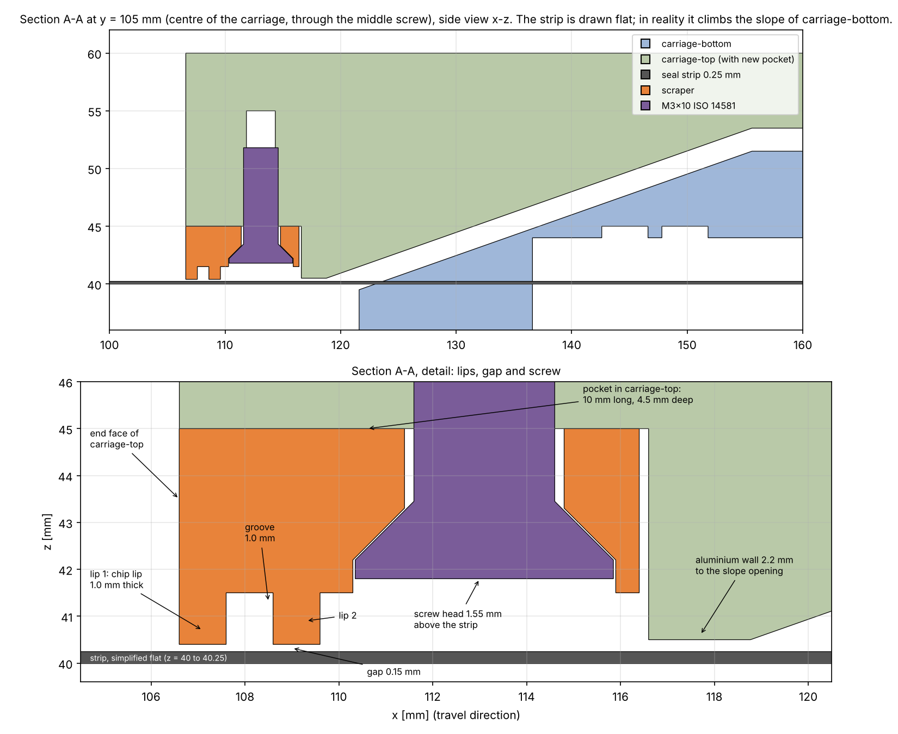
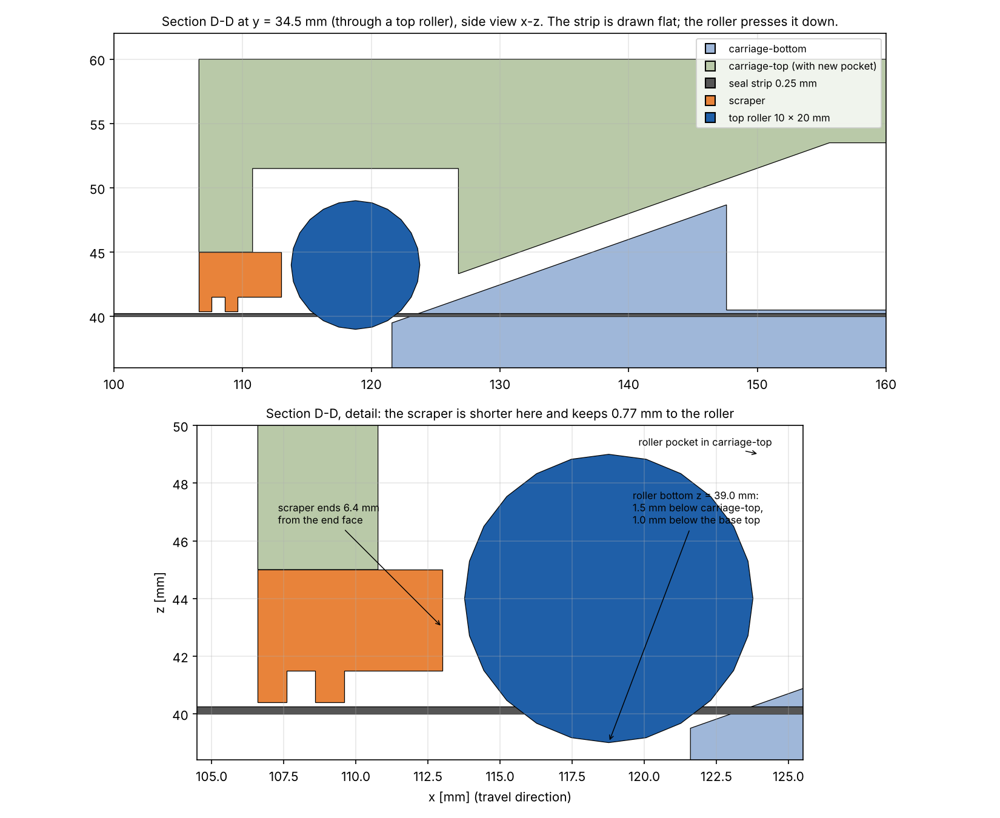
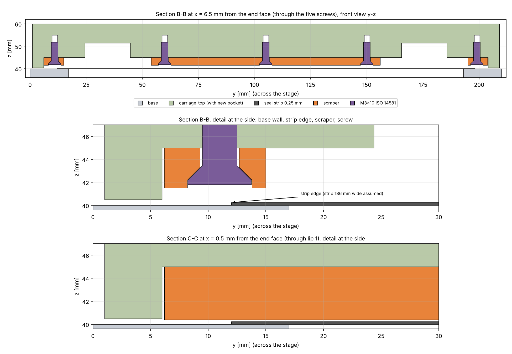
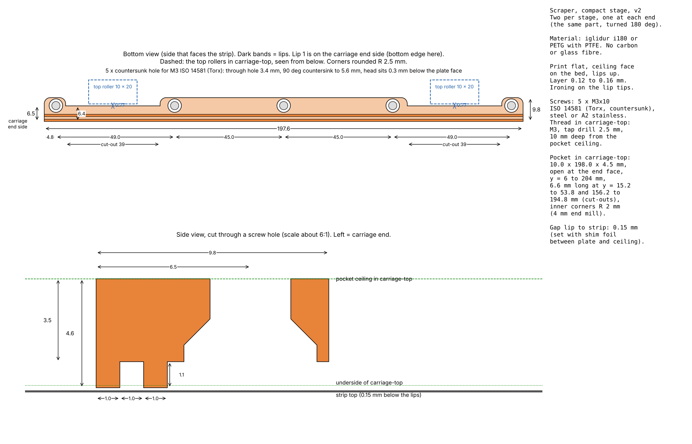
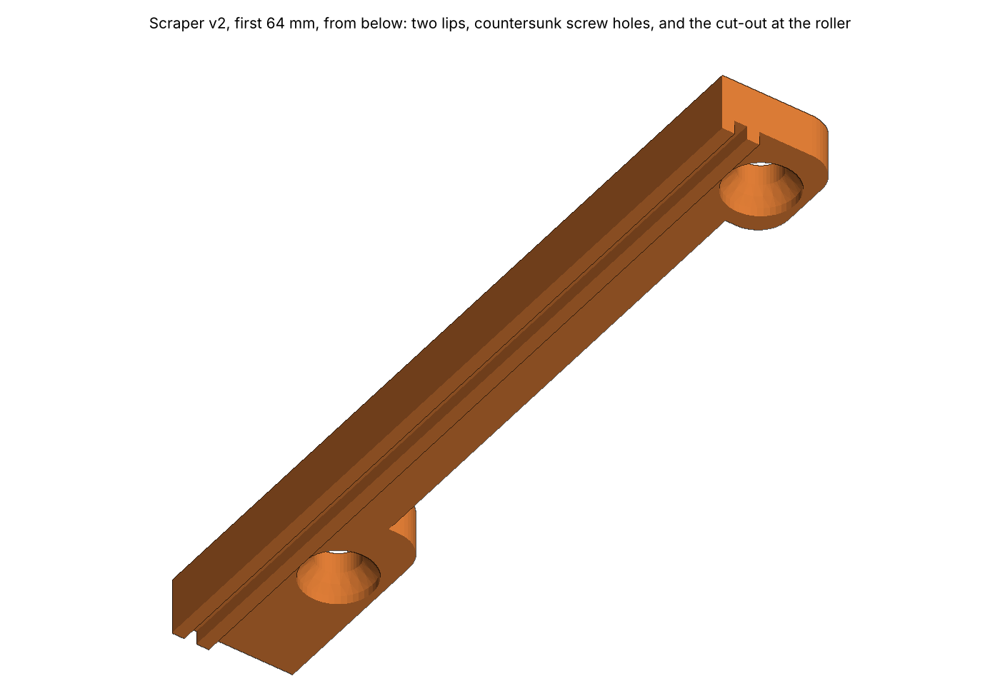
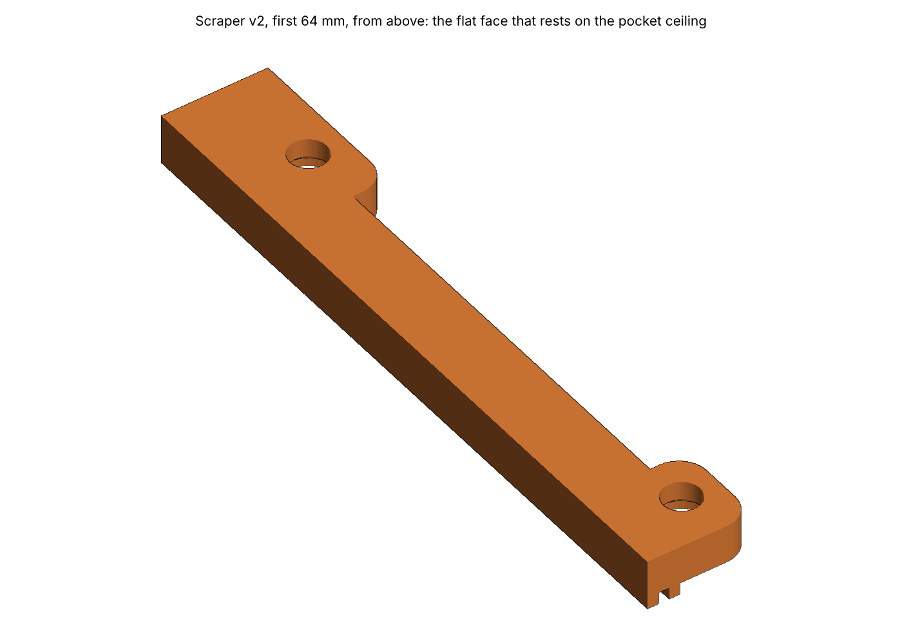
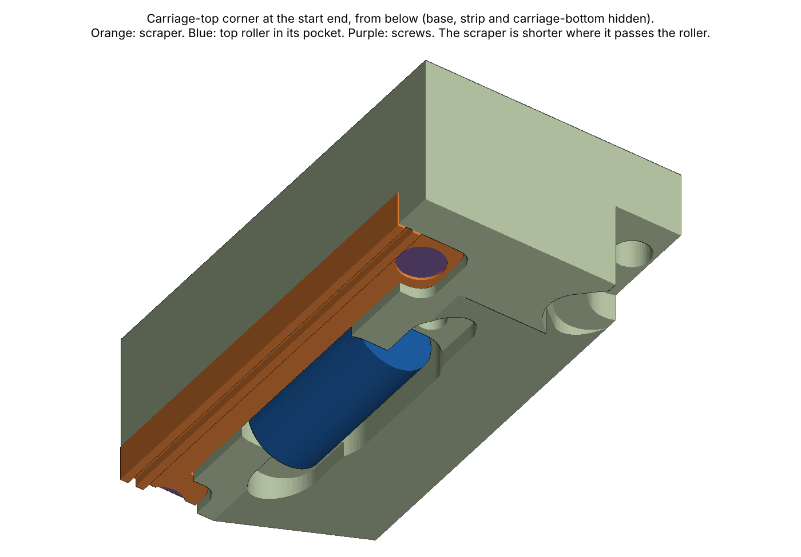

# scraper-fit — results

Regenerated by:

```bash
python modules/compact-stage/simulation/cases/scraper-fit/run.py
```

This is version 2. It takes the top rollers into account, which were added to carriage-top on
2026-10-22.

## The short answer

- **The scraper fits, and it keeps 0.77 mm to each top roller.** It sits in a pocket, 4.5 mm
  deep, cut up into the underside of carriage-top at each end. The pocket is 10 mm long, but only
  6.6 mm long where the rollers are. There the scraper is 6.4 mm long. It touches no other part.
  It may overlap the roller pockets, but not the rollers.
- **The top rollers stick out 1.5 mm below carriage-top.** Their lowest point is at z = 39.0 mm:
  1.0 mm below the top of the base and 1.25 mm below the top of a flat strip. In plan, each
  roller starts 7.17 mm from the carriage end face.
- **It is held by five M3x10 countersunk screws (ISO 14581, Torx head)** that screw up into
  carriage-top, away from the rollers. Each head sits 0.3 mm inside the plastic, 1.55 mm above
  the strip.
- **It has two lips with a groove between them.** Both lips stop 0.15 mm above the strip. So
  there is no friction and no wear in normal use. Chips larger than 0.15 mm stay outside.
- **Carriage-bottom starts 5.6 mm behind the scraper.** The aluminium wall between the pocket and
  the slope opening of carriage-top is 2.2 mm thick.

## Fit checks

| Check | Result |
| --- | ---: |
| Scraper overlaps carriage-top (with the pocket) | 0 mm³ |
| Scraper overlaps carriage-bottom | 0 mm³ |
| Scraper overlaps base | 0 mm³ |
| Scraper to carriage-bottom | 5.57 mm |
| Scraper to base (over the base walls, beside the strip) | 0.40 mm |
| Lip tip to strip | 0.15 mm |
| Screw head to strip | 1.55 mm |
| Roller model overlaps carriage-top (check of the model) | 0 mm³ |
| Roller to carriage-bottom (the log of 2026-10-22 says 0.32 mm) | 0.32 mm |
| Scraper overlaps the rollers | 0 mm³ |
| Scraper to the rollers | 0.77 mm |
| Screws to the rollers | 10.8 mm |

The rollers have no part in CAD yet. The case models each one as a Ø10 × 20 mm cylinder. Its
axis is on the low edge of the slanted face (x = 118.77 mm), 3.5 mm above the underside of
carriage-top, 70.5 mm each side of the centre line. That is where the axle lies in its slot. The
model gives the same 0.32 mm gap to carriage-bottom as the CAD work of 2026-10-22.

## Figures














